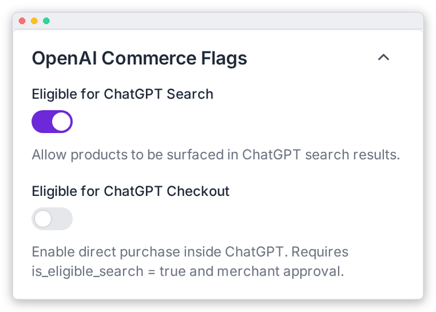

# ChatGPT Commerce Flags

Decide whether your products may appear in ChatGPT, and whether shoppers can buy them there. These settings are in the **OpenAI Commerce Flags** panel (right column) of **OpenAI Feed › Configuration**. Remember to click **Save Settings** when you're done.

| Field | What it does |
|---|---|
| **Eligible for ChatGPT Search** | Lets your products appear in ChatGPT's shopping answers. Leave this on for most stores. |
| **Eligible for ChatGPT Checkout** | Lets shoppers buy without leaving ChatGPT. You need OpenAI's merchant approval, **and** Search must also be on. If Search is off, Checkout is always sent as `false`. |

---

[← Attribute Mapping](./attribute-mapping.md) · [Return Policy →](./return-policy.md)
