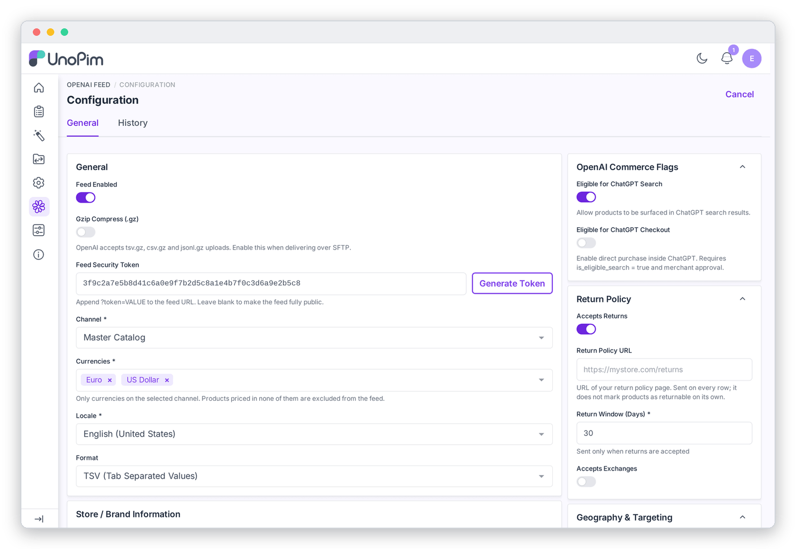
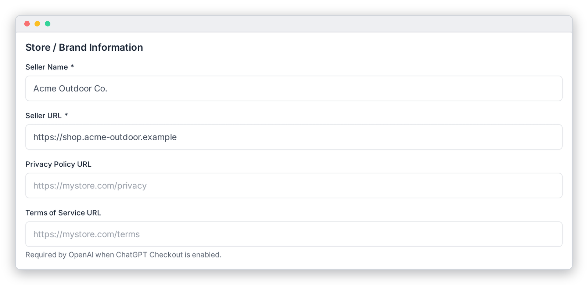
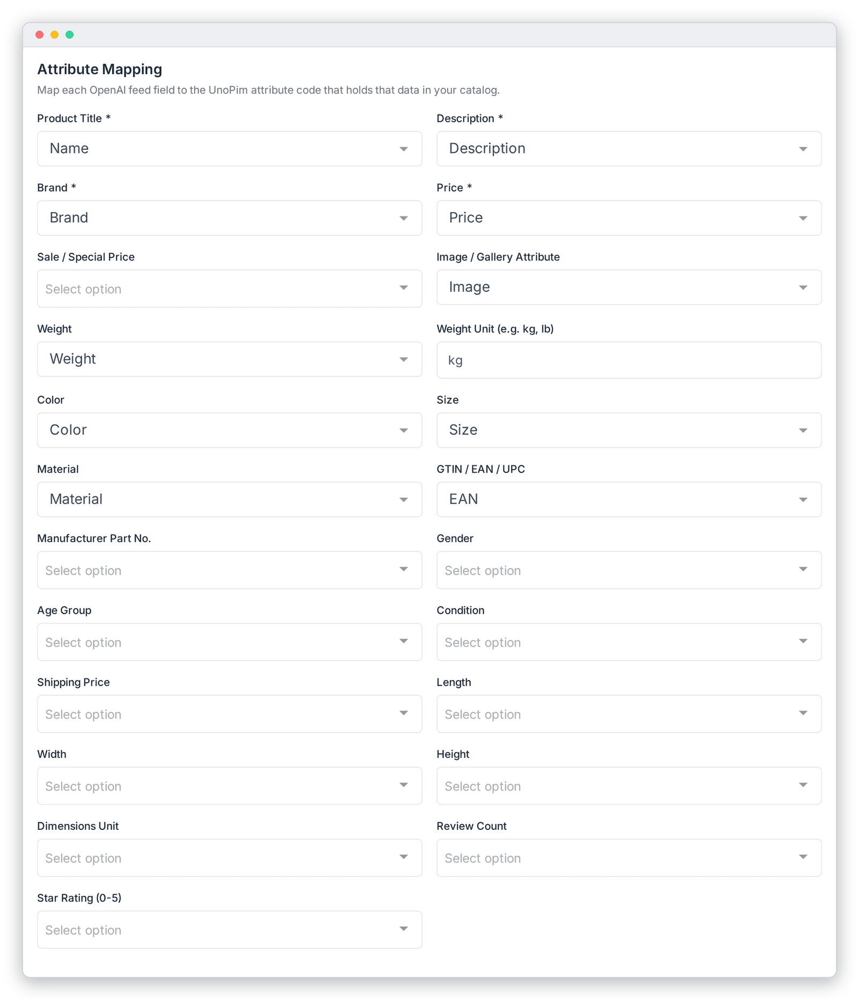

# Configuration

Navigate to **Admin Panel → OpenAI Feed → Feed Settings** to open the settings form. All settings are saved when you click **Save Settings**.

---

## General

| Field | Description |
|---|---|
| **Feed Enabled** | Toggle the feed on or off. While disabled, the public URL returns 404, **Generate Now** and the CLI command do nothing, and the cron schedule is not registered. |
| **Gzip Compress (.gz)** | Writes the feed gzip-compressed (`products.tsv.gz`, `products.jsonl.gz`). Enable this when delivering over SFTP. |
| **Feed Security Token** | A 48-character hex token appended to the public feed URL. Click **Generate Token** to create one. Leave blank to make the feed fully public (not recommended for production). |
| **Format** | Output format: **TSV**, **JSONL** (one JSON record per line), or **JSON array (legacy)**. The file name follows the format (`products.tsv`, `products.jsonl`, `products.json`). After changing **Format** or **Gzip Compress**, the public URL returns 503 until the feed is generated again. |
| **Channel** | The UnoPim channel whose products are included in the feed. |
| **Currencies** | One or more currencies assigned to the selected channel (currencies not on the channel are rejected on save). Each product is priced in the first currency it has a price for. Products with no price in any selected currency are excluded from the feed. |
| **Locale** | Locale used for translatable attributes (product name, description, etc.). |

---

## Store / Brand Information

This information is embedded in every row of the feed for attribution and return policy purposes.

| Field | Description |
|---|---|
| **Seller Name** | Your store or brand name. Maximum 70 characters. |
| **Seller URL** | The homepage URL of your store (e.g. `https://mystore.com`). Also used to build product URLs when **Product URL Template** is blank. |
| **Privacy Policy URL** | Sent as `seller_privacy_policy`. Required by OpenAI when ChatGPT Checkout is enabled. |
| **Terms of Service URL** | Sent as `seller_tos`. Required by OpenAI when ChatGPT Checkout is enabled. |

---

## OpenAI Commerce Flags

Controls where your products appear in ChatGPT.

| Field | Description |
|---|---|
| **Eligible for ChatGPT Search** | When on, products can surface in ChatGPT conversational search responses. |
| **Eligible for ChatGPT Checkout** | When on, users can purchase directly from within ChatGPT. Requires **Eligible for ChatGPT Search** to also be on: if Search is off, every row is sent with `is_eligible_checkout=false`. |

---

## Return Policy

OpenAI includes return policy details on product pages shown to ChatGPT users.

| Field | Description |
|---|---|
| **Accepts Returns** | Toggle on if your store accepts returns. **Return Window** is only sent when this is on. |
| **Return Policy URL** | Direct link to your return policy page, sent on every row. It does not mark products as returnable on its own. |
| **Return Window (Days)** | Number of days a customer has to initiate a return (default: 30). |
| **Accepts Exchanges** | Toggle on if your store accepts exchanges. |

---

## Geography & Targeting

| Field | Description |
|---|---|
| **Target Countries** | Comma-separated ISO 3166-1 alpha-2 country codes where your products are available (e.g. `US,CA,GB`). Codes are upper-cased; country names are rejected. |
| **Store Country** | The two-letter code of the country your store is based in (e.g. `US`). |

---

## Attribute Mapping

Map each OpenAI feed field to the UnoPim attribute that holds that data in your catalog.

| OpenAI Field | Description | Required |
|---|---|---|
| **Product Title** | Product name shown in ChatGPT results. | Yes |
| **Description** | Product description (HTML stripped, max 5,000 characters). | Yes |
| **Brand** | Brand or manufacturer name. | Yes |
| **Price** | Regular selling price. Products with no price, or a zero price, in the selected currencies are excluded. | Yes |
| **Sale / Special Price** | Discounted price. Sent only when it is strictly below **Price**. | — |
| **Image / Gallery Attribute** | Main product image or gallery attribute. The first image becomes `image_url`, the rest `additional_image_urls`. | — |
| **Weight** | Product weight value. | — |
| **Weight Unit** | Text field, not an attribute. Used only when the weight attribute has no unit of its own (measurement attributes carry their own unit). Allowed: `g`, `kg`, `oz`, `lb`. Any other value drops the weight from the feed. Defaults to `kg`. | — |
| **Color** | Color super-attribute for configurable products. Used to build `variant_dict`. | For variants |
| **Size** | Size super-attribute for configurable products. Used to build `variant_dict`. | For variants |
| **Material** | Product material attribute. | — |
| **GTIN / EAN / UPC** | Global trade item number (barcode). Strongly recommended. Values with an invalid length or check digit are dropped. | — |
| **Manufacturer Part No.** | MPN for the product. | — |
| **Gender** | Target gender. Normalized to `male`, `female` or `unisex`; other values are dropped. | — |
| **Age Group** | Target age group. Normalized to the OpenAI values (`newborn` … `adult`); other values are dropped. | — |
| **Condition** | Normalized to `new`, `refurbished` or `used`. Defaults to `new` when unmapped. | — |
| **Shipping Price** | Shipping price, read in the same currency as **Price**. | — |
| **Length / Width / Height** | Product dimensions. Sent only when at least two are filled and a unit is known. | — |
| **Dimensions Unit** | Unit used when the dimension attributes have none: `in`, `cm`, `ft`, `m` or `mm`. | — |
| **Review Count** | Number of reviews. | — |
| **Star Rating (0-5)** | Average rating. Sent only when the review count is above 0 and the value is between 0 and 5. | — |

> [!TIP]
> For configurable products, map **Color** and **Size** to your actual super-attribute codes. These are used to populate the `variant_dict` field that ChatGPT uses to show variant selectors on product listings.

> [!WARNING]
> **Skip this field** only omits **Condition**, **Shipping Price**, the dimension fields, **Review Count** and **Star Rating**. For the other fields, a skipped mapping falls back to a default attribute code (`name`, `description`, `brand`, `price`, `special_price`, `image`, `weight`, `color`, `size`, `material`, `ean`, `mpn`, `gender`, `age_group`), which is used if that attribute exists in your catalog. An empty **Product Title** falls back to the SKU.

---

## Product Filters

| Field | Description |
|---|---|
| **Only Enabled Products** | When on, products with status = disabled are excluded from the feed. When off, disabled products are included with `availability=out_of_stock`. |
| **Product Limit** | Maximum number of parent products in the feed. Set to `0` for no limit. Configurable products still emit one row per variant regardless of this limit. When a limit is set, all limited products are loaded in one query and **Batch Size** is not used. |
| **Product URL Template** | Template for building product page URLs. Use `{sku}` or `{id}` as placeholders (e.g. `https://mystore.com/products/{sku}`). When blank, URLs are built as `<Seller URL>/products/<sku>`. |

---

## Performance & Schedule

| Field | Description |
|---|---|
| **Batch Size** | Number of products loaded per database query (10–5,000). Default is 500. Lower this value if you see memory errors on large catalogs. |
| **Auto-Update Interval (Hours)** | How often the feed regenerates automatically via the Laravel scheduler (1–168 hours). Default is 6 hours. The scheduler checks hourly and runs when the last successful generation is older than this interval. |
| **Image Base URL** | Prepended (with `/storage/`) to relative image paths. Defaults to `APP_URL` when blank. Set it if `APP_URL` is not the public address OpenAI can reach, otherwise image URLs will point to an unreachable host. |

> [!NOTE]
> The extension registers its own cron entry automatically via the service provider. You do not need to edit `bootstrap/app.php`. The only server-level requirement is that `php artisan schedule:run` runs every minute — see [Automated generation](./feed-generation#automated-generation-cron).

---

## SFTP Delivery to OpenAI

OpenAI ingests feeds pushed to the SFTP location it provides during merchant onboarding. When enabled, every generated feed is uploaded there under a stable file name: `openai-product-feed.<format>`, with `.gz` when compressed (for example `openai-product-feed.tsv.gz`).

| Field | Description |
|---|---|
| **Upload to OpenAI via SFTP** | Upload every generated feed to the SFTP server. |
| **SFTP Host** | Required when SFTP is on. |
| **SFTP Port** | Defaults to `22`. |
| **SFTP Username** | Required when SFTP is on. |
| **SFTP Password** / **SFTP Private Key** | Provide one of them. Stored encrypted with `APP_KEY`; if `APP_KEY` changes, enter them again. Leave blank to keep the saved secret. |
| **Remote Directory** | Directory on the SFTP server. Leave blank for the account root. |

A failed upload marks the run as failed in the generation history. The generated file is still kept locally and served at the public URL.

---

Click **Save Settings** to apply all settings. The next feed generation will use the updated configuration. Settings are read when a generation starts, so a run already in progress keeps the old values.
