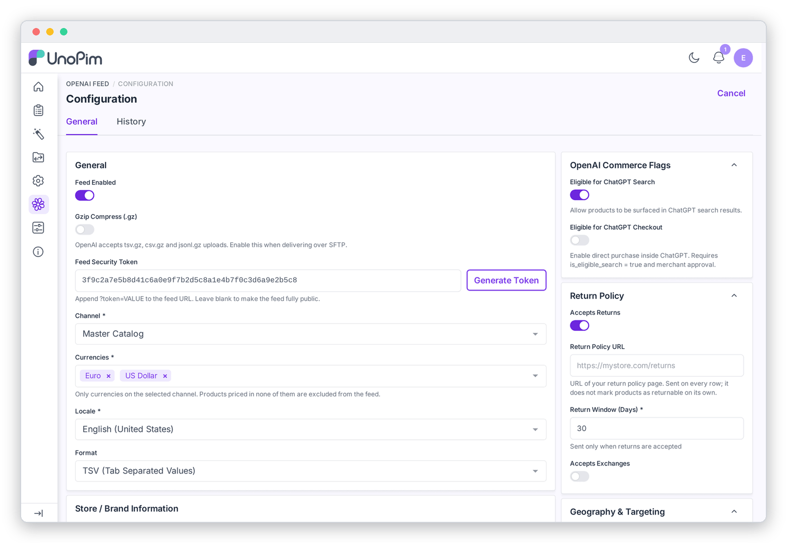

# Configuration

All feed settings are on one admin page: **OpenAI Feed › Configuration**. Change what you need, click **Save Settings**, and the next generation uses it.

## Minimum setup

1. In [General Settings](./general-settings.md), turn the feed on, click **Generate Token**, and pick a channel, currencies and locale.
2. Enter your seller name and URL in [Store Information](./store-information.md).
3. Check the four required fields in [Attribute Mapping](./attribute-mapping.md), then save.

Everything else is optional and has sensible defaults.

## Settings pages

| Page | What you set |
|---|---|
| [General Settings](./general-settings.md) | On/off, token, channel, currencies, locale, format |
| [Store Information](./store-information.md) | Seller name, store URL, policy links |
| [Attribute Mapping](./attribute-mapping.md) | Which attribute fills each feed field |
| [ChatGPT Commerce Flags](./commerce-flags.md) | Search and Checkout eligibility |
| [Return Policy](./return-policy.md) | Returns, return window, exchanges |
| [Geography & Targeting](./geography.md) | Target countries, store country |
| [Product Filters](./product-filters.md) | Which products are included |
| [Schedule & Performance](./schedule-performance.md) | Auto-update interval, batch size |
| [SFTP Delivery](./sftp-delivery.md) | Automatic upload to OpenAI |
| [Settings History](./settings-history.md) | Who changed what, and when |
