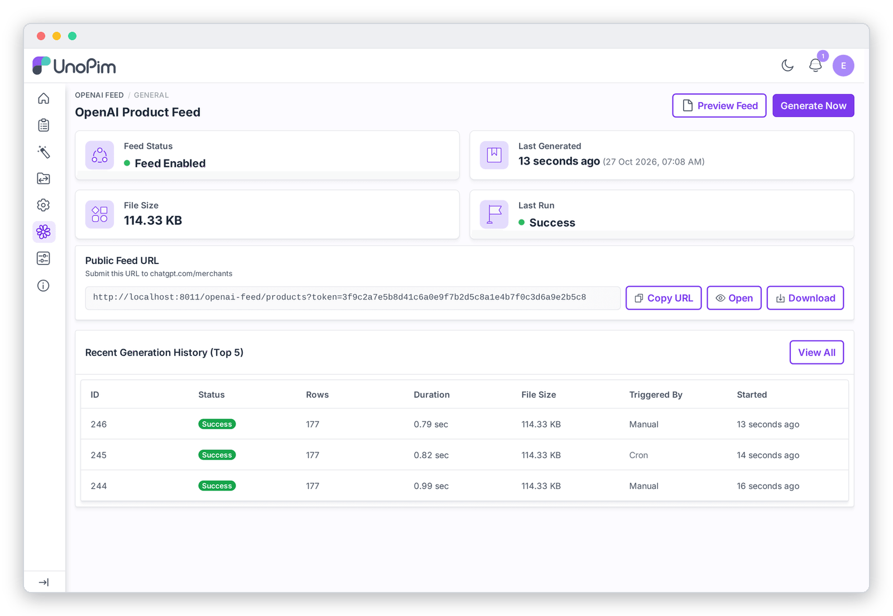

# Generating the Feed

This page covers the day-to-day work: building the feed, checking what's in it, and watching how each run went.

---

## The dashboard

Open **OpenAI Feed › General**.

| Area | What it tells you |
|---|---|
| **Feed Status** | Whether the feed is enabled. |
| **Last Generated** | When the current feed file was built, e.g. *"1 minute ago (27 Oct 2026, 06:58 AM)"*. |
| **File Size** | Size of the current feed file. |
| **Last Run** | Result of the most recent run: *Success*, *Running* or *Failed*. |
| **Public Feed URL** | The address you give OpenAI, including your token. Use **Copy URL**, **Open** (view it in a new tab) or **Download** (save the file). |
| **Recent Generation History (Top 5)** | The last five runs. **View All** opens the full history. |

The buttons at the top right are **Preview Feed** and **Generate Now**. While a generation is running, **Generate Now** is disabled and reads *Generating…*, a **Stop** panel appears, and the page refreshes on its own when the run finishes.

---

## Generate the feed manually

1. Click **Generate Now** and confirm.
2. What happens next depends on your queue setup:
   - **With a queue worker** (`database`/`redis`): you see *"Feed generation queued, running in the background"*. The run appears as **Running** in the history and switches to **Success** or **Failed** when it ends.
   - **With `QUEUE_CONNECTION=sync`**: the page waits until the feed is built, then shows *"Feed generated: 177 rows written in 0.9 seconds"*.
3. Every run, successful or not, is recorded in the history as **Manual**.

If you click **Generate Now** while another run is in progress, you get *"A feed generation job is already running"*. Two runs never overlap.

> [!NOTE]
> The feed is written to a temporary file first and swapped in only when the run succeeds. If a run fails or is stopped, OpenAI keeps getting the **previous** complete feed. It never gets a half-written file.

---

## Stop a running generation

Click **Stop** in the panel that appears on the dashboard while a run is in progress, and confirm. The run is marked **Failed** with the reason *"Stopped manually"*, its temporary file is deleted, and the existing feed file is left untouched. If the job was still waiting in the queue, it is skipped when a worker picks it up.

---

## Automatic generation

Once the scheduler is running (see [Installation › Step 5](./installation.md#step-5-enable-the-scheduler)), the feed rebuilds itself on the interval you set in [Configuration › Performance & Schedule](./schedule-performance.md). Scheduled runs show **Cron** in the *Triggered By* column.

The schedule only runs while **Feed Enabled** is on.

---

## Related

- [CLI Commands](./cli.md): generate from the terminal or a deploy script.
- [Feed Preview](./preview.md): check the rows before OpenAI sees them.
- [Generation History](./generation-history.md): every run and why it failed.
