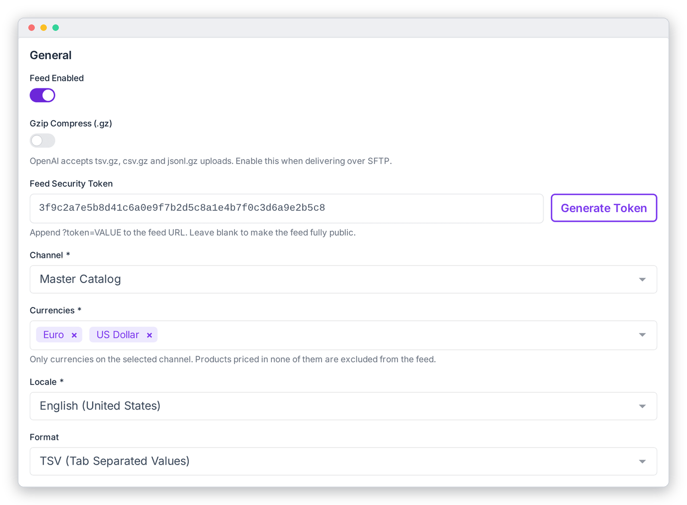

# General Settings

Turn the feed on, protect it with a token, and choose which channel, currencies, language and file format to export. These settings are in the **General** card (top of the left column) of **OpenAI Feed › Configuration**. Remember to click **Save Settings** when you're done.

| Field | What it does |
|---|---|
| **Feed Enabled** | Master switch. When off, nothing is generated (manually or on schedule) and the public feed URL returns *404 Not Found*. |
| **Gzip Compress (.gz)** | Compresses the feed file (for example `products.tsv.gz`). OpenAI accepts `tsv.gz`, `csv.gz` and `jsonl.gz`. Turn this on when you deliver over SFTP. |
| **Feed Security Token** | A secret that must be added to the feed URL as `?token=…`. Click **Generate Token** to create a random 48-character token. Leave it blank only if you want the feed to be public. |
| **Channel** \* | The UnoPim channel to export. Its channel-specific values (prices, names, etc.) are used. |
| **Currencies** \* | One or more currencies of that channel, **in order of preference**. See *How currencies work* below. |
| **Locale** \* | The language for translatable values: titles, descriptions, category names and select-option labels. |
| **Format** | **TSV** (tab-separated, recommended), **JSONL** (one JSON object per line) or **JSON array** (legacy). |

> [!WARNING]
> Generating a new token **immediately** invalidates the old one. If OpenAI already has your feed URL, update it in the OpenAI merchant portal straight away, or OpenAI's next fetch will get *403 Forbidden*.

## How currencies work

Each product is priced in the **first** selected currency it has a price for. The sale price is quoted in that same currency. A product with no price in **any** selected currency is left out of the feed.

*Example:* with currencies `USD, EUR`, a product priced only in EUR is exported as `129.00 EUR`. A product priced in both is exported in USD.

Only currencies assigned to the selected channel can be chosen. If the list is empty, assign currencies to the channel under **Settings › Channels** first.

---

[← Configuration overview](./configuration.md) · [Store Information →](./store-information.md)
