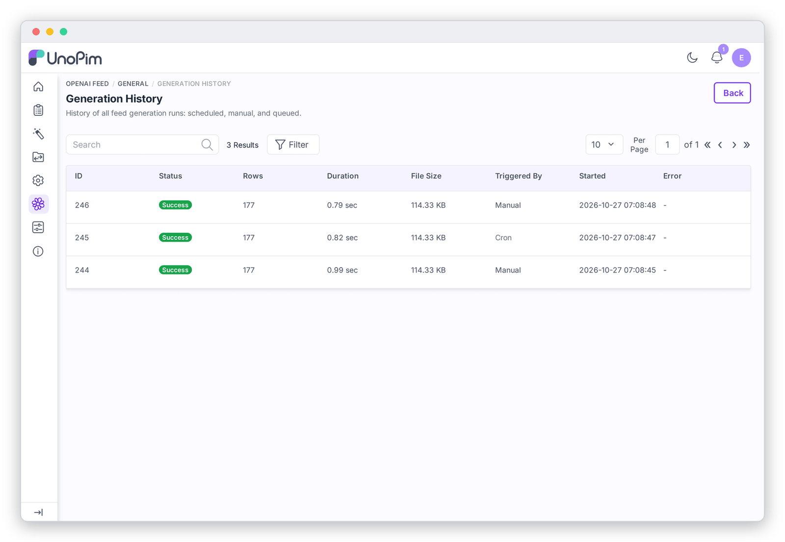

# Generation History

Click **View All** on the dashboard to see every run.

| Column | How to read it |
|---|---|
| **Status** | **Success**, **Running** or **Failed**. |
| **Rows** | Rows written. A sudden drop usually means a filter, currency or mapping change, or products being disabled. |
| **Duration** | How long the run took. Steady growth means your catalog is growing. A sudden jump points to a slow database or server. |
| **File Size** | Size of the file produced. |
| **Triggered By** | **Manual** (dashboard or CLI), **Cron** (scheduler) or **Api**. |
| **Started** | When the run began. |
| **Error** | Why a failed run failed, e.g. *"Stopped manually"* or *"The feed was generated but the SFTP upload to OpenAI failed"*. |

You can sort, filter by status, trigger or date range, and search. Technical error details (stack traces) are never shown here; they are written to `storage/logs/laravel.log`.
