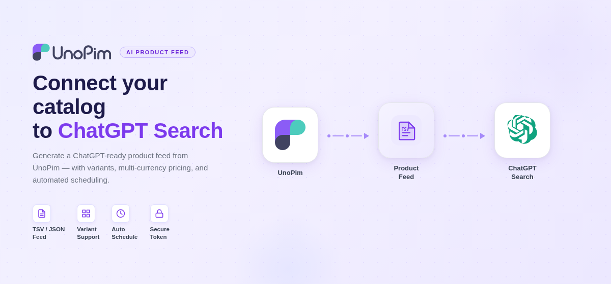

# AI Product Feed (OpenAI / ChatGPT)

<br>

<div align="center">
  
</div>

<br>

The **AI Product Feed** extension turns your UnoPim catalog into a product feed that **ChatGPT** can read. Once OpenAI ingests the feed, your products can appear in ChatGPT shopping answers and, if you are approved, be bought directly inside ChatGPT.

You set the feed up once. After that UnoPim rebuilds it on a schedule, so ChatGPT always sees your latest titles, prices, images and stock.

---

## How it works

```
 UnoPim catalog ──► Feed generator ──► Feed file (TSV / JSONL / JSON, optional .gz)
                                              │
                         ┌────────────────────┴────────────────────┐
                         ▼                                         ▼
              Public feed URL (with token)              SFTP upload to OpenAI
              OpenAI fetches it                          OpenAI picks it up
```

1. **Configure** which channel, locale and currencies to export, your store details, and which UnoPim attribute fills each feed field.
2. **Generate** the feed: click a button, let the scheduler do it, or run a command.
3. **Deliver** it to OpenAI, either by giving OpenAI your protected feed URL or by letting UnoPim upload each new file over SFTP.
4. **Monitor** every run from the dashboard and the generation history.

---

## Features

| Area | What you get |
|---|---|
| **Formats** | TSV (tab-separated), JSONL (one JSON record per line) or a JSON array. Any format can be gzip-compressed (`.gz`). |
| **Delivery** | A token-protected public URL, plus optional automatic **SFTP upload** to the location OpenAI gives you. |
| **Variants** | Configurable products become one row per variant, grouped with `group_id` and described with `variant_dict` (e.g. `{"color":"Red","size":"M"}`). |
| **Multi-currency** | Pick several currencies in priority order. Each product is priced in the first one it has a price for. |
| **ChatGPT flags** | Choose whether products may appear in ChatGPT Search, ChatGPT Checkout, or both. |
| **Attribute mapping** | Map 23 feed fields (title, brand, price, GTIN, images, dimensions, reviews and more) to your own UnoPim attributes. |
| **Data quality** | Strips HTML from descriptions, checks GTIN check digits, trims text to OpenAI's length limits, and normalises units, gender, age group and condition values. |
| **Localisation** | Text and select-option labels are exported in the locale you choose, not the admin's language. |
| **Preview** | Browse the exact rows the feed will contain, and open any row to see every mapped field. |
| **Monitoring** | Dashboard status cards, the last 5 runs, and a full generation history with rows, duration, file size and trigger. |
| **Control** | Stop a running generation at any time. Only one generation runs at a time. |
| **Audit trail** | Every settings change is recorded in a History tab (who changed what, and when). Passwords and keys are never shown. |
| **Security** | The feed file lives in private storage. It is reachable only through the feed URL, and only with your token. SFTP secrets are stored encrypted. |
| **Scheduling** | Automatic regeneration every 1–168 hours, safe on multi-server setups. |
| **Permissions** | Separate role permissions for viewing, configuring, generating and previewing the feed. |

---

## Requirements

| Requirement | Version |
|---|---|
| UnoPim | 3.0.0 – 3.1.3 |
| PHP | 8.4.1 or higher |
| Database | MySQL 8.0+, MariaDB 10.6+ or PostgreSQL 16+ |
| Queue | `database` or `redis` driver recommended for large catalogs (`sync` works for small ones) |
| Scheduler | `php artisan schedule:run` every minute, for automatic regeneration |
| SFTP delivery (optional) | `league/flysystem-sftp-v3` Composer package |

---

## Quick start

New to the extension? The [Quick Start](./quick-start.md) walks you from installation to a live ChatGPT feed in seven short steps, with screenshots.

---

## In this guide

**Getting started:** [Quick Start](./quick-start.md) · [Installation](./installation.md) · [Roles & Permissions](./permissions.md) · [Upgrading & Uninstalling](./upgrading.md)

**Configuration:** [Overview](./configuration.md) · [General Settings](./general-settings.md) · [Store Information](./store-information.md) · [Attribute Mapping](./attribute-mapping.md) · [ChatGPT Commerce Flags](./commerce-flags.md) · [Return Policy](./return-policy.md) · [Geography & Targeting](./geography.md) · [Product Filters](./product-filters.md) · [Schedule & Performance](./schedule-performance.md) · [SFTP Delivery](./sftp-delivery.md) · [Settings History](./settings-history.md)

**Using the feed:** [Generating the Feed](./feed-generation.md) · [Feed Preview](./preview.md) · [Generation History](./generation-history.md) · [CLI Commands](./cli.md)

**Publishing:** [Submitting to ChatGPT](./submitting-to-chatgpt.md) · [Feed Fields Reference](./feed-fields.md) · [Security](./security.md)

**Help:** [Troubleshooting & FAQ](./troubleshooting.md) · [Contact Support](./contact-support.md)
