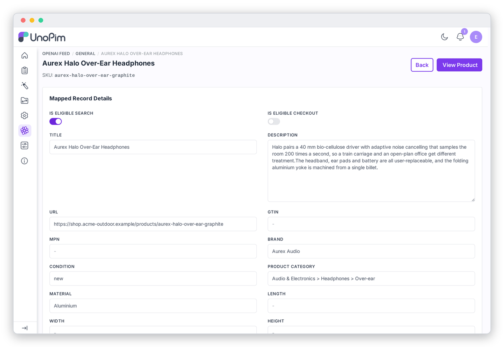

# Feed Preview

Click **Preview Feed** on the dashboard to see the rows the feed will contain, worked out from your **current** settings and catalog.

- Each configurable product shows **one row per variant**. The *Variant Attributes* column shows that variant's options, e.g. `{"color":"Sand"}`.
- The preview applies the same rules as the real feed: product filters, product limit, the currency rule and the price requirement. If a product isn't in the preview, it won't be in the feed.
- Use the **search box** or **Filter** to find rows by ID, title, brand, GTIN or category.

Click the **eye icon** on any row to see every field exactly as it will be exported:

Use this page to answer questions like "why is my GTIN empty?" (the code failed the check-digit test) or "which URL will ChatGPT link to?". **View Product** opens the product in UnoPim so you can fix its data.

> [!TIP]
> The preview reads live data. You don't need to generate the feed to see the effect of a mapping change. Save the configuration and refresh the preview.
