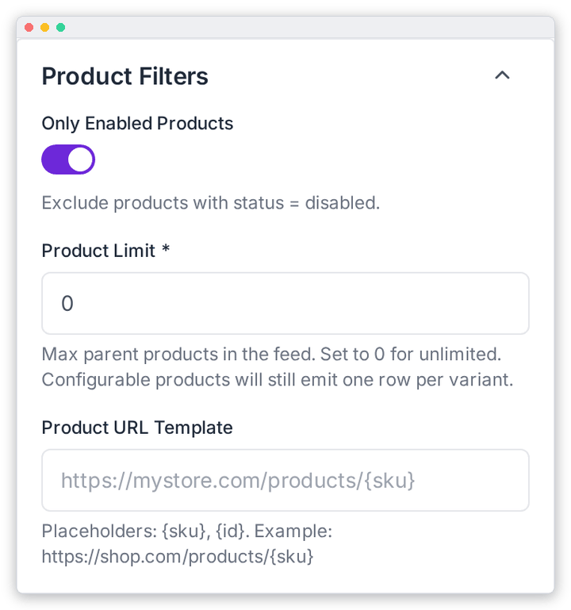

# Product Filters

Choose which products go into the feed and how their links are built. These settings are in the **Product Filters** panel (right column) of **OpenAI Feed › Configuration**. Remember to click **Save Settings** when you're done.

| Field | What it does |
|---|---|
| **Only Enabled Products** | Skip products whose status is *disabled*. Recommended. |
| **Product Limit** \* | The maximum number of **parent** products in the feed. `0` means no limit. A configurable product still adds one row per variant, so the row count can be higher than the limit. The [preview](./preview.md) uses the same limit. |
| **Product URL Template** | How to build each product's link on your store. Use `{sku}` and `{id}` as placeholders, e.g. `https://shop.example.com/p/{sku}`. If empty, links are `<Seller URL>/products/<sku>`. |

> [!TIP]
> Set **Product Limit** to a small number such as `20` while you test your mapping. Then set it back to `0` before you submit the feed to OpenAI.

---

[← Geography & Targeting](./geography.md) · [Schedule & Performance →](./schedule-performance.md)
