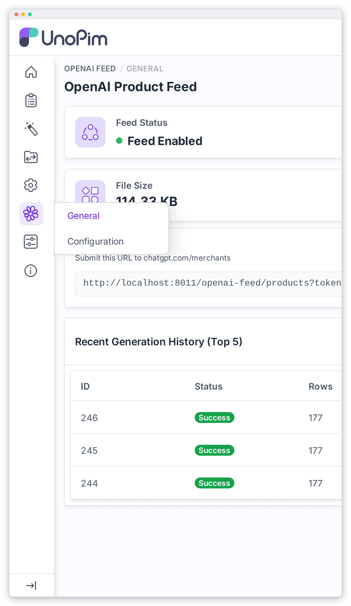
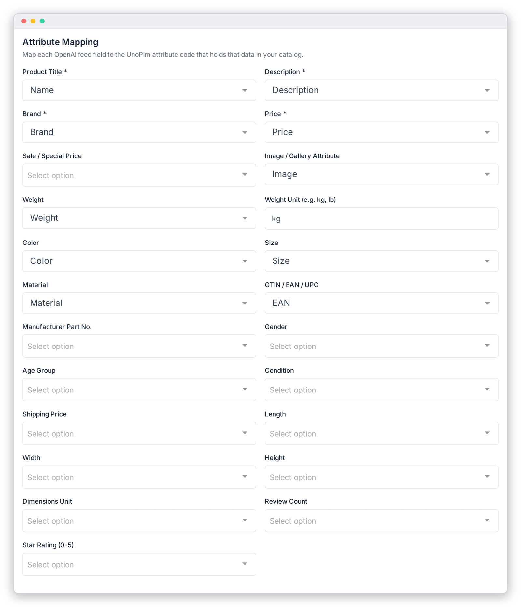
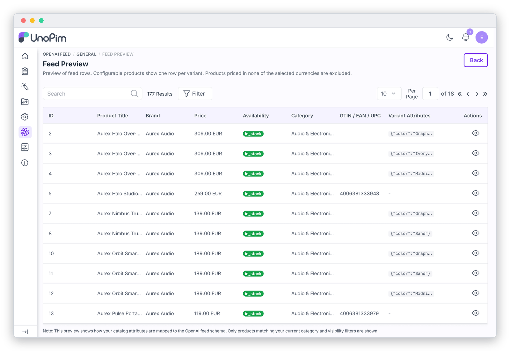

# Quick Start

This page takes you from a fresh install to a feed that ChatGPT can read in about ten minutes. Each step links to a detailed page if you want to know more.

**Before you start:** the extension is [installed](./installation.md), a queue worker is running, and your products have a name, description, brand and price in the channel you want to export.

---

## 1. Open the extension

In the admin sidebar, hover over **OpenAI Feed** and click **Configuration**.

---

## 2. Fill in the General card

1. Turn **Feed Enabled** on.
2. Click **Generate Token**. The token protects your feed URL.
3. Pick the **Channel** to export, then its **Currencies** in order of preference, then the **Locale** (language).
4. Leave **Format** on **TSV** unless OpenAI asked you for something else.

More detail: [General Settings](./general-settings.md).

---

## 3. Enter your store details

In **Store / Brand Information**, type your **Seller Name** and **Seller URL**. If you plan to enable ChatGPT Checkout later, also add your privacy policy and terms of service links.

---

## 4. Check the attribute mapping

The four starred fields (**Product Title**, **Description**, **Brand**, **Price**) must point at attributes that hold data. Map **Image**, **Color**, **Size** and **GTIN** too if you have them, since they make your products much more visible in ChatGPT.

Then click **Save Settings**.

More detail: [Attribute Mapping](./attribute-mapping.md).

---

## 5. Generate and check the feed

Open **OpenAI Feed › General** and click **Generate Now**. When the run shows **Success**, click **Preview Feed** and open a couple of rows to check the titles, prices and images.

Fewer products than expected? See [Troubleshooting › Some products are missing](./troubleshooting.md#some-products-are-missing).

---

## 6. Send the feed to OpenAI

Copy the **Public Feed URL** from the dashboard and register it at [chatgpt.com/merchants](https://chatgpt.com/merchants), or set up [SFTP Delivery](./sftp-delivery.md) if OpenAI gave you SFTP details.

More detail: [Submitting to ChatGPT](./submitting-to-chatgpt.md).

---

## 7. Keep it fresh automatically

Make sure the scheduler crontab entry from [Installation › Step 5](./installation.md#step-5-enable-the-scheduler) is in place. The feed then rebuilds every 6 hours. You can change that interval in [Schedule & Performance](./schedule-performance.md).

That's it: your catalog is now published to ChatGPT and stays up to date on its own.
