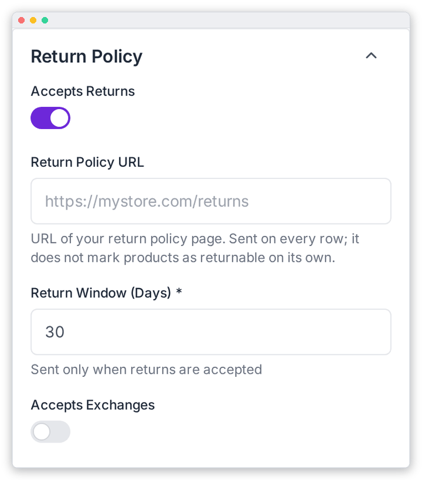

# Return Policy

Describe your returns and exchanges so ChatGPT can show them to shoppers. These settings are in the **Return Policy** panel (right column) of **OpenAI Feed › Configuration**. Remember to click **Save Settings** when you're done.

| Field | What it does |
|---|---|
| **Accepts Returns** | Whether you accept returns. |
| **Return Policy URL** | Link to your return policy page. It is sent on every row. On its own, it doesn't mark products as returnable. |
| **Return Window (Days)** \* | How many days customers have to return an item. It is only sent when *Accepts Returns* is on. Default: 30. |
| **Accepts Exchanges** | Whether you accept exchanges. |

---

[← ChatGPT Commerce Flags](./commerce-flags.md) · [Geography & Targeting →](./geography.md)
