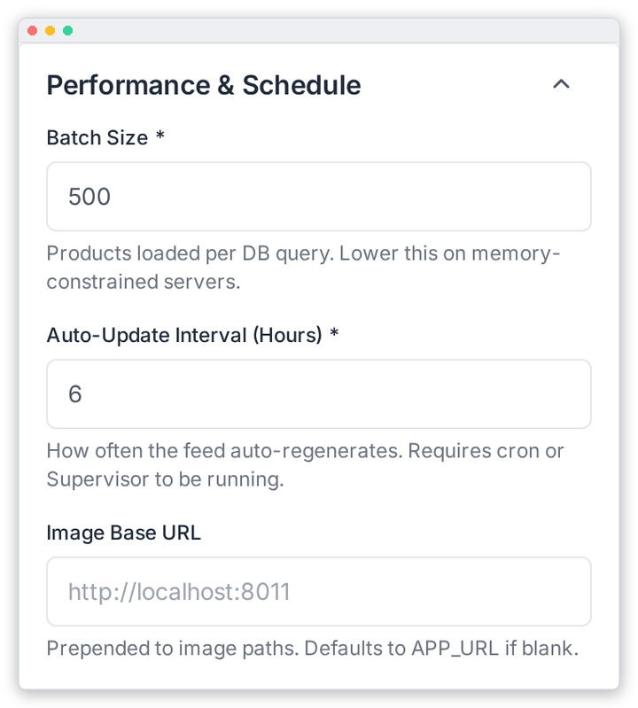

# Schedule & Performance

Control how often the feed rebuilds itself and how hard it works the server. These settings are in the **Performance & Schedule** panel (right column) of **OpenAI Feed › Configuration**. Remember to click **Save Settings** when you're done.

| Field | What it does |
|---|---|
| **Batch Size** \* | How many products are loaded from the database at a time (10–5,000; default 500). Lower it if generation runs out of memory. Raise it to speed up generation on a large server. |
| **Auto-Update Interval (Hours)** \* | How often the feed is rebuilt automatically (1–168 hours; default 6). See *How scheduling works* below. |
| **Image Base URL** | Put in front of relative image paths, e.g. `https://cdn.example.com`. If empty, your `APP_URL` is used. Image links then look like `<base>/storage/<path>`. |

## How scheduling works

Every hour, the scheduler checks when the feed was last built **successfully**. If that was longer ago than your interval, it builds the feed again. This means:

- Any interval works correctly, including long ones like 48 or 168 hours.
- A manual **Generate Now** counts as a fresh build, so the next automatic run moves back accordingly.
- If a scheduled run fails, it is retried at the next hourly check instead of waiting a whole interval.
- Only one generation runs at a time, even if you run UnoPim on several servers.

This needs the crontab entry from [Installation › Step 5](./installation.md#step-5-enable-the-scheduler).

---

[← Product Filters](./product-filters.md) · [SFTP Delivery →](./sftp-delivery.md)
