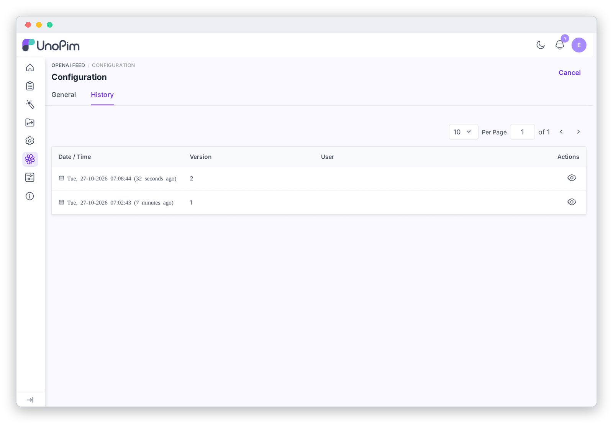

# Settings History

Open the **History** tab at the top of the configuration page to see every change ever saved: when it happened, who made it, and the old and new values. Click the eye icon on a version to see exactly which fields changed.

Mapping changes are shown field by field (for example `attribute_mapping.brand: brand → manufacturer`). SFTP passwords and private keys are never recorded.

---

## When to use it

- **Something changed and the feed looks different.** Compare the latest versions to see which setting or mapping was edited, and by whom.
- **Undoing a mistake.** The history shows the old value of every field, so you can type it back in and save.
- **Audits.** Each version records the admin user who saved it, so you can show who approved a change to what is published to ChatGPT.

Every **Save Settings** click that changes at least one value creates a new version. Saving without changing anything does not.

---

[← SFTP Delivery](./sftp-delivery.md) · [Generating the Feed →](./feed-generation.md)
