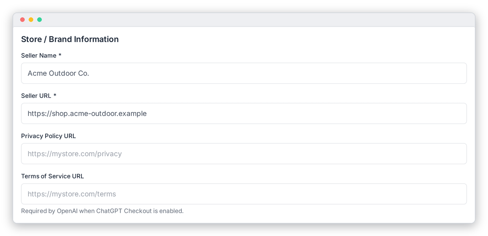

# Store Information

Tell ChatGPT who is selling the products. These settings are in the **Store / Brand Information** card (left column) of **OpenAI Feed › Configuration**. Remember to click **Save Settings** when you're done.

These values are written on **every** row of the feed.

| Field | What it does |
|---|---|
| **Seller Name** \* | Your store or brand name, as shoppers should see it. Maximum 70 characters. |
| **Seller URL** \* | Your store's home page, e.g. `https://shop.example.com`. Also used to build product links when no *Product URL Template* is set. |
| **Privacy Policy URL** | Link to your privacy policy. **Required by OpenAI if ChatGPT Checkout is enabled.** |
| **Terms of Service URL** | Link to your terms of service. **Required by OpenAI if ChatGPT Checkout is enabled.** |

---

[← General Settings](./general-settings.md) · [Attribute Mapping →](./attribute-mapping.md)
