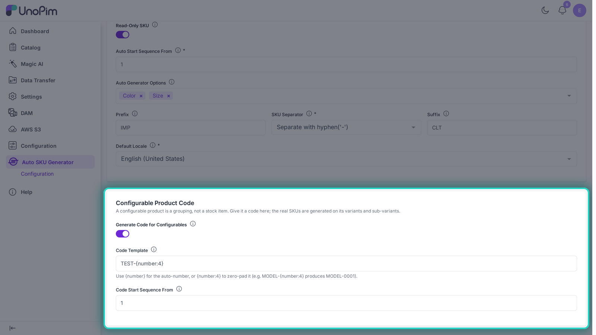

# Configuration

To set up your automatic SKU generation rules, navigate to **Admin Panel → Auto SKU Generator** in your UnoPim dashboard.


---

## 1. General Settings

These settings control the activation and restriction of the SKU generator.

* **Enable Auto SKU Generation**  
  Toggles automatic SKU generation on or off. When enabled, new products automatically receive a generated SKU.
* **Read-Only SKU**  
  Locks the generated SKU field on the product creation form and in the add-variant and add-sub-variant dialogs. Enable this to prevent users from manually modifying auto-generated SKUs. *(Only works when Auto SKU Generation is ON)*.

> [!NOTE]
> Saving the configuration requires the **Update Configuration** permission (Roles screen: **Auto SKU Generator → Configuration → Update Configuration**). Opening the page requires **Configuration**.

---

## 2. Sequence Settings

* **Auto Start Sequence From**  
  The starting number for the auto-increment sequence (e.g., `1`, `1001`, or `2026001`). The system increments this number by 1 for each new product.
  
  > [!IMPORTANT]
  > Changing this number resets the active counter back to this starting value. Saving the page without changing it keeps the current counter.
  >
  > If a generated SKU already exists in the catalog, the next free number is used instead, so a reset never creates duplicates.

---

## 3. SKU Format Settings

Define the structure and format of your generated SKUs.

* **Prefix**  
  A fixed text added at the beginning of the SKU (e.g., `SKU` or `PRD`).
* **Suffix**  
  A fixed text added at the end of the SKU (e.g., `2026` or `NEW`).
* **SKU Separator**  
  The character separating each part of the SKU (including between attribute values). Options include:
  * **Hyphen (`-`)** → `SKU-Red-M-1001`
  * **Underscore (`_`)** → `SKU_Red_M_1001`


---

## 4. Auto Generator Options

* **Auto Generator Options**  
  Select product attributes (e.g., **Color**, **Size**, or **Brand**) to include in the SKU structure.
  
  * **How it works:** Values of these attributes are automatically extracted and placed into the SKU.
  * **Example:** With a prefix of `PRD`, attributes `Color` (Red) and `Size` (M), and sequence `101`, the resulting SKU is:
    ```
    PRD-Red-M-101
    ```

  > [!NOTE]
  > Only attributes of type *select* or *multiselect* can be selected. An attribute with no value on the product is left out, without an empty separator.

  > [!WARNING]
  > The segment is the value as submitted, which for select attributes is the **option code** (for example `red`), not its label (`Red`). Values are only available where the attribute is submitted with the product: the axis values in the add-variant dialog and the columns of an import file. The admin **Create Product** form for a simple product has no attribute fields, so those SKUs contain only prefix, sequence and suffix.

* **Default Locale**  
  Required field saved with the configuration. The current version does not read it: SKU segments always use the submitted option code, whatever locale is selected.

---

## 5. Configurable Product Code

A configurable product is a grouping, not a stock item. Give it a **code** here; the real SKUs are generated on its variants and sub-variants.



* **Generate Code for Configurables**  
  When enabled, configurable products (and their sub-parents) receive an auto-generated code instead of an SKU. Their variants and sub-variants still get normal SKUs.
* **Code Template**  
  The free-text and auto-number pattern used to build the code. Use `{number}` for the auto-number, or `{number:4}` to zero-pad it.
  * **Example:** `MODEL-{number:4}` produces `MODEL-0001`.
  
  > [!NOTE]
  > If the template has no `{number}` token, the sequence number is appended at the end (e.g. `MODEL` → `MODEL-1`).
* **Code Start Sequence From**  
  The next number used in the configurable code. It auto-increments with each new configurable and is **independent of the SKU sequence**.