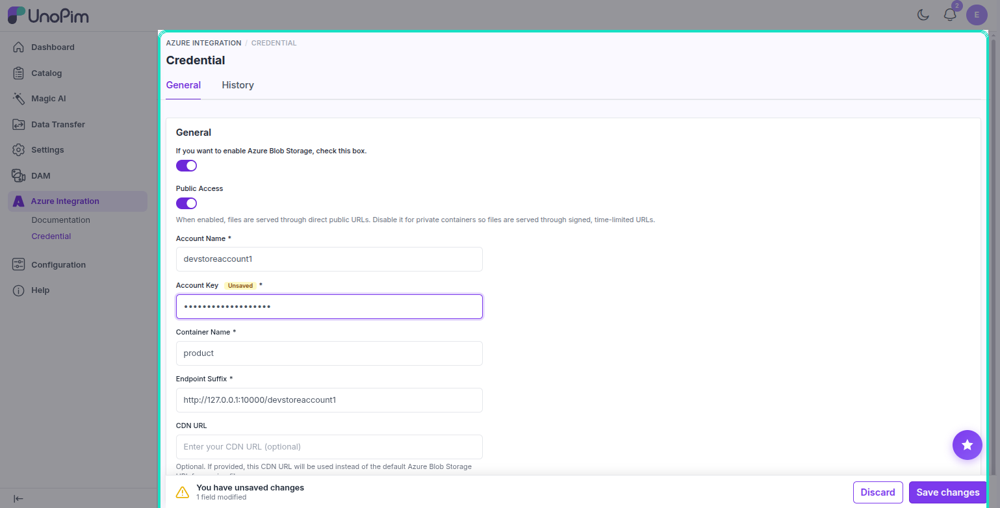

# Setting Up Azure Credentials in UnoPim

Once the module is installed, the next step is to connect your Azure Blob Storage account to UnoPim by entering your credentials.

---

## Step 1 - Open Azure Integration

Log in to your UnoPim dashboard. You'll notice a new **Azure Integration** option in the left navigation panel. Click on it to expand the menu.

---

## Step 2 - View the Documentation *(Optional)*

Go to **Azure Integration → Documentation** to access the official Azure Blob Storage documentation directly from UnoPim. This is helpful if you need to look something up while configuring the integration.

---

## Step 3 - Enter Your Credentials

Navigate to **Azure Integration → Credential**. Fill in the following fields with your Azure Blob Storage details:

| Field | What to enter |
|---|---|
| **Account Name** | The name of your Azure Storage Account |
| **Account Key** | The access key for your Azure Storage Account - found in your Azure portal under **Access keys** |
| **Container Name** | The name of the Blob container where media files will be stored |
| **Endpoint Suffix** | The endpoint suffix for your Azure storage service (e.g., `core.windows.net`). Files are served from `https://<account>.blob.<suffix>/<container>`. A full URL (for example an Azurite emulator, `http://127.0.0.1:10000/devstoreaccount1`) is used as the blob endpoint as-is |
| **CDN URL** | Optional. Replaces the Azure Blob URL as the base for public file URLs. It must be reachable (it is checked with a request on save). Not used when **Public Access** is off |
| **Public Access** | On: files are served through direct public URLs and the container's access level is set to public (blob) on save. Off: files are served through signed SAS URLs valid for 30 minutes, and the container is set to private |

Once all fields are filled in, click **Save Credential**. The credentials are checked against Azure before they are saved; the stored **Account Key** is encrypted and shown masked.

> [!WARNING]
> Public serving needs **Allow Blob public access** turned on for the storage account in the Azure portal. If it is off, saving shows a warning that the container could not be made public. The setting stays on public and file URLs are still built as public links, which Azure refuses. Turn on **Allow Blob public access** and save again, or turn **Public Access** off.

---

## Step 4 - Enable or Disable the Credential

The credential form has an enable switch. Use it to enable or disable the Azure integration at any time, then click **Save Credential**.

Here's what each state means:

| State | What happens |
|---|---|
| **Enabled**  | All media files (images and PDFs) uploaded in UnoPim are stored directly in Azure Blob Storage and served via an Azure Blob URL |
| **Disabled**  | Media files are stored in your local server storage instead, and no files are sent to Azure |

> **Note:** If you switch from enabled to disabled, any files already uploaded to Azure Blob Storage will remain there - only new uploads will go to local storage going forward.

> [!IMPORTANT]
> The Azure disk is configured when the application boots. After changing the credential, the switch or **Public Access**, run `php artisan queue:restart` so queue workers (imports, exports) use the new settings.

---

Once your credential is saved and enabled, your UnoPim instance is fully connected to Azure Blob Storage. Any product media you upload from this point will be stored securely in the cloud.