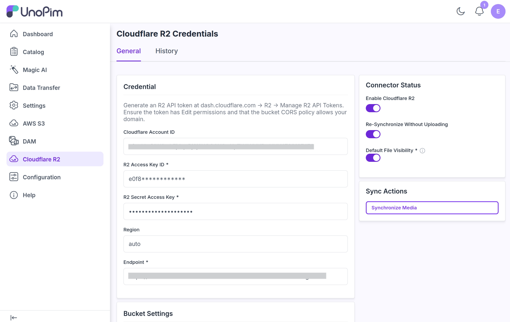

# Configure R2 Keys

Store your Cloudflare R2 API token here. Add a credential before you can use anything else.

**Open it from:** *Cloudflare R2 → Credential*

---

## The credential page



The page is one form with two columns:

- **Left** — Credentials, Bucket Settings, Cache Control Rules.
- **Right** — Connector Status (toggles) and Sync Actions.

A **General** tab and a **History** tab sit at the top. **Save** is in the top-right corner.

---

## Get an R2 API token

1. Sign in to the [Cloudflare dashboard](https://dash.cloudflare.com/).
2. Go to **R2 → Manage R2 API Tokens**.
3. Create a token with **Edit** permission for your bucket.
4. Copy the **Account ID**, **Access Key ID**, and **Secret Access Key**.

> Make sure your bucket's **CORS** policy allows requests from your UnoPim domain — otherwise images won't render in the admin.

---

## Fill in the form

### Credentials

| Field | What it is |
|---|---|
| **Cloudflare Account ID** | Your account ID. The endpoint is auto-derived from this when **Endpoint** is empty. |
| **R2 Access Key ID** | The token's access key. Required on first save; leave blank later to keep the saved one. |
| **R2 Secret Access Key** | The token's secret. Hidden after saving — leave blank to keep the saved one. |
| **Region** | Defaults to `auto` for R2. |
| **Endpoint** | Required. Auto-filled to `https://<account_id>.r2.cloudflarestorage.com` if you leave it blank but provide an **Account ID**. |

### Bucket Settings

| Field | What it is |
|---|---|
| **Bucket Name** | The bucket you created. Required. |
| **Bucket URL** | The **public** address of the bucket. Required for **public** buckets, blank for **private** ones. Use the R2 public development URL (`https://pub-xxxx.r2.dev`) or a custom domain connected to the bucket in Cloudflare (e.g. `https://cdn.example.com`). |
| **Environment Update Time** | Optional `YYYY-MM-DD HH:MM:SS`. Informational only — it does not change file URLs or clear any cache. |

> [!WARNING]
> Never put the **Endpoint** (`https://<account_id>.r2.cloudflarestorage.com`) in **Bucket URL**. That address is the private S3 API: uploads still work, but every image preview fails with an `Authorization` error.

### Connector Status (right column)


| Toggle | What it does |
|---|---|
| **Enable Cloudflare R2** | Master switch. New uploads go to R2 only when this is on. |
| **Re-Synchronize Without Uploading** | Skip the upload step — only verifies the file exists on R2 and writes the mapping row. Use this when files are already on R2. Applies to `php artisan cloudflare_r2:export-media`; see [Re-map without re-uploading](./migration#re-map-without-re-uploading). |
| **Default File Visibility** | On = **Public** (served from the **Bucket URL**). Off = **Private** (signed links that expire after 30 minutes; leave **Bucket URL** blank). |

### Cache Control Rules

Per-extension `max-age` for newly uploaded objects. With no rules, a default 7-day cache is used.

| Extension | Max age (seconds) | Effect |
|---|---|---|
| `jpg` | `2592000` | 30 days |
| `png` | `2592000` | 30 days |
| `pdf` | `86400` | 1 day |

Click **Add Rule** to add one, fill the extension and seconds, click **Save**. Rules apply to **new** uploads — change a rule and re-sync to apply it to old files.

---

## Save = test + save

Click **Save**. The form runs a live `ListObjects` against your bucket first. If the credentials work, the form is saved. If not, you see the error and nothing is stored.

> [!TIP]
> No separate **Test Connection** step exists — Save *is* the test. Bad keys never reach the database.

---

## Edit later

The next time you open the page:

- **Access Key** shows masked (`580a************`).
- **Secret Key** shows fully masked (`********************`).

Leave both blank to keep the stored values. Type a new value to replace one.

---

## Change the Bucket URL later

Moving from the `r2.dev` address to your own domain, or correcting a wrong **Bucket URL**, takes more than **Save**. Each file's public URL is stored when it is uploaded, and running queue workers keep the settings they started with.

1. Make sure the new address serves files: open one existing file on the new host in a browser.
2. Save the new **Bucket URL**.
3. Restart the queue workers so new uploads use the new address:

   ```bash
   php artisan queue:restart
   ```

   With Supervisor, also run `sudo supervisorctl restart all`.
4. Point the URLs of already uploaded files to the new address. Replace both values with your own:

   ```bash
   php artisan tinker --execute="\$old = 'https://pub-xxxx.r2.dev'; \$new = 'https://cdn.example.com'; DB::table('cloudflare_r2_media_mappings')->where('cdn_url', 'like', \$old.'/%')->update(['cdn_url' => DB::raw(\"REPLACE(cdn_url, '\$old', '\$new')\")]);"
   ```

5. Clear the cache:

   ```bash
   php artisan cache:clear
   ```

6. Switch off the old address in Cloudflare only after previews load from the new one.

> [!NOTE]
> A new import or **Re-Synchronize Without Uploading** does not update the URLs of files that are already on R2. Without server access, [contact support](./contact-support) and we will run steps 3–5 for you.

---

## Change history

Click the **History** tab to see every change made to the credential — toggles flipped, fields edited, rules added.

> Access keys and secret keys are **never** written to history.
