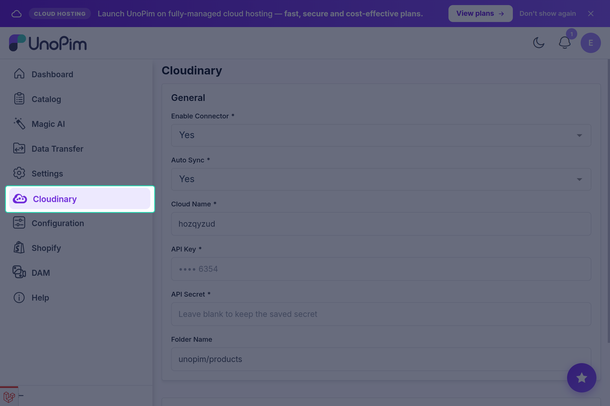
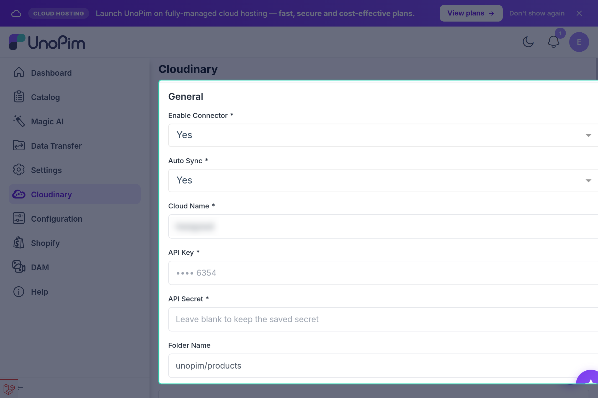

# Setting Up Credentials & Connector Settings

After installing the connector, the next step is connecting your Cloudinary account to UnoPim and configuring media synchronization preferences.

---

## Accessing the Configuration Page

1. Log in to your UnoPim admin panel.
2. In the left-hand navigation sidebar, click on **Cloudinary → Credentials**.

<!-- ============================================================ -->
<!-- SCREENSHOT PLACEHOLDER: Cloudinary Sidebar Navigation        -->
<!-- IMAGE_NAME: cloudinary-sidebar-menu.png                      -->
<!-- Location: docs/cloudinary/images/cloudinary-sidebar-menu.png -->
<!-- Description: UnoPim left navigation bar showing Cloudinary expanded with Credentials and Settings submenus -->
<!-- ============================================================ -->

You will be directed to the **Cloudinary Connector Configuration** page.

---

## Configuring Connection Parameters

Fill in the configuration fields using the credentials obtained from your Cloudinary Console (refer to [Cloudinary Setup](./cloudinary-setup.md)):

<!-- ============================================================ -->
<!-- SCREENSHOT PLACEHOLDER: Cloudinary Credentials Form          -->
<!-- IMAGE_NAME: cloudinary-configuration-form.png                -->
<!-- Location: docs/cloudinary/images/cloudinary-configuration-form.png -->
<!-- Description: Full page view of the Cloudinary Credentials configuration form (/admin/cloudinary/credentials) -->
<!-- ============================================================ -->

### Field Reference

| Field | Requirement | Description |
|---|---|---|
| **Enable Connector** | Required | Toggle **Yes** to activate Cloudinary integration, or **No** to keep it inactive. |
| **Auto Sync Product Images** | Required (if Enabled) | When set to **Yes**, product media is automatically uploaded to Cloudinary whenever a product is created or updated in UnoPim. |
| **Cloud Name** | Required (if Enabled) | Your unique Cloudinary cloud identifier (e.g., `unopim-cloud`). |
| **API Key** | Required (if Enabled) | The API Key generated from your Cloudinary console. Leave blank to keep the saved key. |
| **API Secret** | Required (if Enabled) | The API Secret generated alongside your API Key. Once saved, UnoPim encrypts it and leaves the field blank. Leave blank to keep the saved secret. |
| **Folder Name** | Optional | Target directory path in Cloudinary where media will be organized. Defaults to `unopim/products`. |

### Changing Cloud Name, Credentials, or Folder

Each file's full Cloudinary URL (including the cloud name and folder) is stored when the file is uploaded. Changing these fields only affects new uploads:

- Already uploaded files keep their stored URL and stay in the old cloud or folder. They are not moved or re-uploaded.
- New uploads go to the new cloud name and folder.
- Deleting or pulling an old file calls the Cloudinary API with the **current** credentials, so it can fail for files that live in a different Cloudinary account.

> [!WARNING]
> To move media to a different Cloudinary account, run **Pull all media to local** with the old credentials first, then save the new credentials and run **Sync all media to Cloudinary**. See [Media Synchronization](./sync-media).

> [!NOTE]
> Settings are read from the database on every operation, so running queue workers use new values on their next job. No `php artisan queue:restart` or cache clear is needed.

### Environment Fallback

Until the configuration is first saved in the admin panel, the connector reads these `.env` values. After saving, the database values are used.

| Variable | Default |
|---|---|
| `CLOUDINARY_ENABLED` | `false` |
| `CLOUDINARY_AUTO_SYNC` | `false` |
| `CLOUDINARY_CLOUD_NAME` | - |
| `CLOUDINARY_API_KEY` | - |
| `CLOUDINARY_API_SECRET` | - |
| `CLOUDINARY_FOLDER` | `unopim/products` |

---

## Saving and Verifying Credentials

1. Once all details are filled in, click **Save Changes** at the top right of the page.
2. When **Enable Connector** is **Yes**, UnoPim verifies the credentials with a call to the Cloudinary API. When it is **No**, the values are saved without verification.
3. Upon successful validation, a confirmation message appears:
   > *Cloudinary configuration saved successfully.*

::: tip Credential Validation Error
If you receive the error *"The Cloudinary credentials are invalid. Please check the cloud name, API key, and API secret"*, verify that there are no accidental spaces before or after your copied keys.
:::

---

## Disabling the Connector

If you ever need to disable the connector:

::: warning Important: Pull Media First
UnoPim refuses to set **Enable Connector** to **No** while any product media exists only on Cloudinary, with the error *"Pull all media to local first, then disable the connector."* Use the **Pull all media to local** button in the Bulk Media Sync section first, wait for the queue job to finish, then disable the connector.
:::

---

## Next Step: Image Transformations

Once your credentials are authenticated, configure dynamic image resizing, automated WebP/AVIF formatting, and AI object focus in [Image Transformations & Optimization](./transformations.md).
