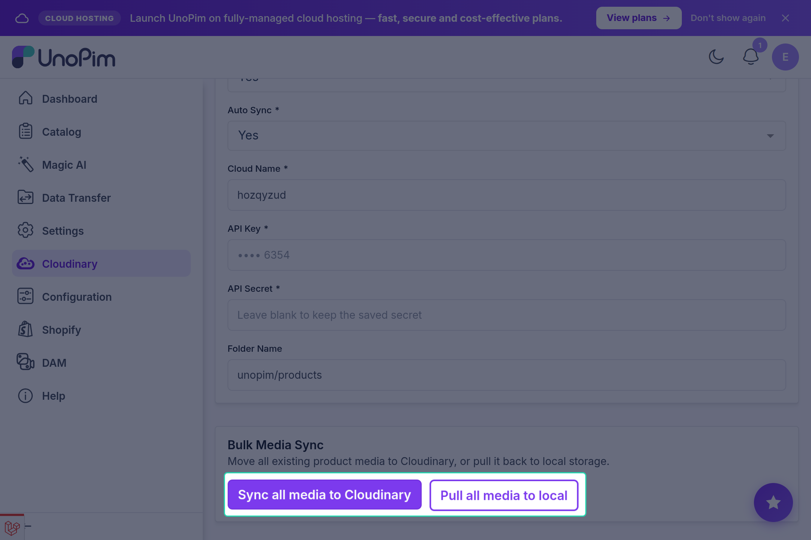

# Media Synchronization

The **Cloudinary Connector** provides multiple options for syncing catalog media between UnoPim and your Cloudinary environment.

---

## 1. Automatic Real-Time Synchronization

When **Auto Sync Product Images** is set to **Yes** in the connector configuration:

- Whenever an administrator or import job adds or updates product images in UnoPim, the connector automatically dispatches an upload job to the queue.
- Media files are transferred to Cloudinary under the configured folder, and the corresponding Cloudinary public ID and secure URL are stored per file.
- Product attribute values keep their original local path, so catalog associations and indexing remain intact.

> [!WARNING]
> After all of a product's local media uploads successfully, the local product files are **deleted** from UnoPim storage. From then on the image is served only from Cloudinary. DAM asset files are uploaded but never deleted locally.

---

## 2. Bulk Media Sync via Admin UI

If you already have existing products with local images prior to installing the connector, or if you need to migrate media between local storage and Cloudinary in batch, use the **Bulk Media Sync** section located at the bottom of the Cloudinary configuration page (**Cloudinary → Credentials**). The section is shown only when the connector is enabled, a Cloud Name is saved, and your role has **Update credentials** or **Update settings**.

<!-- ============================================================ -->
<!-- SCREENSHOT PLACEHOLDER: Bulk Media Sync Section              -->
<!-- IMAGE_NAME: bulk-media-sync.png                              -->
<!-- Location: docs/cloudinary/images/bulk-media-sync.png         -->
<!-- Description: Bulk Media Sync card showing Sync all media and Pull all media buttons -->
<!-- ============================================================ -->


### Sync all media to Cloudinary

1. Click **Sync all media to Cloudinary**.
2. UnoPim dispatches a background task scanning all product image, gallery, file, and asset attributes, plus all DAM assets (when DAM is installed).
3. Media files stored locally are uploaded to Cloudinary, and media records are updated. Local product files are deleted after a successful upload.
4. A notification indicates that media synchronization has started in the background. If nothing needs syncing, you see *"All media is already synchronized with Cloudinary."* instead.

---

### Pull all media to local

Use this option to retrieve all product media currently stored on Cloudinary and save it back to UnoPim's default filesystem disk (`FILESYSTEM_DISK`, `public` by default):

1. Click **Pull all media to local**.
2. UnoPim downloads each file from its stored Cloudinary URL and writes it to local storage.
3. After every file of a product downloads successfully, those files are **deleted from Cloudinary**.

::: tip Recommended Before Disabling
Always run **Pull all media to local** prior to disabling the Cloudinary connector so that your product catalog continues serving images without interruption.
:::

---

## 3. CLI Console Commands

For large catalogs with thousands of high-resolution images, running synchronization via the command line interface (CLI) is recommended.

### Push Local Media to Cloudinary

To synchronize all product media from local storage to Cloudinary:

```bash
php artisan cloudinary:sync-media
```

**Console Output:**
```text
Pushing local media to Cloudinary...
  synced product #101
  synced product #102
  ...
Done. Products processed: 250, files synced: 480.
```

---

### Pull Cloudinary Media to Local Storage

To pull all Cloudinary media back to local storage:

```bash
php artisan cloudinary:sync-media --pull
```

**Console Output:**
```text
Pulling Cloudinary media back to local storage...
  pulled product #101
  pulled product #102
  ...
Done. Products processed: 250, files pulled: 480.
```

---

::: warning
The CLI push also deletes local product files after upload, and the CLI pull deletes files from Cloudinary after download, the same as the admin buttons. The push command also uploads DAM assets when DAM is installed.
:::

---

## REST API

The connector adds these routes under `/api/v1/rest/cloudinary` (OAuth2 token, same as the UnoPim REST API):

| Method | Route | Purpose | API permission |
|---|---|---|---|
| `GET` | `/configuration` | Returns `enabled`, `cloud_name`, `folder`, and `auto_sync`. | Cloudinary → Settings |
| `POST` | `/configuration/test` | Tests the saved credentials against Cloudinary. | Cloudinary → Settings → Update settings |
| `POST` | `/products/{id}/sync` | Syncs one product's media to Cloudinary immediately. | Cloudinary → Products → Sync product media |

---

## Queue Monitoring

Ensure your queue worker is running while bulk actions are dispatched:

```bash
php artisan queue:work --tries=3 --timeout=120
```

You can view the progress and logs under `storage/logs/laravel.log`.
