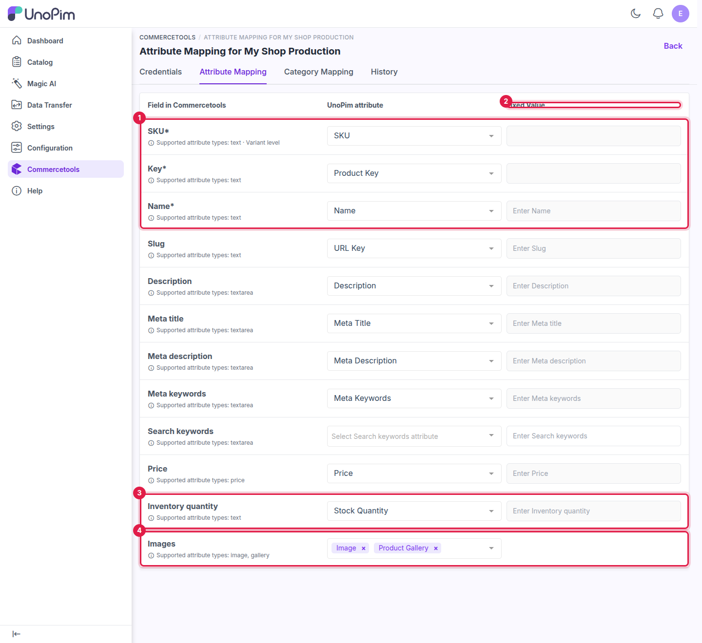
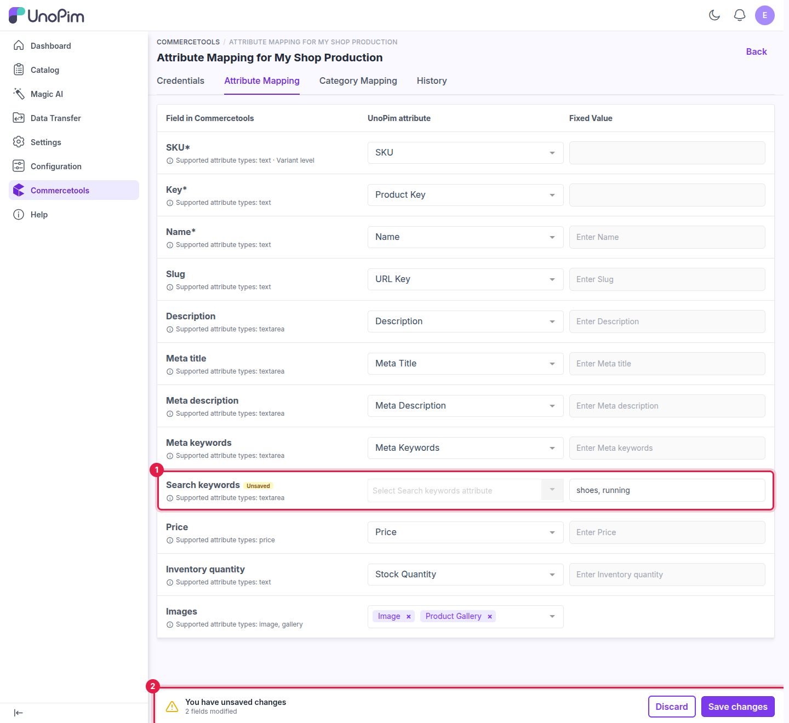

# Attribute Mapping

The **Attribute Mapping** tab on a connection controls which UnoPim attribute feeds each commercetools product field during export, and which UnoPim attribute receives each field during import. Set it up once per connection.

Open it from **Commercetools → Edit (connection) → Attribute Mapping**.

## How the mapping screen works

Each row in the mapping table has three columns:

| Column | Purpose |
|---|---|
| **Field in Commercetools** | The commercetools product field being mapped (read-only). Required fields are marked with `*`. The supported UnoPim attribute types are shown under the field name. |
| **UnoPim attribute** | The UnoPim attribute that holds the value. Only attributes of a supported type are listed, so a wrong type can't be picked by mistake. |
| **Fixed Value** | An optional constant sent for every product instead of an attribute value. |

For each row you can set either a **UnoPim attribute** or a **Fixed Value** — not both. Selecting an attribute disables the fixed value input. **SKU**, **Key** and **Images** do not accept a fixed value.

---

## Available fields

| Field in Commercetools | Supported UnoPim attribute types | Notes |
|---|---|---|
| **SKU** *(required)* | Text | The SKU of each product variant. The attribute must be **unique**. |
| **Key** *(required)* | Text | A unique key that identifies the product in commercetools. The attribute must be **unique**. |
| **Name** *(required)* | Text | The product name shown on your storefront. |
| **Slug** | Text | The URL-friendly part of the product page address (e.g. `blue-running-shoes`). |
| **Description** | Textarea | The full product description. |
| **Meta title** | Textarea | Page title used by search engines. |
| **Meta description** | Textarea | Description shown in search engine results. |
| **Meta keywords** | Textarea | SEO keywords for the product page. |
| **Search keywords** | Textarea | Words customers can search for to find the product. |
| **Price** | Price | The product price, in each exported currency. |
| **Inventory quantity** | Text (with **Number** validation) | The stock quantity. See [Inventory quantity](#inventory-quantity) below. |
| **Images** | Image, Gallery, Asset | You can select more than one attribute. See [Images](#images) below. |

> **Important:** **SKU**, **Key** and **Name** must be mapped before any product export or import can run. Until they are, product jobs stop with the message *"The selected connection has no attribute mappings configured."*

### Inventory quantity

Map **Inventory quantity** to a **text** attribute that uses **Number** validation (or enter a fixed value).

- **Export** — the quantity of each simple product and each variant is written to its commercetools **inventory entry**, matched by SKU. A missing entry is created.
- **Import** — the quantity of each SKU is read from commercetools and saved to the mapped attribute.

Only whole numbers of zero or more are sent.

### Images

commercetools keeps a list of images on each variant, so **Images** is not limited to one attribute. Select one or more of:

| UnoPim attribute type | What is sent |
|---|---|
| **Image** | The single image. |
| **Gallery** | Every image in the gallery, in order. |
| **Asset** | Every DAM asset linked to the product. Requires the UnoPim **DAM** extension — without it, the asset type is not offered. |

On import, the images are downloaded from commercetools and saved to the mapped attribute. Image export can be switched off per job with **With Media** on the [product export](./export-products).

---

## Other product attributes

Any other attribute on a commercetools product type is filled from the UnoPim attribute that has the **same code**. For example, a commercetools attribute called `color` is filled from the UnoPim attribute `color`.

You don't need to map these — just make sure the codes are the same on both sides. The easiest way is to run the [family export](./export-families) (or the [family import](./import-families)) before exporting products.

---

## Save the mapping

Any change on this tab opens the **You have unsaved changes** bar at the bottom of the page, and the changed rows are marked **Unsaved**. Click **Save changes** to store the mapping, or **Discard** to revert it. The updated mapping is used by the next export or import job on this connection.

Every saved change is recorded in the connection's **History** tab.

> **Permissions:** users without the **Update System Fields Mapping** permission see this tab read-only.

---

## What's next

- [Category Mapping](./category-mapping) — map commercetools category fields.
- [Export: Families](./export-families) — create commercetools product types from your attribute families.
- [Export: Products](./export-products) — send products using this mapping.
