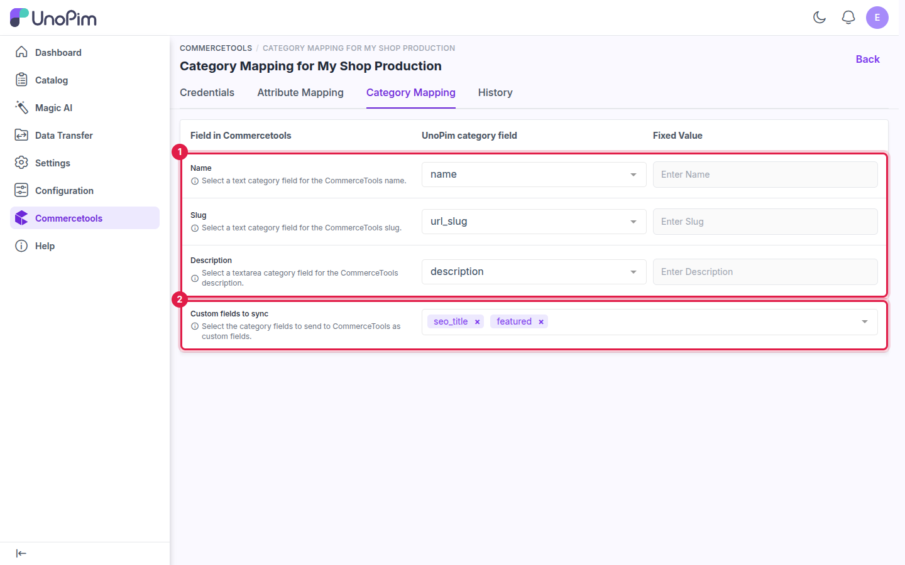

# Category Mapping

The **Category Mapping** tab on a connection controls which UnoPim category fields feed the commercetools category **name**, **slug** and **description**, and which other category fields are sent as commercetools **custom fields**. It is used by the [category export](./export-categories) and the [category import](./import-categories).

Open it from **Commercetools → Edit (connection) → Category Mapping**.

## How the mapping screen works

| Column | Purpose |
|---|---|
| **Field in Commercetools** | The commercetools category field being mapped (read-only). |
| **UnoPim category field** | The UnoPim category field that holds the value. Only fields of a supported type are listed. |
| **Fixed Value** | An optional constant used when the mapped field is empty, or when no field is mapped. |

## Available fields

| Field in Commercetools | Supported UnoPim category field type | When nothing is mapped |
|---|---|---|
| **Name** | Text | The fixed value is used. If a category has no name in any selected locale, its code is used. |
| **Slug** | Text | The fixed value is used, then the category's own `slug` field if it has one, then the category **code** (e.g. `audio_electronics`). |
| **Description** | Textarea | The fixed value is used. Otherwise no description is sent. |

## Custom fields to sync

Use **Custom fields to sync** to send other UnoPim category fields — for example a text, select, boolean or date field — to commercetools as **custom fields**.

- On export, the connector creates (or extends) a commercetools **type** for categories named `unopim-category-fields-{connection ID}`, with one field definition per selected UnoPim field, and writes the values to each category.
- On import, the same custom fields are read back into the matching UnoPim category fields.

Supported UnoPim category field types: text, textarea, boolean, select, multiselect, date, datetime and checkbox. Only active category fields are listed.

> **Note:** Custom fields need the `manage_types` scope (or `manage_project`) on the API client. See [commercetools API Client](./commercetools-setup), Step 5.

## Save the mapping

Click **Save changes** in the unsaved-changes bar at the bottom of the page, or **Discard** to revert. Every saved change is recorded in the connection's **History** tab.

## What's next

- [Export: Categories](./export-categories) — send your category tree to commercetools.
- [Import: Categories](./import-categories) — bring the commercetools category tree into UnoPim.
