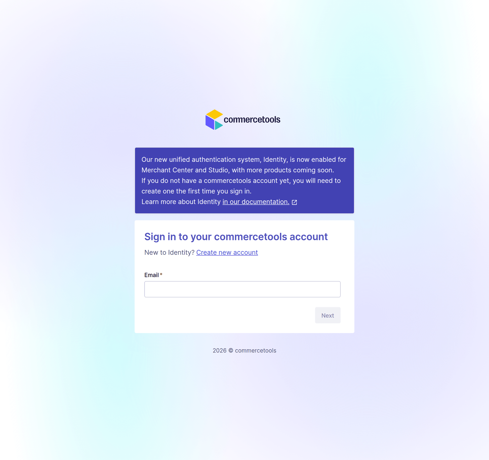
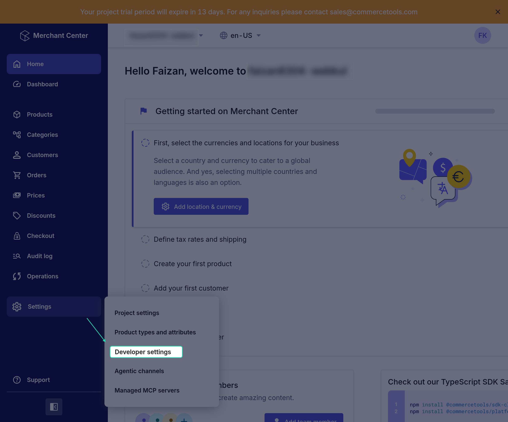
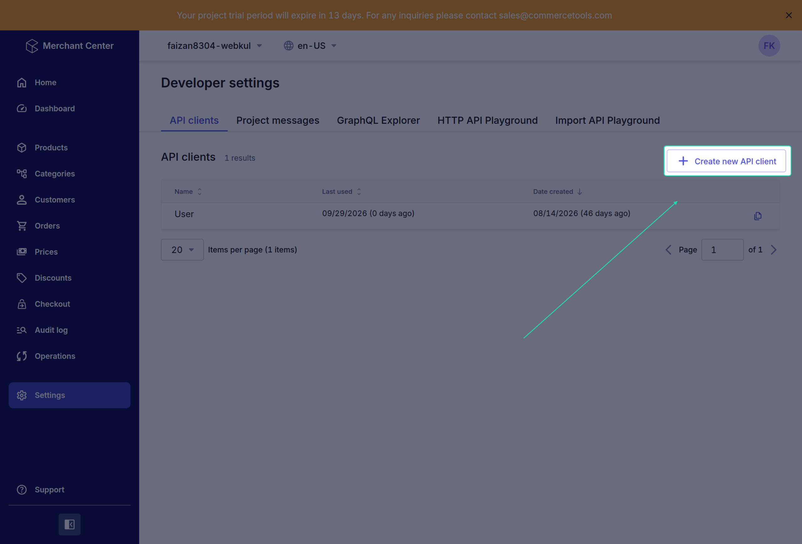
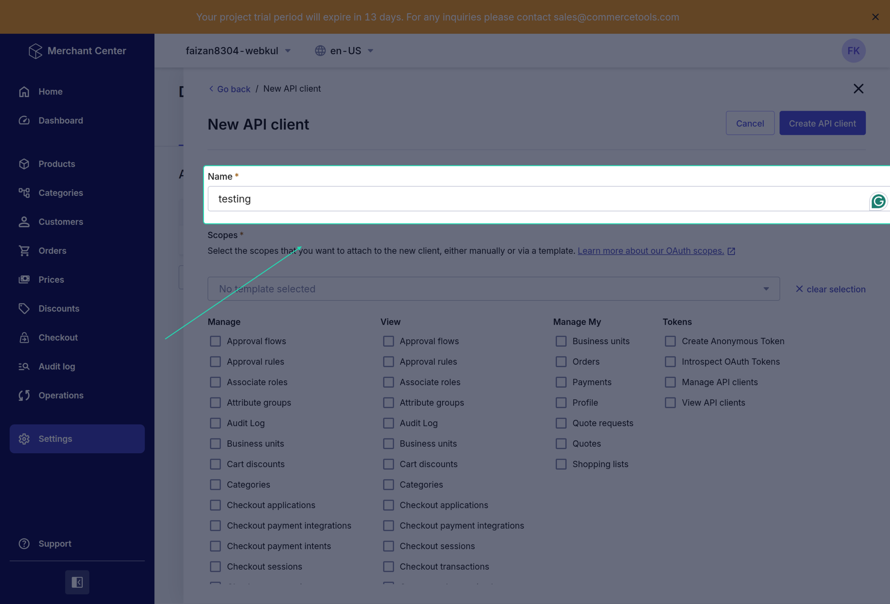
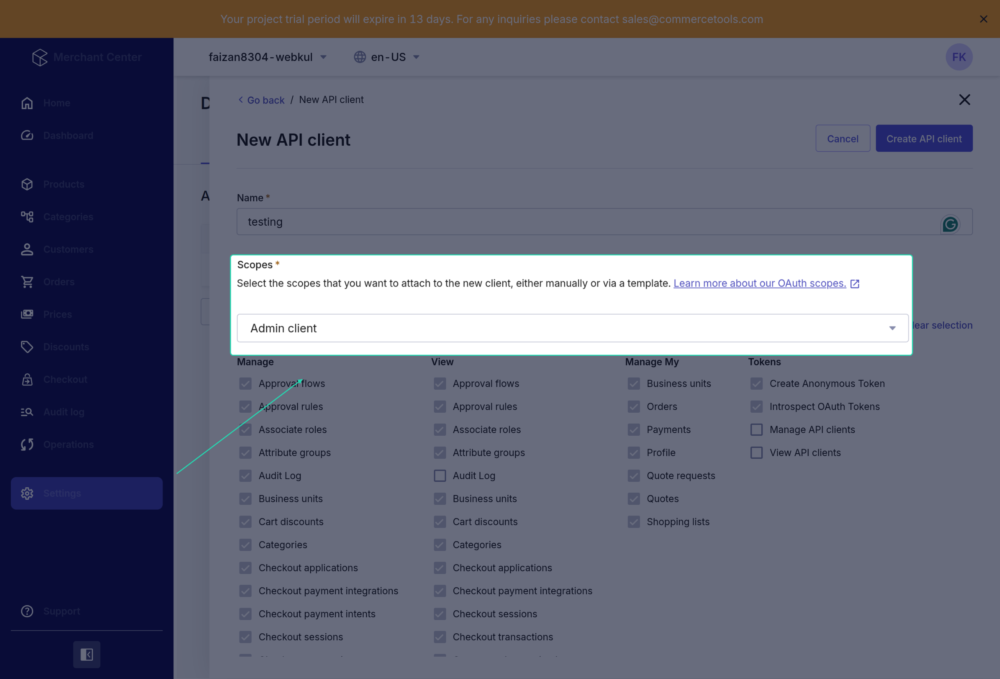

# commercetools API Client

Before you connect UnoPim, create an **API client** in your commercetools project. The API client gives UnoPim the credentials it needs to read and write data in that project. It takes about five minutes.

## Step 1 — Open the Merchant Center

Log in to the [commercetools Merchant Center](https://mc.commercetools.com) and open the project you want to connect.

## Step 2 — Go to Developer settings

In the left menu, click **Settings**, then click **Developer settings**.

## Step 3 — Create a new API client

On the **API clients** tab, click **Create new API client**.

## Step 4 — Name the API client

Enter a name for the client, for example `UnoPim Connector`.

## Step 5 — Choose the scopes

Scopes decide what UnoPim is allowed to do in your project. The simplest option is the **Admin client** template, which gives full access (`manage_project`).

If you prefer tighter access, select only these scopes:

| Scope | Why UnoPim needs it |
|---|---|
| `manage_products` / `view_products` | Export and import products and their inventory quantity |
| `manage_categories` / `view_categories` | Export and import categories |
| `manage_product_types` / `view_product_types` | Export attribute families and import product types |
| `manage_types` / `view_types` | Send UnoPim category fields as commercetools custom fields (only if you use **Custom fields to sync** on the [Category Mapping](./category-mapping) tab) |

> **Note:** If you only plan to export, the `manage_*` scopes are enough. If you only plan to import, the `view_*` scopes are enough.

Click **Create API client**.

## Step 6 — Copy the credentials

commercetools now shows the new credentials. Copy them and keep them somewhere safe. You will enter them in UnoPim later.

| Value | Example |
|---|---|
| **project_key** | `my-shop` |
| **client_id** | `a1b2c3d4e5f6...` |
| **secret** | `Xy9...` |
| **scope** | `manage_project:my-shop` |
| **API URL** | `https://api.europe-west1.gcp.commercetools.com` |

> **Important:** The **secret** is shown **only once**. If you close this screen without copying it, you have to create a new API client.

## Step 7 — Find your region

UnoPim asks for your project's **region**. Read it from the **API URL**: it is the part between `api.` and `.commercetools.com`.

| API URL | Region |
|---|---|
| `https://api.europe-west1.gcp.commercetools.com` | `europe-west1.gcp` |
| `https://api.us-central1.gcp.commercetools.com` | `us-central1.gcp` |
| `https://api.eu-central-1.aws.commercetools.com` | `eu-central-1.aws` |
| `https://api.us-east-2.aws.commercetools.com` | `us-east-2.aws` |

## What's next

- [Installation](./installation) — install the connector in UnoPim.
- [Setup Commercetools Connection](./setup) — enter these credentials in UnoPim.
