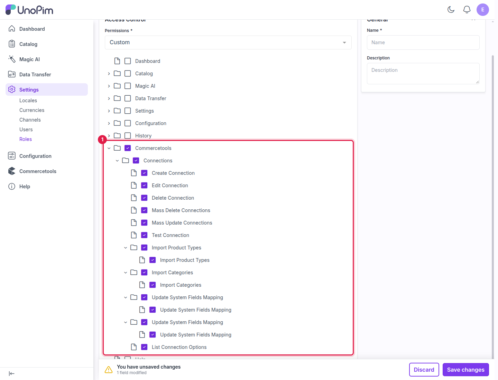

# Connector Settings

The connector works with its default settings, so most stores don't need to change anything here. This page covers the optional environment settings, user permissions and sync-log clean-up.

## Environment settings

Change these values in your UnoPim `.env` file, then run `php artisan optimize:clear`.

| Setting | Default | What it does |
|---|---|---|
| `COMMERCETOOLS_ENABLED` | `true` | Set to `false` to switch the connector off without uninstalling it. |
| `COMMERCETOOLS_API_TIMEOUT` | `30` | How many seconds to wait for commercetools to answer a request. |
| `COMMERCETOOLS_API_RETRIES` | `3` | How many times a failed request is tried again. |
| `COMMERCETOOLS_API_RETRY_DELAY_MS` | `1000` | How long to wait between retries, in milliseconds. |
| `COMMERCETOOLS_TOKEN_REFRESH_BUFFER` | `600` | How many seconds before the access token expires UnoPim requests a new one. |
| `COMMERCETOOLS_API_URL_TEMPLATE` | `https://api.{region}.commercetools.com` | The commercetools API address. `{region}` is filled from the connection. |
| `COMMERCETOOLS_AUTH_URL_TEMPLATE` | `https://auth.{region}.commercetools.com` | The commercetools login address. `{region}` is filled from the connection. |

## User permissions

Decide which admin users may manage commercetools connections.

1. Go to **Settings → Roles** and open (or create) a role.
2. Set **Permissions** to **Custom** and tick the **Commercetools** permissions this role should have.
3. Assign the role to the admin user.



| Permission | What it allows |
|---|---|
| **Connections** | See the **Commercetools Connections** page. |
| **Create Connection** | Create a connection. |
| **Edit Connection** | Open and edit a connection. |
| **Delete Connection** | Delete a connection. |
| **Mass Delete Connections** | Delete several connections at once. |
| **Mass Update Connections** | Switch several connections on or off at once. |
| **Test Connection** | Use the **Test** action. |
| **Import Product Types** / **Import Categories** | Fetch product types and categories from commercetools for a connection. |
| **Update System Fields Mapping** | Save the **Attribute Mapping** tab. It appears twice in the tree: the second entry covers the **Category Mapping** tab. |
| **List Connection Options** | Load connections, channels, locales and attributes in the export and import job forms. Grant it to anyone who creates commercetools jobs. |

> **Note:** Creating and running export and import jobs is controlled by the standard UnoPim **Data Transfer** permissions.

## Cleaning up the sync log

The connector records every exported and imported record in a sync-log table. On busy stores this table can grow large. Remove old rows with:

```bash
php artisan commercetools:sync-log:prune
```

By default this removes rows older than 30 days.

| Option | What it does |
|---|---|
| `--older-than=7d` | Change the age limit, e.g. `7d`, `30d`, `90d`. |
| `--connection=3` | Clean up only one connection, by its ID. |
| `--dry-run` | Show how many rows would be removed, without removing them. |

To run it automatically every night, add this to `routes/console.php`:

```php
use Illuminate\Support\Facades\Schedule;

Schedule::command('commercetools:sync-log:prune --older-than=30d')->dailyAt('02:30');
```

## What's next

- [Export: Families](./export-families) — start your first export.
