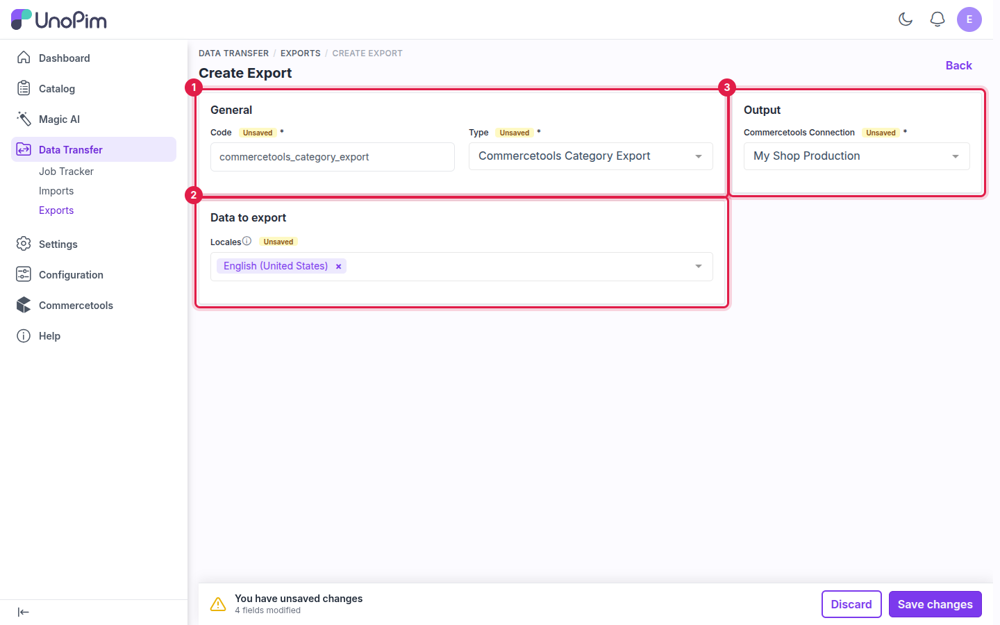
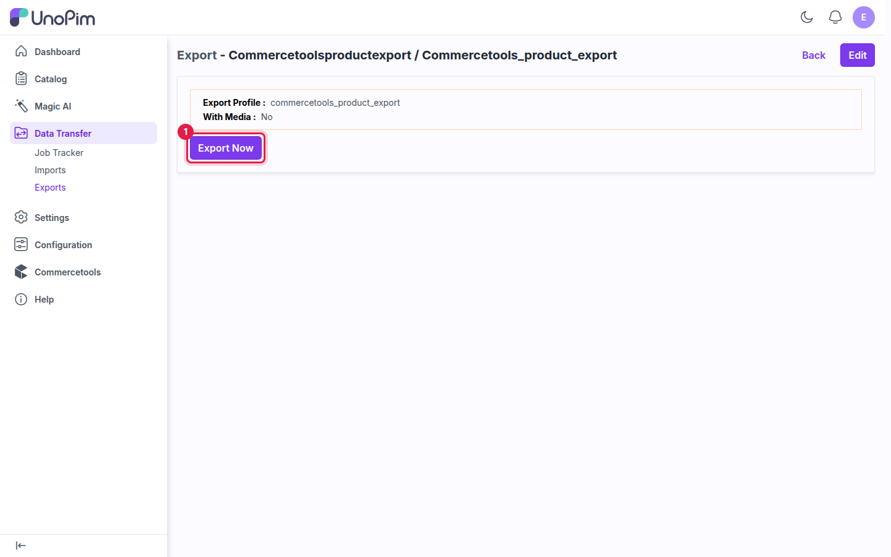

# Export: Categories

The **Commercetools Category Export** job sends your UnoPim category tree to commercetools. Parent categories are always created before their children, so the tree in commercetools matches the one in UnoPim.

Export categories before products, so products can be placed in the right categories as soon as they land in commercetools.

## Prerequisites

- An active connection. See [Setup Commercetools Connection](./setup).
- Optional: a saved [Category Mapping](./category-mapping), to choose which category fields feed the name, slug and description, and which fields are sent as custom fields.

## How to run the Category Export

### Step 1 - Go to Data Transfer → Exports

Navigate to **Data Transfer → Exports** from the main sidebar menu and click **Create Export**.

### Step 2 - Enter a Code and select the Type

Enter a unique **Code**, then select **Commercetools Category Export** in the **Type** dropdown.

**Example:** `commercetools_category_export`

### Step 3 - Configure the job



| Field | Card | Required | Notes |
|---|---|---|---|
| **Commercetools Connection** | Output | Yes | Select the connection to export to. Only active connections are listed. |
| **Locales** | Data to export | Yes | The category name, slug and description are sent in each selected locale. |

### Step 4 - Save

Click **Save changes** in the unsaved-changes bar at the bottom of the page.

### Step 5 - Export Now

Click **Export Now** to start the job. It is added to the queue and runs in the background.



### Step 6 - Monitor progress

Track the job in **Data Transfer → Job Tracker**. When it completes, you see how many categories were created, updated and skipped.

## How multiple locales are exported

Selecting several locales does **not** create several copies. Each UnoPim category becomes **one** commercetools category, and the value for every selected locale is stored inside it. For example, `audio_electronics` exported with three locales becomes:

```json
{
  "key": "audio_electronics",
  "name": {
    "en-US": "Audio & Electronics",
    "de-DE": "Audio & Elektronik",
    "fr-FR": "Audio et électronique"
  },
  "slug": {
    "en-US": "audio_electronics",
    "de-DE": "audio_electronics",
    "fr-FR": "audio_electronics"
  }
}
```

In the Merchant Center, switch the data locale at the top of the screen to see the same record in another language.

## Things to know

- **Slug** — unless you map a slug field on the [Category Mapping](./category-mapping) tab, the slug is the category **code**, the same in every locale.
- **Missing translations** — a locale with no name is skipped. A category with no name in any selected locale uses its code as the name.
- **Adding a locale later** — re-run the export with the new locale selected. The value is added to the existing category; nothing is duplicated.

## What's next

- [Export: Products](./export-products) — send products to commercetools.
