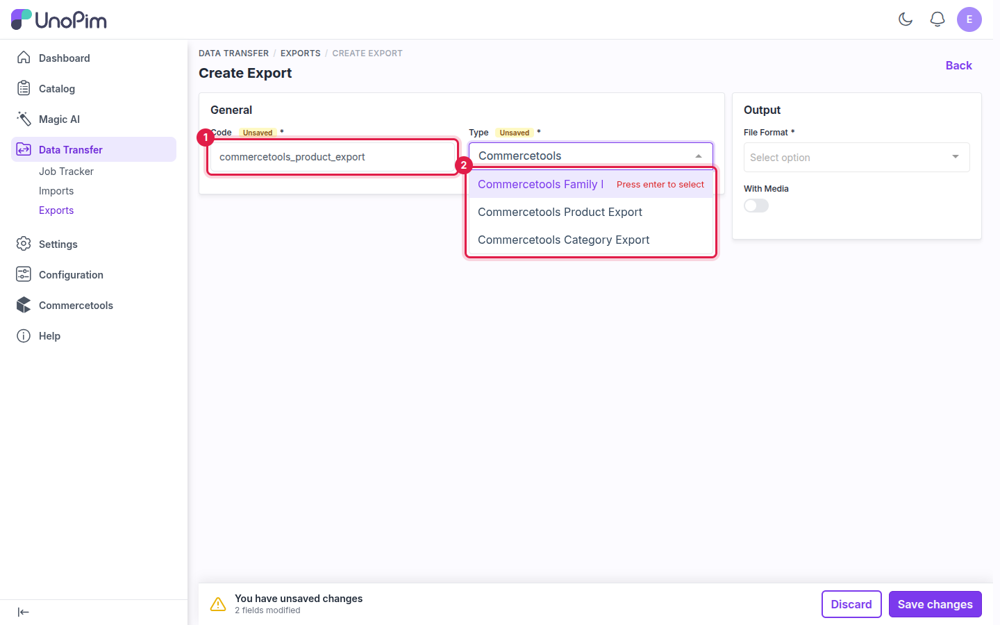
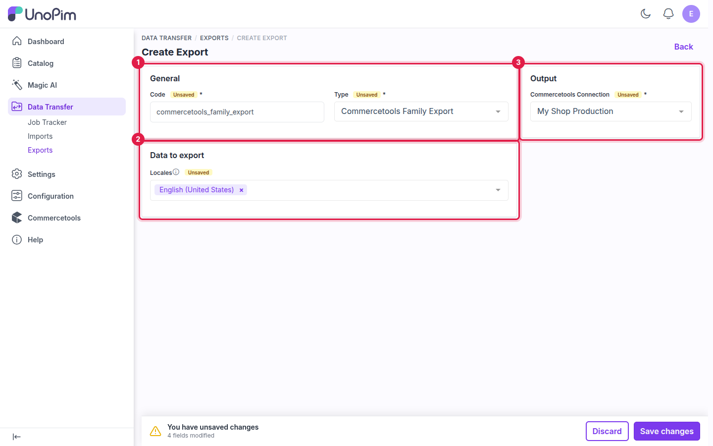
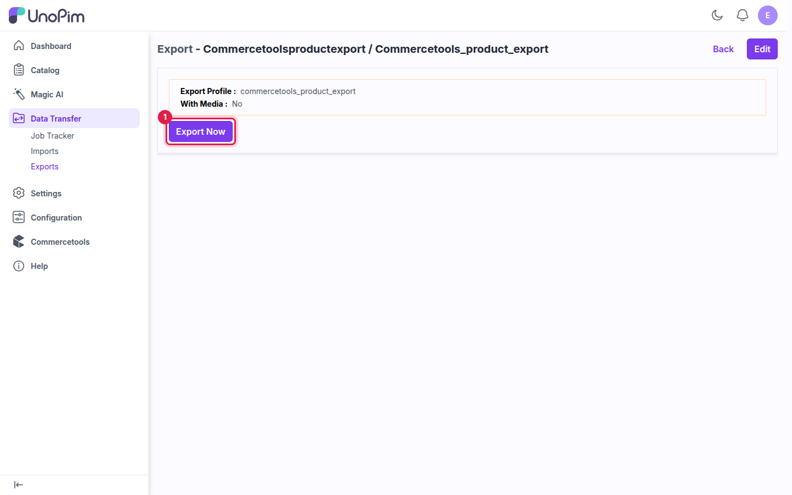

# Export: Families

The **Commercetools Family Export** job sends your UnoPim attribute families to commercetools as **product types**. Each family becomes a product type with the same key, together with its attributes and select-option labels.

**Run this job first.** A product can be exported only when its attribute family already exists in commercetools as a product type. The recommended order for a first sync is **families → categories → products**.

## Prerequisites

- An active connection. See [Setup Commercetools Connection](./setup).

## How to run the Family Export

### Step 1 - Go to Data Transfer → Exports

Navigate to **Data Transfer → Exports** from the main sidebar menu and click **Create Export**.

### Step 2 - Enter a Code and select the Type

Enter a unique **Code** for this job, then select **Commercetools Family Export** in the **Type** dropdown. All three commercetools export types are listed there.

**Example:** `commercetools_family_export`

### Step 3 - Configure the job

| Field | Card | Required | Notes |
|---|---|---|---|
| **Commercetools Connection** | Output | Yes | Select the connection to export to. Only active connections are listed. |
| **Locales** | Data to export | Yes | The locales for the product type name, attribute labels and option labels. |

### Step 4 - Save

Click **Save changes** in the unsaved-changes bar at the bottom of the page. commercetools jobs send data through the API, so no export file is created.

### Step 5 - Export Now

Click **Export Now** to start the job. It is added to the queue and runs in the background.

### Step 6 - Monitor progress

Track the job in **Data Transfer → Job Tracker**. When it completes, you see how many product types were created, updated and skipped.

## Things to know

- **Selected locales** — each product type is created once, with its labels stored in every selected locale.
- **Re-running the export** — product types that already exist in commercetools are updated, and new attributes are added. Nothing is duplicated.

## What's next

- [Export: Categories](./export-categories) — send your category tree.
- [Export: Products](./export-products) — send products once their families exist in commercetools.
