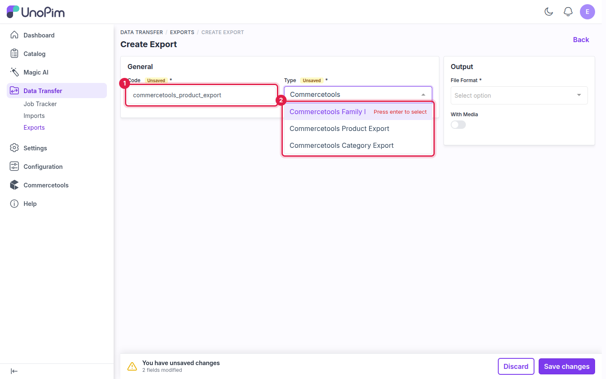
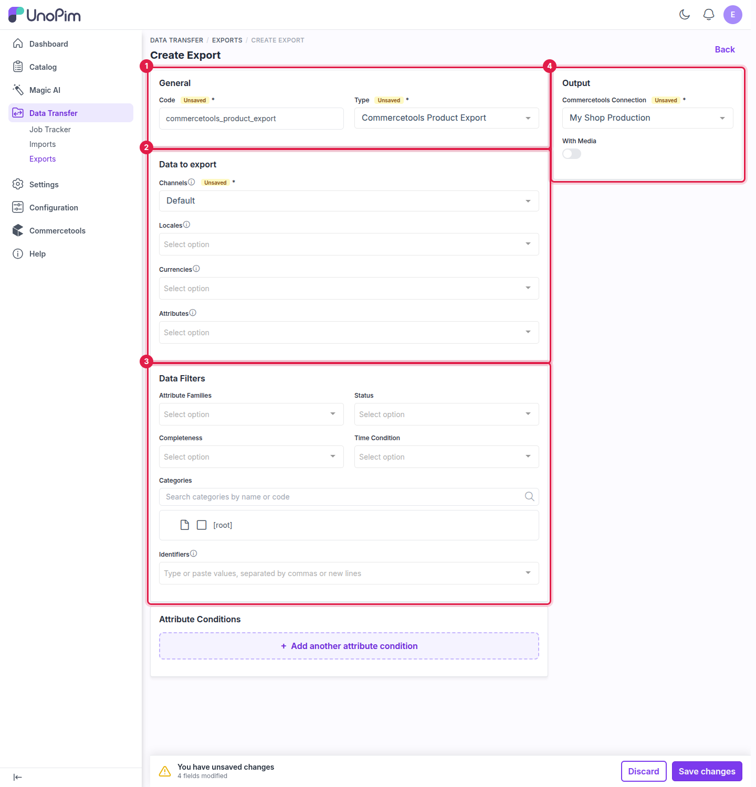
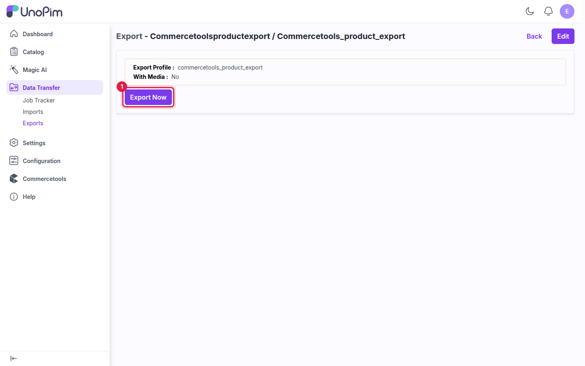

# Export: Products

The **Commercetools Product Export** job sends simple and configurable products to commercetools, using the connection's [Attribute Mapping](./attribute-mapping). Products that already exist in commercetools are updated instead of duplicated.

## Prerequisites

- An active connection with **SKU**, **Key** and **Name** mapped. See [Attribute Mapping](./attribute-mapping).
- The products' attribute families exported as product types. See [Export: Families](./export-families).
- Recommended: categories exported first. See [Export: Categories](./export-categories).

## How to run the Product Export

### Step 1 - Go to Data Transfer → Exports

Navigate to **Data Transfer → Exports** from the main sidebar menu and click **Create Export**.

### Step 2 - Enter a Code and select the Type

Enter a unique **Code**, then select **Commercetools Product Export** in the **Type** dropdown.

**Example:** `commercetools_product_export`

### Step 3 - Configure the job

The product export uses the same filters as the standard UnoPim product export, grouped into cards.

**Output**

| Field | Required | Notes |
|---|---|---|
| **Commercetools Connection** | Yes | The connection to export to. Only active connections are listed. |
| **With Media** | No | Turn on to send product images. When off, new products are created without images and images already in commercetools are left as they are. |

**Data to export**

| Field | Required | Notes |
|---|---|---|
| **Channels** | Yes | The channel whose values are exported. Select **one** channel only — a commercetools product carries the values of one channel. |
| **Locales** | No | The locales to export. Leave empty to export every locale of the selected channel. |
| **Currencies** | No | The currencies to export prices in. Leave empty to export every currency of the channel. Prices in other currencies already in commercetools are kept. |
| **Attributes** | No | Only the selected attributes are sent. Leave empty to send every attribute. |

**Data Filters**

| Field | Notes |
|---|---|
| **Attribute Families** | Export only products of the selected families. |
| **Status** | Export only enabled or only disabled products. |
| **Completeness** | Export only products that are complete on at least one, or on all, selected locales. |
| **Time Condition** | Export only products updated in the last N days, between two dates, or since the last export. |
| **Categories** | Export only products in the selected categories. |
| **Identifiers** | Paste SKUs, separated by commas or new lines, to export only those products. |

**Attribute Conditions**

Click **Add another attribute condition** to export only products that match every condition, e.g. `color` is `red`.

### Step 4 - Save

Click **Save changes** in the unsaved-changes bar at the bottom of the page.

### Step 5 - Export Now

Click **Export Now** to start the job. It is added to the queue and runs in the background.

### Step 6 - Monitor progress

Track the job in **Data Transfer → Job Tracker**. When it completes, the status changes to **Completed** and you see how many products were created, updated and skipped. Click **Download Log** to see exactly what was exported and why any product was skipped.

## How configurable products are exported

A configurable product and all of its variants are sent as **one** commercetools product. Each variant becomes a commercetools variant with its own SKU, attributes, prices, images and inventory quantity.

- **Variant SKUs in Identifiers** — entering a variant's SKU adds or updates only that variant in its parent product. The parent must already be exported; otherwise the variant is skipped with *"Parent product {SKU} does not exist on Commercetools. Export the parent product first."*
- **Attribute Conditions on variant attributes** — a condition on a variant attribute (for example `color`) sends the configurable product with **only the matching variants**. Other variants already in commercetools are left untouched. If no variant matches, the product is skipped.
- **Filters checked on the parent** — Attribute Families, Categories, Status and Completeness are checked on the configurable (parent) product.

## Things to know

- **Selected attributes and new products** — commercetools needs some fields to create a product, such as the name, the slug and any attribute the product type marks as required. If the **Attributes** filter leaves one of them out, existing products are still updated but new products are not created. The log lists the missing attributes.
- **Families without a product type** — products whose family has no matching product type in commercetools are skipped. Run the [family export](./export-families) or the [family import](./import-families) first.
- **Re-running the export** — existing products are updated, not duplicated, and new variants added in UnoPim are added to the existing product.
- **Multiple locales** — each product is created once, with its name, slug, description, SEO fields and localized attributes stored in every selected locale.

## Viewing exported products in commercetools

Log in to the [commercetools Merchant Center](https://mc.commercetools.com) and go to **Products**. The exported products appear with their variants, prices, images and descriptions. Switch the data locale to check translated values.

## What's next

- [Import: Products](./import-products) — bring commercetools products into UnoPim.
