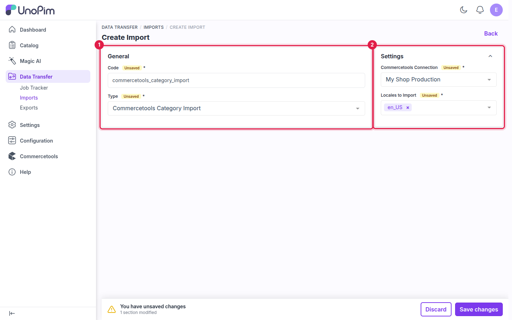
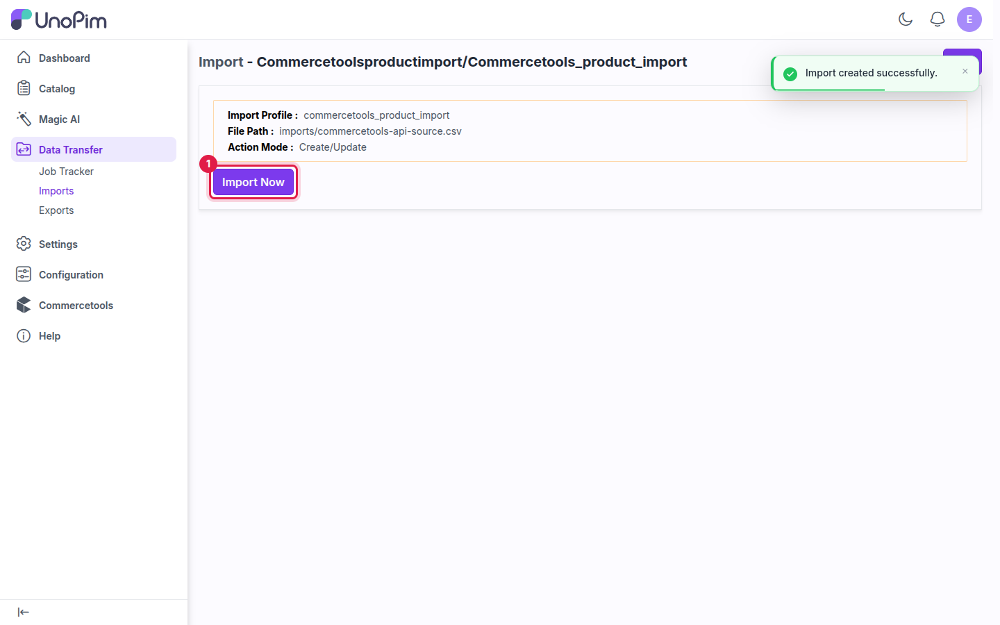

# Import: Categories

The **Commercetools Category Import** job brings the commercetools category tree into UnoPim. Parent categories are imported before their children. Values are written to the UnoPim category fields chosen on the connection's [Category Mapping](./category-mapping) tab, including any custom fields.

## Prerequisites

- An active connection. See [Setup Commercetools Connection](./setup).

## How to run the Category Import

### Step 1 - Go to Data Transfer → Imports

Navigate to **Data Transfer → Imports** from the main sidebar menu and click **Create Import**.

### Step 2 - Enter a Code and select the Type

Enter a unique **Code**, then select **Commercetools Category Import** in the **Type** dropdown.

**Example:** `commercetools_category_import`

### Step 3 - Configure the Settings

| Field | Required | Notes |
|---|---|---|
| **Commercetools Connection** | Yes | The connection to import from. Only active connections are listed. |
| **Locales to Import** | Yes | The locales whose names, slugs and descriptions you want to bring in. |

### Step 4 - Save

Click **Save changes** in the unsaved-changes bar at the bottom of the page.

### Step 5 - Import Now

Click **Import Now** to start the job.

### Step 6 - Monitor progress

Track the job in **Data Transfer → Job Tracker**. When it completes, you see how many categories were created, updated and skipped.

## Things to know

- **Category codes** — each commercetools category is matched to a UnoPim category by its key.
- **Missing parents** — a category whose parent can't be found is skipped.
- **Re-running the import** — categories imported before are updated, not duplicated.

## What's next

- [Import: Products](./import-products) — bring in products and their variants.
