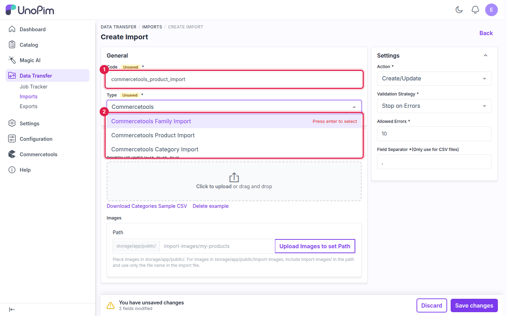
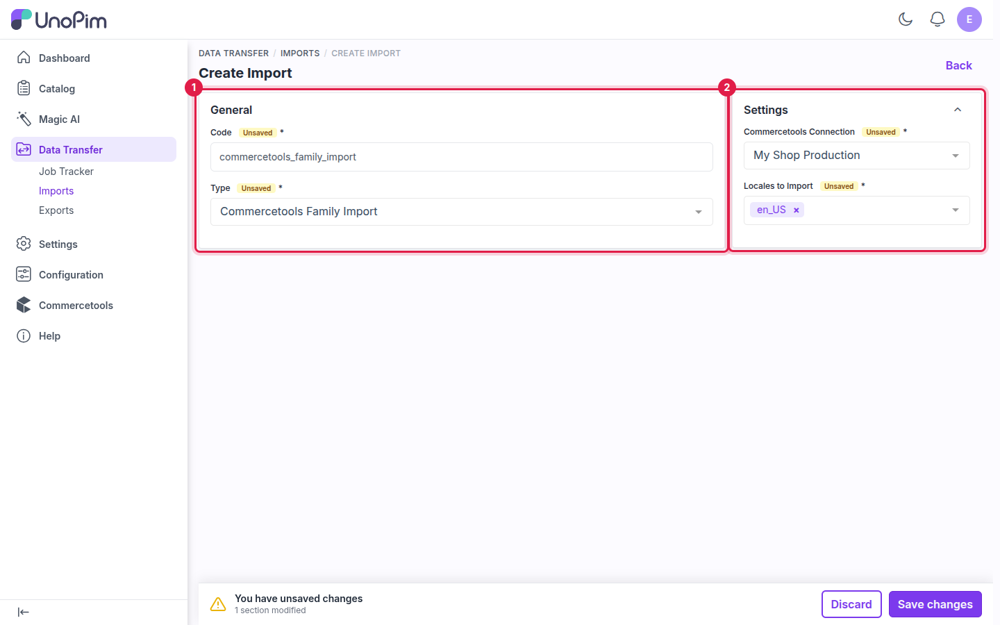
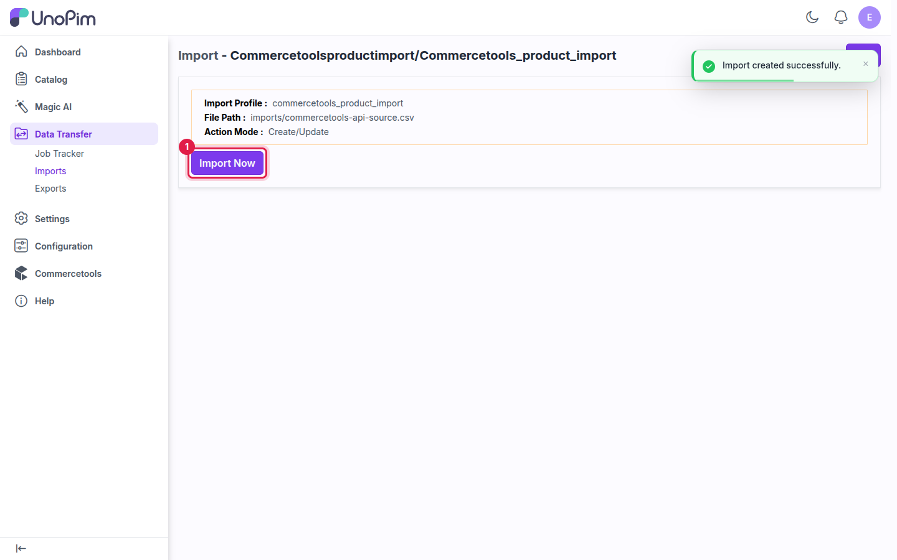

# Import: Families

The **Commercetools Family Import** job brings your commercetools **product types** into UnoPim as attribute families, with their attribute groups, attributes and select options.

**Run this job first** when importing. Products need their attribute family to exist in UnoPim. The recommended order is **families → categories → products**.

## Prerequisites

- An active connection. See [Setup Commercetools Connection](./setup).

## How to run the Family Import

### Step 1 - Go to Data Transfer → Imports

Navigate to **Data Transfer → Imports** from the main sidebar menu and click **Create Import**.

### Step 2 - Enter a Code and select the Type

Enter a unique **Code**, then select **Commercetools Family Import** in the **Type** dropdown. All three commercetools import types are listed there.

**Example:** `commercetools_family_import`

### Step 3 - Configure the Settings

| Field | Required | Notes |
|---|---|---|
| **Commercetools Connection** | Yes | The connection to import from. Only active connections are listed. |
| **Locales to Import** | Yes | The locales whose labels you want to bring in. |

commercetools import jobs read data from the API, so no import file is needed.

### Step 4 - Save

Click **Save changes** in the unsaved-changes bar at the bottom of the page.

### Step 5 - Import Now

Click **Import Now** to start the job. It is added to the queue and runs in the background.

### Step 6 - Monitor progress

Track the job in **Data Transfer → Job Tracker**. When it completes, you see how many families were created, updated and skipped.

## Things to know

- **Re-running the import** — families imported before are matched again and updated, not duplicated.
- **Attribute codes** — imported attributes get their codes from the commercetools attribute names, so later product imports and exports match them automatically.

## What's next

- [Import: Categories](./import-categories) — bring in the category tree.
