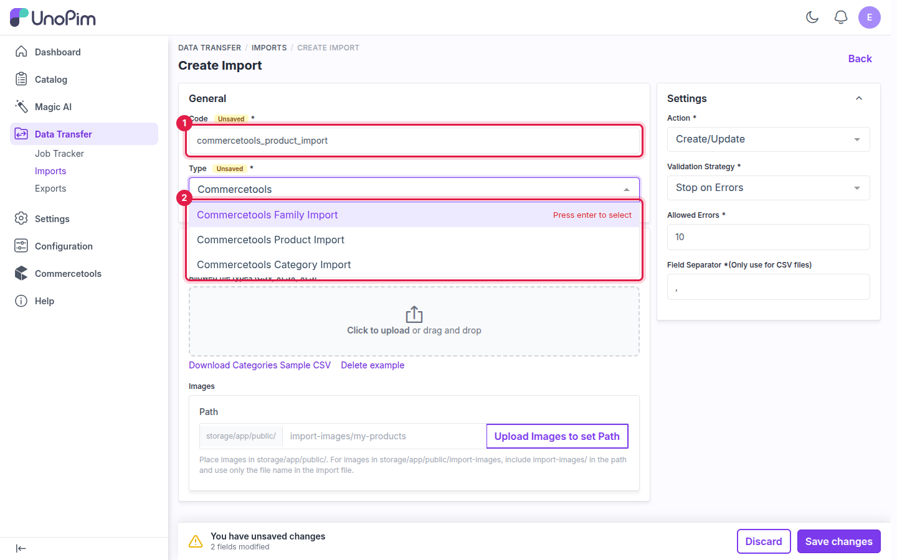
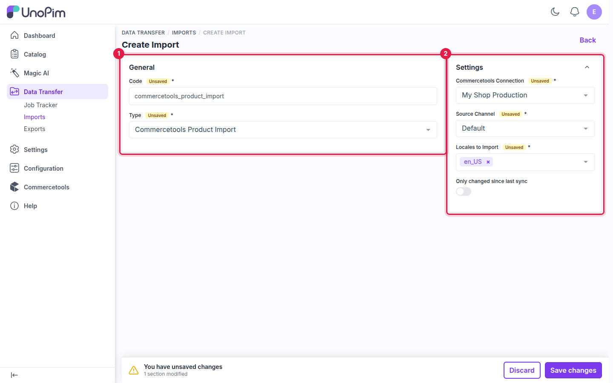
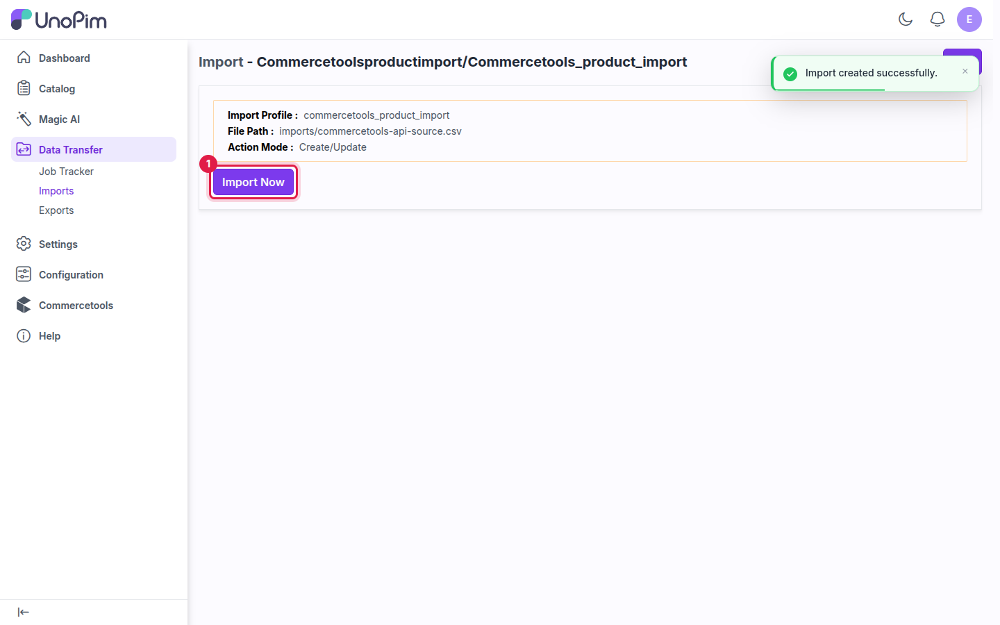

# Import: Products

The **Commercetools Product Import** job brings commercetools products and their variants into UnoPim, including unpublished (staged) changes, product images and inventory quantities. Values are written to the UnoPim attributes chosen on the connection's [Attribute Mapping](./attribute-mapping) tab.

## Prerequisites

- An active connection with **SKU**, **Key** and **Name** mapped. See [Attribute Mapping](./attribute-mapping).
- The products' families and categories already in UnoPim. See [Import: Families](./import-families) and [Import: Categories](./import-categories).

## How to run the Product Import

### Step 1 - Go to Data Transfer → Imports

Navigate to **Data Transfer → Imports** from the main sidebar menu and click **Create Import**.

### Step 2 - Enter a Code and select the Type

Enter a unique **Code**, then select **Commercetools Product Import** in the **Type** dropdown.

**Example:** `commercetools_product_import`

### Step 3 - Configure the Settings

| Field | Required | Notes |
|---|---|---|
| **Commercetools Connection** | Yes | The connection to import from. Only active connections are listed. |
| **Source Channel** | Yes | The UnoPim channel the imported product values are saved to. |
| **Locales to Import** | Yes | The locales whose values you want to bring in. Only locales of the selected channel are listed. |
| **Only changed since last sync** | No | Turn on to import only products changed in commercetools since the last successful import. |

### Step 4 - Save

Click **Save changes** in the unsaved-changes bar at the bottom of the page.

### Step 5 - Import Now

Click **Import Now** to start the job. It is added to the queue and runs in the background.

### Step 6 - Monitor progress

Track the job in **Data Transfer → Job Tracker**. When it completes, the status changes to **Completed** and you see how many products were created, updated and skipped.

## Things to know

- **Variant structure** — an imported configurable product is built against the variant structure its family already defines in UnoPim, so it matches a product created in the admin.
- **Product images** — images are downloaded from commercetools and saved to the mapped image, gallery or DAM asset attribute.
- **Inventory** — when **Inventory quantity** is mapped, the quantity of each SKU is read from commercetools and saved to that attribute.
- **Re-running the import** — products imported before are matched again and updated, not duplicated.

## What's next

- [Export: Products](./export-products) — send changes made in UnoPim back to commercetools.
