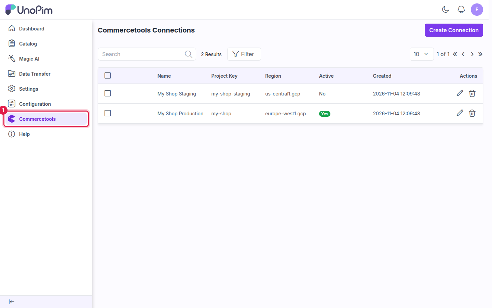

# Installation

## Requirements

| Requirement | Version |
|---|---|
| **UnoPim** | 3.1.x (compatible with 3.0.x) |
| **PHP** | 8.4.1 or higher |
| **Laravel** | 13.x |
| **commercetools** | A project with an API client. See [commercetools API Client](./commercetools-setup). |

A running queue worker is required, because export and import jobs are dispatched to the queue.

> **Upgrading from UnoPim 2.x?** Upgrade UnoPim to 3.x first by following its `UPGRADE.md`, then replace the `packages/Webkul/Commercetools` folder with the latest connector release and run the setup commands below again. Your connections and mappings are kept.

## Steps

### 1. Extract the extension

Unzip the extension package. Rename the extracted folder to `Commercetools` and move it into your UnoPim project:

```
/your-unopim-project
└── packages/
    └── Webkul/
        └── Commercetools/
```

### 2. Register the service provider

Open `bootstrap/providers.php` and add the following entry:

```php
use Webkul\Commercetools\Providers\CommercetoolsServiceProvider;

return [
    // ... existing providers ...
    CommercetoolsServiceProvider::class,
];
```

### 3. Register PSR-4 autoload

Open your project-level `composer.json` and add the following entry under `autoload.psr-4`:

```json
"Webkul\\Commercetools\\": "packages/Webkul/Commercetools/src"
```

### 4. Run setup commands

Run the following commands in order from the project root:

**Dump Composer autoload**

```bash
composer dump-autoload
```

**Run the database migrations**

```bash
php artisan migrate
```

This creates the connector's tables (connections, product types, categories, product mappings and the sync log).

**Clear the application cache**

```bash
php artisan optimize:clear
```

**Start (or restart) the queue worker**

```bash
php artisan queue:work
```

If a queue worker is already running, run `php artisan queue:restart` instead so it loads the new code.

> **Tip:** On a live server, run the queue worker under a process manager such as Supervisor, so it restarts automatically after a crash or deploy.

## Verify

Open the UnoPim admin panel and confirm the following:

- A **Commercetools** entry appears in the sidebar. It opens the **Commercetools Connections** page.

  

- **Data Transfer → Exports** lists the export types **Commercetools Family Export**, **Commercetools Category Export** and **Commercetools Product Export**.
- **Data Transfer → Imports** lists the import types **Commercetools Family Import**, **Commercetools Category Import** and **Commercetools Product Import**.
- Under **Settings → Roles**, the **Commercetools** permission group is available. See [Connector Settings](./configuration#user-permissions).

If the menu entry is missing, run `php artisan optimize:clear` and reload the admin panel.

Continue to [Setup Commercetools Connection](./setup) once the menu entry appears.
