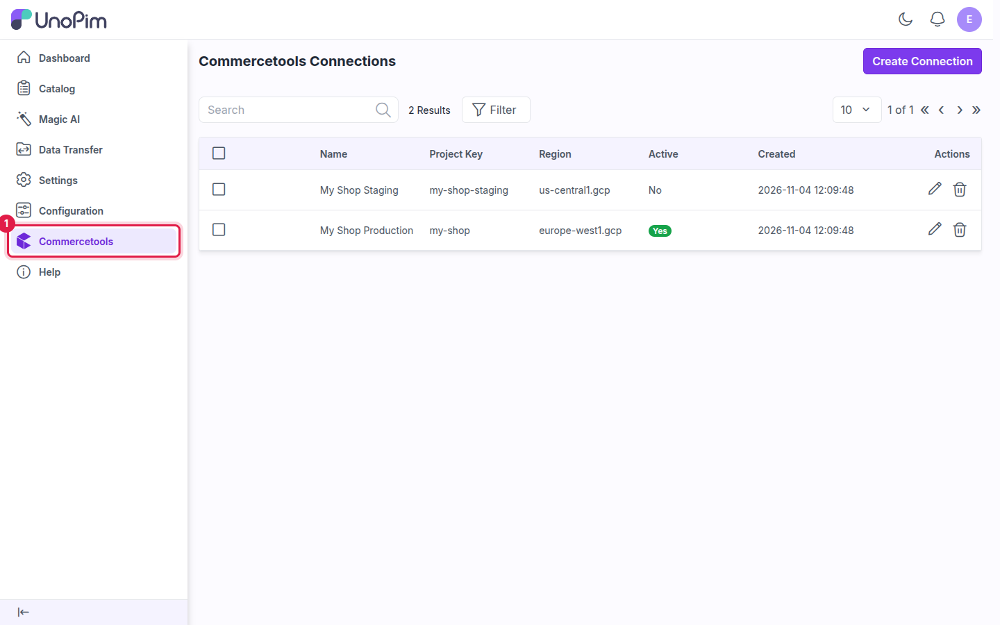
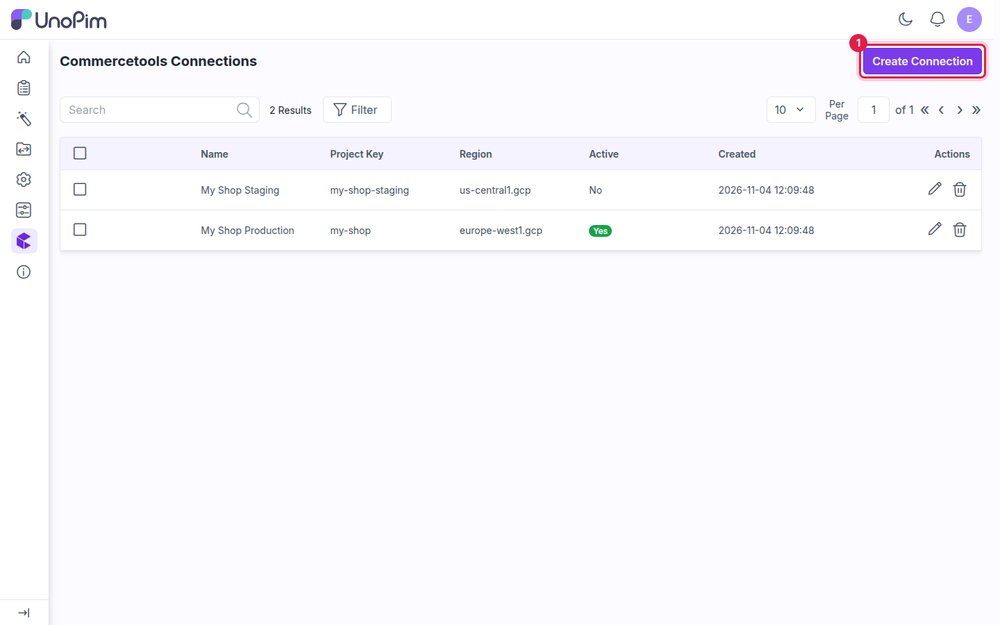
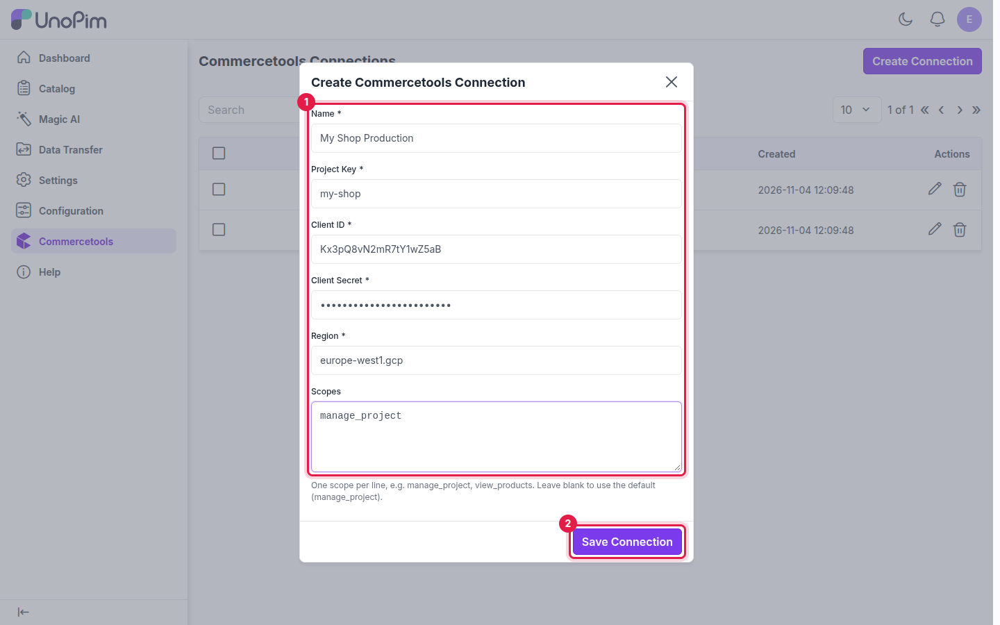
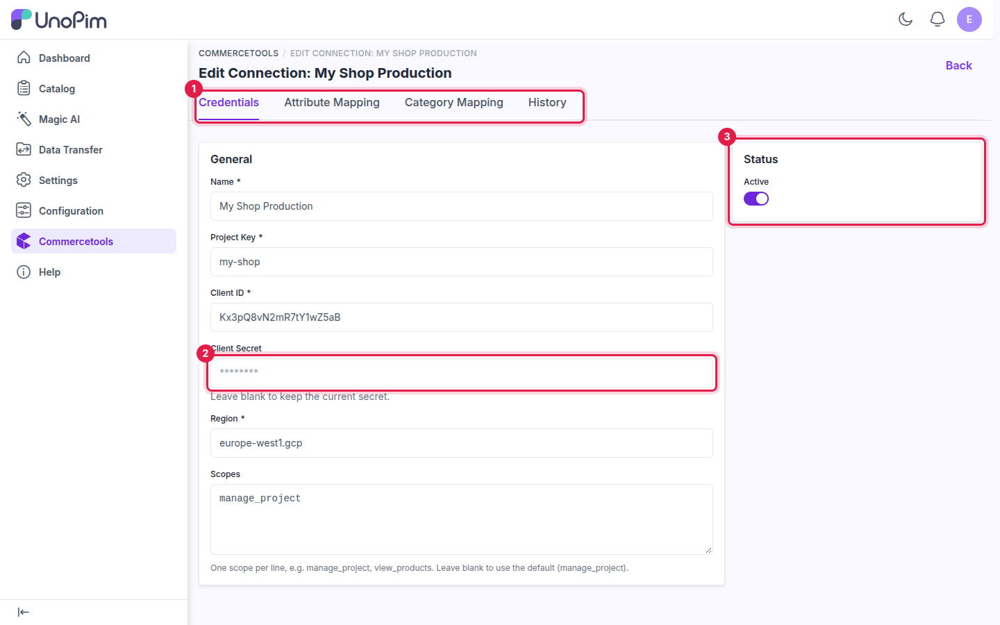
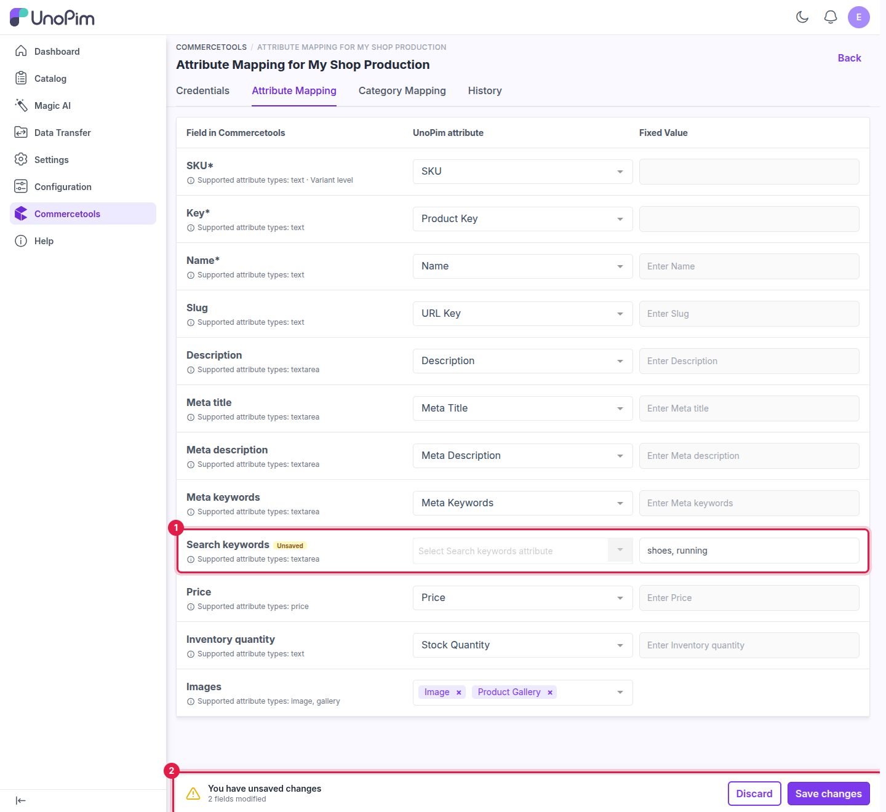
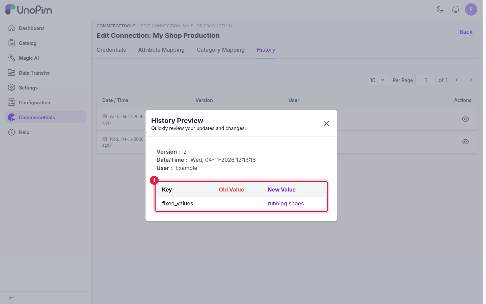

# Setup Commercetools Connection

Once the connector is installed, connect your commercetools project to UnoPim by creating a **connection**. Each connection stores the API client details from [commercetools API Client](./commercetools-setup) and holds the attribute and category mapping for that project. You can create several connections, one per commercetools project.

## Step 1 — Open the Connections page

Log in to your UnoPim admin panel and click **Commercetools** in the sidebar. The **Commercetools Connections** page opens.

## Step 2 — Click Create Connection

Click **Create Connection** in the top-right corner.

## Step 3 — Fill in the API client details

| Field | What to enter |
|---|---|
| **Name** | A label for this project in UnoPim (e.g., `My Shop Production`). |
| **Project Key** | The `project_key` from your API client. Lowercase letters, digits, hyphens and underscores only. |
| **Client ID** | The `client_id` from your API client. A Project Key and Client ID pair can be used by only one connection. |
| **Client Secret** | The `secret` from your API client. Stored encrypted and never shown after saving. |
| **Region** | Your project region, e.g. `europe-west1.gcp` or `us-east-2.aws`. |
| **Scopes** | One scope per line, e.g. `manage_project`. Leave blank to use `manage_project`. |

> **Note:** You don't need to add the project key to a scope. Writing `manage_project` is enough — UnoPim adds `:your-project-key` for you. A scope copied from commercetools, such as `manage_project:my-shop`, also works.

## Step 4 — Save the connection

Click **Save Connection**. The details are checked live against commercetools before they are stored:

| Message | What it means |
|---|---|
| **The provided credentials are not valid for this commercetools project.** | The project key, client ID, secret or scopes are wrong. Nothing is saved. |
| **The commercetools API is not reachable. Check the region and try again.** | The region is wrong, or commercetools could not be reached at that moment. |

After saving, the connection appears in the **Commercetools Connections** grid.

## The connection edit page

Click the **Edit** icon on a connection's row. The edit page has four tabs:

| Tab | What it holds |
|---|---|
| **Credentials** | Name, project key, client ID, client secret, region, scopes and the **Active** switch. |
| **Attribute Mapping** | Which UnoPim attribute feeds each commercetools product field. See [Attribute Mapping](./attribute-mapping). |
| **Category Mapping** | Which UnoPim category field feeds each commercetools category field. See [Category Mapping](./category-mapping). |
| **History** | A log of every change made to this connection and its mappings. |

### Editing the credentials

- **Client Secret** — the saved secret is never shown. Leave the field blank to keep it, or type a new one to replace it.
- **Active** — only active connections can be selected in export and import jobs. Turn it off to pause a connection without deleting it.
- Every save of the **Credentials** tab is checked against commercetools again, using the stored secret if you left the field blank.

### Saving changes

When you change a field on any tab, a **You have unsaved changes** bar appears at the bottom of the page and the changed fields are marked **Unsaved**. Click **Save changes** to store them, or **Discard** to revert.

## Connection history

Open the **History** tab to see every version of the connection: the date and time, who made the change, and the old and new value of each field. Click the **view** icon on a row to see what changed. For the mappings, only the fields that actually changed are listed. The client secret is never saved in history.

## Managing connections

Each connection appears as a row in the **Commercetools Connections** grid with columns for **Name**, **Project Key**, **Region**, **Active** and **Created**.

| Action | How |
|---|---|
| **Edit** | Click the **Edit** icon to update the credentials and mappings. |
| **Delete** | Click the **Delete** icon to permanently remove the connection and its mappings. |
| **Test** | Click the **Test** action, the last action on the row, to log in to commercetools with the saved details. The result is shown as a message: **Connection successful.**, or the reason it failed. |
| **Update Status** | Select several rows, then choose **Update Status → Active / Inactive** to switch them on or off at once. |
| **Delete (mass)** | Select several rows, then choose **Delete** to remove them at once. |

To connect more than one commercetools project, repeat the steps above and create a separate connection for each project.

## What's next

- [Attribute Mapping](./attribute-mapping) — map commercetools product fields to UnoPim attributes.
- [Category Mapping](./category-mapping) — map commercetools category fields to UnoPim category fields.
