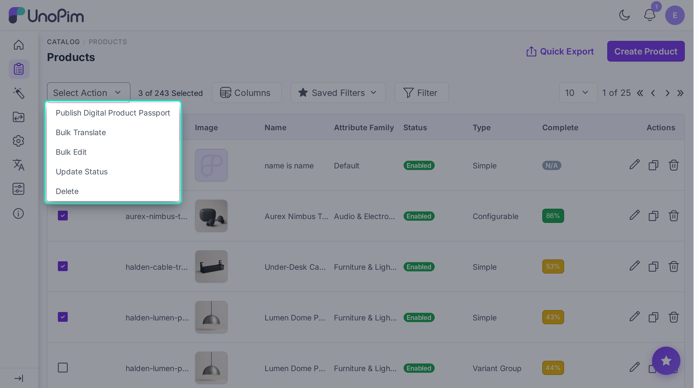

# Translate many products

Translate many products at once from the products list.

> **Before you start.** Add a [DeepL key](./credentials), tick **AI Translate** on every field you want translated (see [Mark fields](./attribute-setup)), and your role needs **bulk translate** permission.

## Steps

1. Open **Catalog > Products**.
2. Tick the products you want to translate.
3. Open the **Select Action** menu and click **Bulk Translate**.

A wizard opens.

### Step 1 - Source + fields

Pick:

- **Source channel** - where the original text lives.
- **Locale** - what language to translate from.
- **Translatable attributes** - pick the fields to translate (e.g. *name*, *description*, *short_description*).

Click **Next**.

### Step 2 - Target

Pick:

- **Target channels** - one or more.
- **Target locales** - one or more. **Select all** picks every available language.

Click **Bulk Translate**.

You'll see *X product(s) queued for DeepL translation.*

### Step 3 - Progress

The wizard switches to a progress view - *Translating products…* with a progress bar, a percentage, and *X of Y batches complete*.

<!-- TODO: capture screenshot - bulk-translate-progress.png - progress view after clicking Bulk Translate -->

- While it runs you'll see *Processing… Please wait.* You can close the popup - the job keeps running in the background.
- When it's done the title changes to *Translation complete!* (or *Translation failed.* if any batch had errors). Click **Close**.

## Watch the progress later

Open **Settings > Data Transfer > Tracker**. The job appears there too. See [Watch progress](./tracker) for details.
