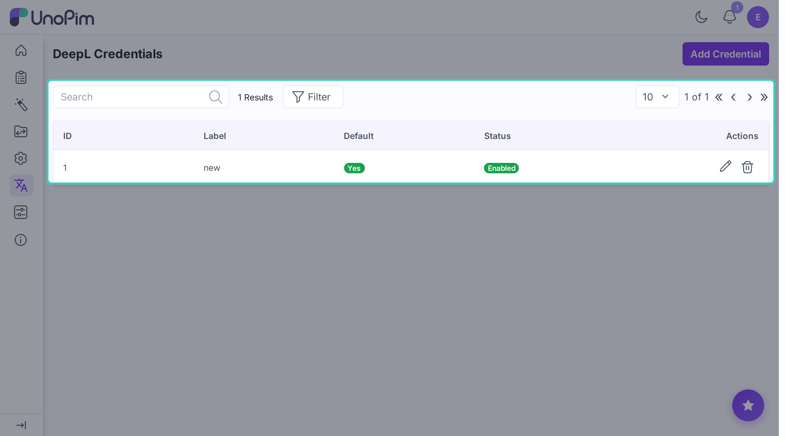
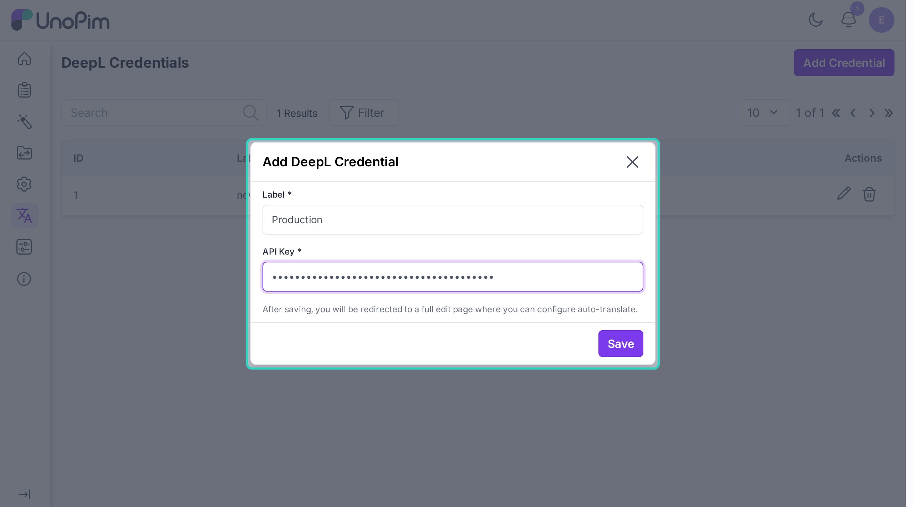
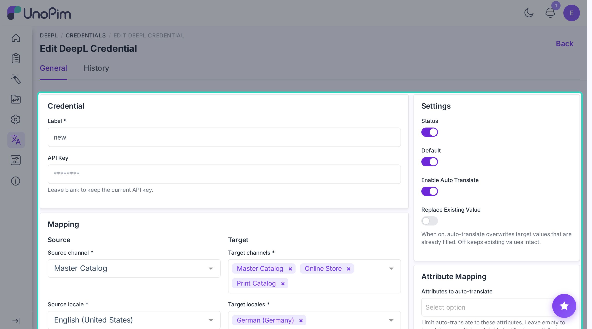
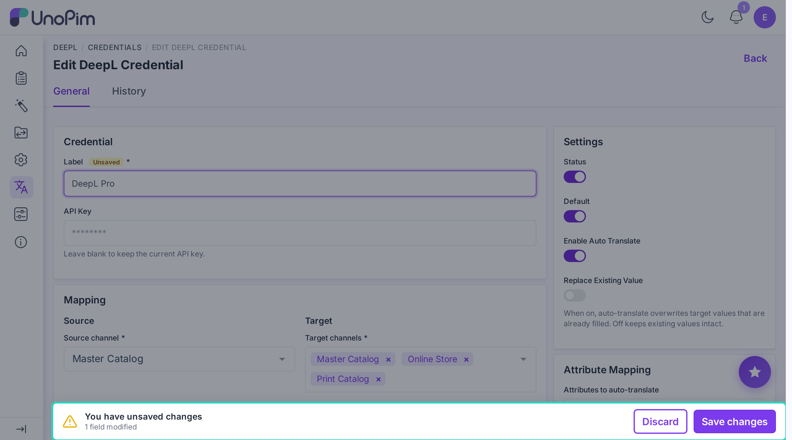
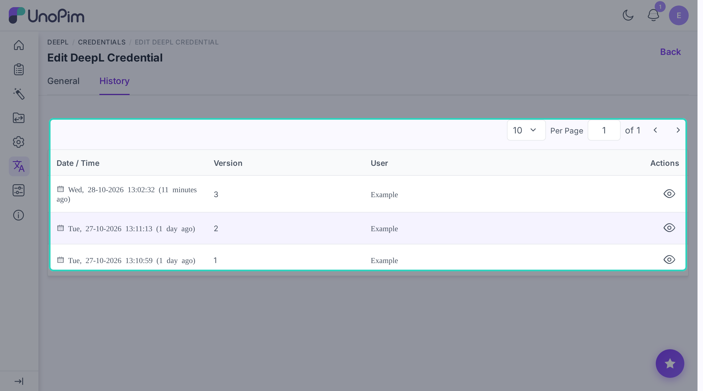

# Add your DeepL key

This is where you store your DeepL API key. Add at least one key before you can translate anything.

**Open it from:** *DeepL > Credentials*

---

## The credentials page

Each row in the list shows one key:

- **Label** - the name you gave it.
- **Default** - whether this is the key used for automatic translation.
- **Status** - on or off.

You can search by label, sort columns, or click **Filter** to narrow the list. Click a row (or its pencil icon) to edit it, the trash icon deletes it.

---

## Add a key

Click **+ Add Credential** in the top-right corner.

Fill in:

- **Label** - any name you want, e.g. *Production*.
- **API Key** - paste your DeepL key.

Click **Save**.

The edit page opens straight away (no page reload), where you can switch on auto-translate.

> The first key you add becomes the **default** automatically.

---

## Edit a key

Click the pencil icon on any row.

The page has two tabs at the top - **General** (shown above) and **History**. General is split into panels: **Credential** and **Mapping** on the left, **Settings** and **Attribute Mapping** on the right.

### Credential

- **Label** - change the name.
- **API Key** - leave blank to keep your current key. Type a new one to replace it.

> When you type a new key, the extension checks it with DeepL before saving. If DeepL rejects it you'll see an error (e.g. *Invalid DeepL API key.*) and nothing is changed.

### Settings (top right)

| Switch | What it does |
|--|--|
| **Status** | Turn the key on or off. Off keys are ignored everywhere. |
| **Default** | Only one key can be the default. The default key is used for automatic translation. |
| **Enable Auto Translate** | Turn on automatic translation after import / save. Shown only on the default key. |
| **Replace Existing Value** | When on, auto-translate overwrites target values that are already filled. Off keeps existing values intact. Shown only when auto-translate is on. |

On a key that isn't the default, the panel shows a note instead: auto-translate can only be set up on the default key.

### Mapping (left side, default key only)

Tell the extension which language to translate **from** and **into**:

- **Source** - **Source channel** + **Source locale**: where the original text lives.
- **Target** - **Target channels** + **Target locales**: where translations should be saved.

The mapping drives auto-translate, and it's also used to pre-fill the source and target in the translate wizards so you don't pick the same values every time. When auto-translate is on, every mapping field is required.

### Attribute Mapping (right side, below Settings - when auto-translate is on)

By default, auto-translate covers **every** AI-translatable text or textarea attribute on the product (i.e. any attribute with **AI Translate** ticked - see [Mark fields](./attribute-setup)).

If you only want auto-translate to touch a few of those attributes, pick them in **Attributes to auto-translate**. Leave the field empty to keep the default behaviour.

This only narrows the list - it can't add attributes that aren't flagged **AI Translate**.

### Save your changes

The edit page has no Save button of its own. As soon as you change something, UnoPim's save bar appears at the bottom of the screen:

- **Save changes** - store the changes. You'll see *Credential updated.*
- **Discard** - throw them away.

---

## Delete a key

Click the trash icon on a row and confirm.

> You can't delete the default key while it's the only active key. Add or turn on another key first.

---

## See change history

The edit page has a **History** tab that lists every change made to this key - label edits, status flips, mapping changes. Auto-translate changes are shown field by field (e.g. *Source Locale*, *Target Locales*, *Attributes to Auto-Translate*). Your API key itself is never shown there, and saving without changing anything doesn't add an entry.

