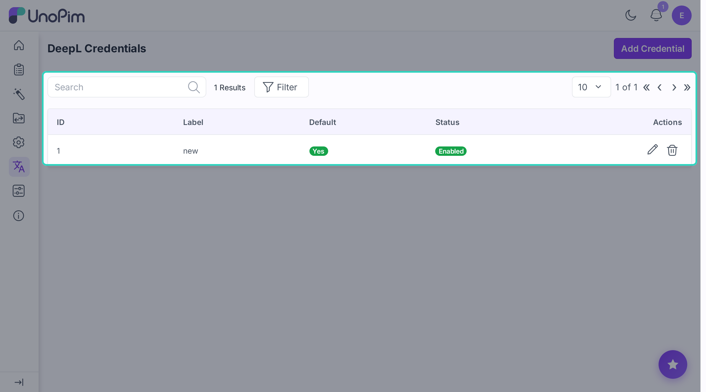
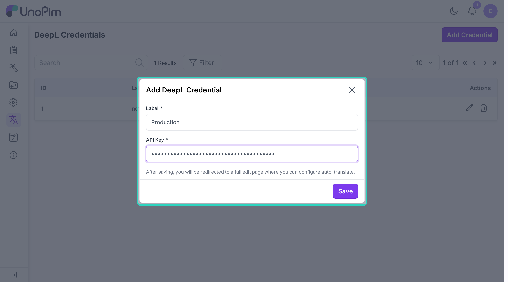
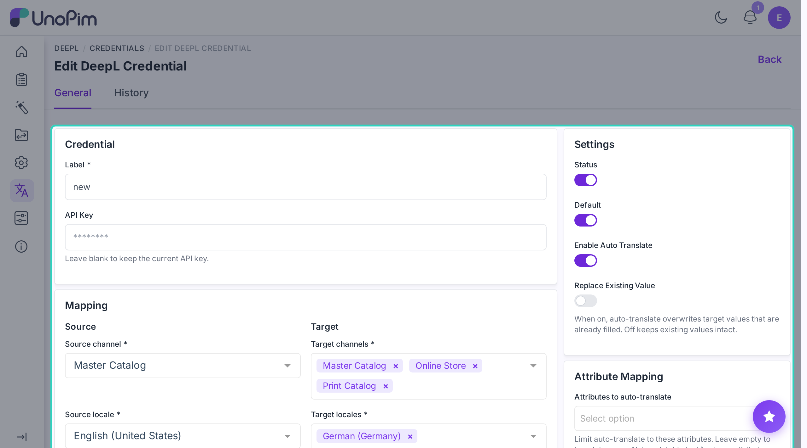
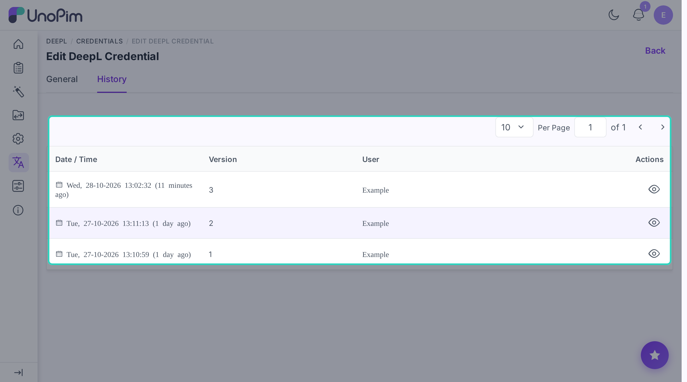

# Add your DeepL key

This is where you store your DeepL API key. Add at least one key before you can translate anything.

**Open it from:** *DeepL → Credentials*

---

## The credentials page

Each row in the list shows one key:

- **Label** — the name you gave it.
- **Default** — whether this is the key used for automatic translation.
- **Status** — on or off.

You can search by label, sort columns, or click **Filter** to narrow the list. The pencil icon edits a row, the trash icon deletes it.

---

## Add a key

Click **+ Add Credential** in the top-right corner.

Fill in:

- **Label** — any name you want, e.g. *Production*.
- **API Key** — paste your DeepL key.

Click **Save**.

> The extension checks the key with DeepL before saving. If the key is wrong you'll see an error and nothing is stored.

After saving, you land on the edit page where you can switch on auto-translate.

---

## Edit a key

Click the pencil icon on any row.

The page has two tabs at the top — **General** (shown above) and **History**. General is split into four panels.

### Credential

- **Label** — change the name.
- **API Key** — leave blank to keep your current key. Type a new one to replace it.

### Settings (top right)

| Switch | What it does |
|--|--|
| **Status** | Turn the key on or off. Off keys are ignored everywhere. |
| **Default** | Only one key can be the default. The default key is used for automatic translation. |
| **Enable Auto Translate** | Turn on automatic translation after import / save. |
| **Replace Existing Value** | When on, auto-translate overwrites target values that are already filled. Off keeps existing values intact. |

### Mapping (only on the default key, when auto-translate is on)

Tell the extension which language to translate **from** and **into**:

- **Source channel** + **Source locale** — where the original text lives.
- **Target channels** + **Target locales** — where translations should be saved.

### Attribute Mapping (right side, next to Mapping)

By default, auto-translate covers **every** AI-translatable text or textarea attribute on the product (i.e. any attribute with **AI Translate** ticked — see [Mark fields](./attribute-setup)).

If you only want auto-translate to touch a few of those attributes, pick them in **Attributes to auto-translate**. Leave the field empty to keep the default behaviour.

This only narrows the list — it can't add attributes that aren't flagged **AI Translate**.

Click **Save changes** in the save bar at the bottom of the page. The edit page has no Save button of its own; the save bar appears as soon as you change a field.

> [!NOTE]
> Auto-translate uses the settings of the default key. If no active key is marked default, the first active key's settings are used.

---

## Test the key

The edit page has a **Test Connection** button. Click it any time to check the key still works and see how much of your DeepL quota you've used.

---

## Delete a key

Click the trash icon on a row and confirm.

> You can't delete the default key while it is the only active key. Add or turn on another key first.

---

## See change history

The edit page has a **History** tab that lists every change made to this key — label edits, status flips, mapping changes. Your API key itself is never shown there.

