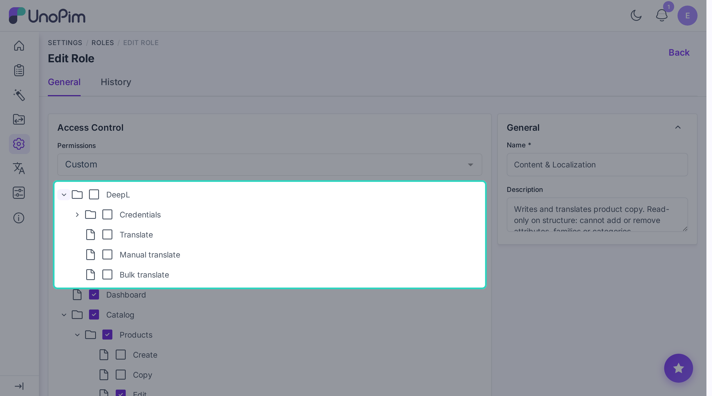

# Installation

This page is for installing the extension. Once it's installed, see [Add your DeepL key](./credentials) to start using it.


## Steps

### 1. Drop the package in place

Place the unzipped extension at:

```
packages/Webkul/DeepLTranslation/
```

### 2. Add it to composer.json

In your project's root `composer.json`:

```json
"autoload": {
    "psr-4": {
        "Webkul\\DeepLTranslation\\": "packages/Webkul/DeepLTranslation/src"
    }
}
```

### 3. Register the provider

In `bootstrap/providers.php`:

```php
Webkul\DeepLTranslation\Providers\DeepLTranslationServiceProvider::class,
```

> [!NOTE]
> This registers `DeepLTranslationServiceProvider` in Laravel so the extension can bootstrap its services, routes, and package configuration during application startup.

### 4. Run the install command

```bash
composer dump-autoload
php artisan deepl:install
```

| Command | Purpose |
|---|---|
| `composer dump-autoload` | Regenerates Composer's autoloader mapping to include the newly added namespace. |
| `php artisan deepl:install` | Installs the DeepL PHP SDK (`deeplcom/deepl-php`) through Composer if it is missing, runs migrations, and clears the view, route and config caches. |

> [!NOTE]
> If the SDK install fails (for example `composer` is not on the `PATH`), run `composer require deeplcom/deepl-php:^1.18` manually and run `php artisan deepl:install` again.

### 5. Keep a queue worker running

```bash
php artisan queue:work
```

| Command | Purpose |
|---|---|
| `php artisan queue:work` | Starts a queue worker to process DeepL translation jobs in the background. Every Apply, bulk and auto-translate save runs as a queued job. |

In production use Supervisor / systemd / Horizon.

### 6. Give your role permission

Open **Settings → Roles**, edit the role, and tick the DeepL permissions you want them to have:

- **DeepL → Credentials** - view DeepL keys, with **Create**, **Edit** (includes Test Connection and Set Default) and **Delete**.
- **DeepL → Translate** - use the per-field button, the product wizard, and the AI agent tile.
- **DeepL → Manual translate** - access to the manual translate endpoints. There is no menu entry for a manual translate page in this version.
- **DeepL → Bulk translate** - translate many products at once.



Without these the menu and buttons stay hidden.

## Check it worked

1. **Menu shows up.** Open the admin panel - a **DeepL** menu appears in the sidebar.
2. **Add a key works.** Open **DeepL → Credentials → Add Credential** and save your key. If the key is wrong, you see a clear error.
3. **Per-field button shows up.** Open any product. A **DeepL Translate** button appears next to translatable fields.
4. **Bulk action shows up.** Open **Catalog → Products**, tick a row, and **Bulk Translate** appears in the actions menu.

If any of these don't work, see [Troubleshooting](./troubleshooting).
