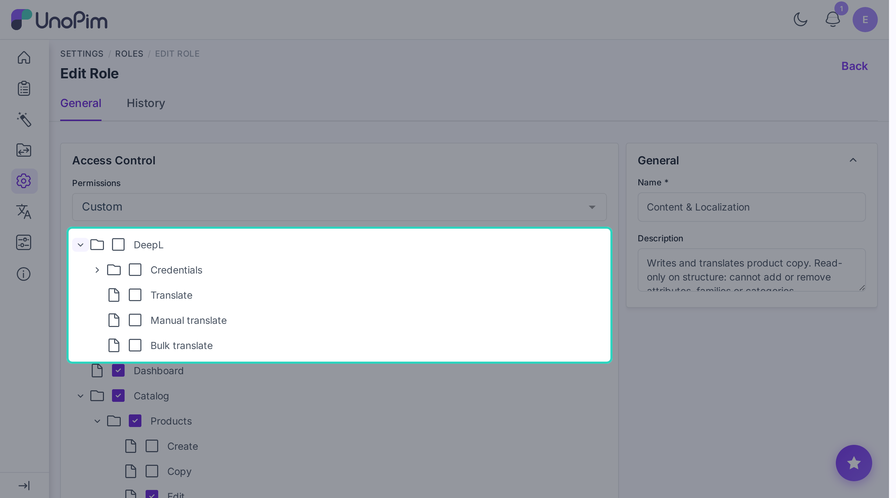

# Installation

This page is for installing the extension. Once it's installed, see [Add your DeepL key](./credentials) to start using it.


## Steps

### 1. Drop the package in place

Place the unzipped extension at:

```
packages/Webkul/DeepLTranslation/
```

### 2. Add it to composer.json

In your project's root `composer.json`:

```json
"autoload": {
    "psr-4": {
        "Webkul\\DeepLTranslation\\": "packages/Webkul/DeepLTranslation/src"
    }
}
```

### 3. Register the provider

In `bootstrap/providers.php`:

```php
Webkul\DeepLTranslation\Providers\DeepLTranslationServiceProvider::class,
```

> [!NOTE]
> This registers `DeepLTranslationServiceProvider` in Laravel so the extension can bootstrap its services, routes, and package configuration during application startup.

> [!WARNING]
> Don't add the extension to `config/concord.php`. It registers itself from the provider above, so a Concord entry would load it twice.

### 4. Run the install command

```bash
composer dump-autoload
php artisan deepl:install
```

| Command | Purpose |
|---|---|
| `composer dump-autoload` | Regenerates Composer's autoloader mapping to include the newly added namespace. |
| `php artisan deepl:install` | Installs the DeepL PHP SDK (`deeplcom/deepl-php`) if it's missing, runs the migrations, and clears the view, route, and config caches. |

You don't need to install the DeepL SDK yourself - `deepl:install` does it for you.

> [!TIP]
> If the SDK install fails (for example, `composer` isn't on the server's `PATH`), run `composer require deeplcom/deepl-php` by hand, then run `php artisan deepl:install` again.

### 5. Keep a queue worker running

```bash
php artisan queue:work
```

| Command | Purpose |
|---|---|
| `php artisan queue:work` | Starts a queue worker to process DeepL translation jobs in the background. |

In production use Supervisor / systemd / Horizon.

### 6. Give your role permission

Open **Settings > Roles**, edit the role, and tick the DeepL permissions you want them to have:

- **Credentials** - see the DeepL menu and the credentials list.
  - **Create** - add a DeepL key.
  - **Edit** - change a key and its auto-translate settings.
  - **Delete** - remove a key.
- **Translate** - use the per-field button, the product wizard, and the AI agent tool.
- **Bulk translate** - translate many products at once.



Without these the menu and buttons stay hidden.

## Check it worked

1. **Menu shows up.** Open the admin panel - a **DeepL** menu appears in the sidebar.
2. **Add a key works.** Open **DeepL > Credentials > Add Credential** and save your key. The edit page opens straight after.
3. **Per-field button shows up.** Open any product. A **DeepL Translate** button appears next to translatable fields.
4. **Bulk action shows up.** Open **Catalog > Products**, tick a row, and **Bulk Translate** appears in the **Select Action** menu.

If any of these don't work, see [Troubleshooting](./troubleshooting).
