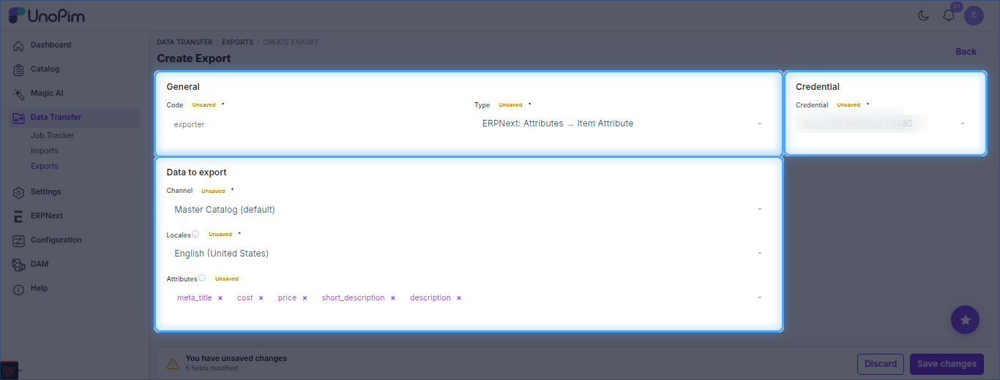
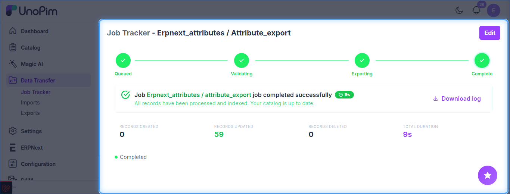

# UnoPim - Export Attributes to ERPNext

Exports UnoPim attributes and their options to ERPNext as **Item Attributes**. Run it before exporting products so variant attributes already exist.

The job type is listed as **ERPNext: Attributes → Item Attribute**.

**Prerequisite:** set up your [credentials](./setup-credentials.md) first.

## Steps

1. Go to **Data Transfer → Exports** and click **Create Export**.
2. Enter a unique **Code** and select **ERPNext: Attributes → Item Attribute** as the type.
3. Set the filters below, then click **Save changes**.
4. Click **Export Now** to run the job.

## Filters

| Filter | Purpose |
| --- | --- |
| **Credential** | ERPNext site to export to. *(required)* |
| **Channel** | Channel the data is taken from. *(required)* |
| **Locales** | Locale used for labels. *(required)* |
| **Attributes** | Only the selected attributes are exported. |

## Track the Job

Follow progress in **Data Transfer → Job Tracker**, which shows the created / updated counts and a downloadable log.

