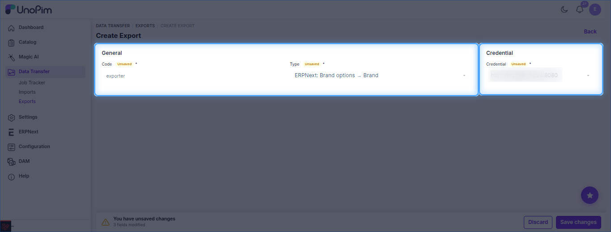
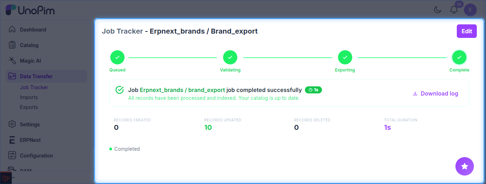

# UnoPim - Export Brands to ERPNext

Exports the options of your UnoPim brand attribute to ERPNext as **Brand** records.

The job type is listed as **ERPNext: Brand options → Brand**.

**Prerequisites:** set up your [credentials](./setup-credentials.md) and choose the brand attribute in Brand Mapping (**ERPNext → Credentials → Edit → ERPNext Attribute Mapping**).

## Steps

1. Go to **Data Transfer → Exports** and click **Create Export**.
2. Enter a unique **Code** and select **ERPNext: Brand options → Brand** as the type.
3. Set the filters below, then click **Save changes**.
4. Click **Export Now** to run the job.

## Filters

| Filter | Purpose |
| --- | --- |
| **Credential** | ERPNext site to export to. *(required)* |

No other filters apply - all options of the mapped brand attribute are exported.

## Track the Job

Follow progress in **Data Transfer → Job Tracker**, which shows the created / updated counts and a downloadable log.

