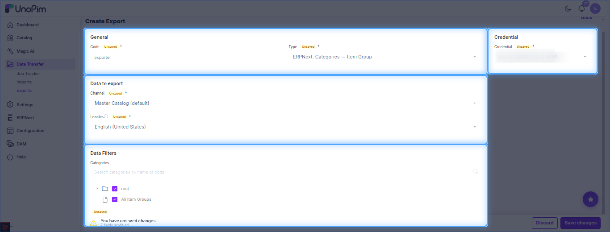
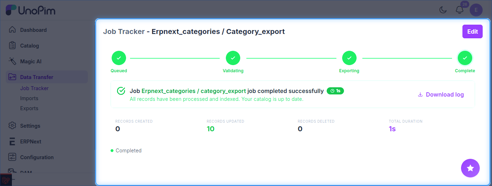

# UnoPim - Export Categories to ERPNext

Exports UnoPim categories to ERPNext as **Item Groups**. Run it before exporting products, since each product's Item Group comes from its first category.

The job type is listed as **ERPNext: Categories → Item Group**.

**Prerequisite:** set up your [credentials](./setup-credentials.md) first.

## Steps

1. Go to **Data Transfer → Exports** and click **Create Export**.
2. Enter a unique **Code** and select **ERPNext: Categories → Item Group** as the type.
3. Set the filters below, then click **Save changes**.
4. Click **Export Now** to run the job.

## Filters

| Filter | Purpose |
| --- | --- |
| **Credential** | ERPNext site to export to. *(required)* |
| **Channel** / **Locales** | Channel and locale the data is taken from. *(required)* |
| **Categories** | Tick the category tree branches to export; use the search box to find a category by name or code. |

## Track the Job

Follow progress in **Data Transfer → Job Tracker**, which shows the created / updated counts and a downloadable log.

