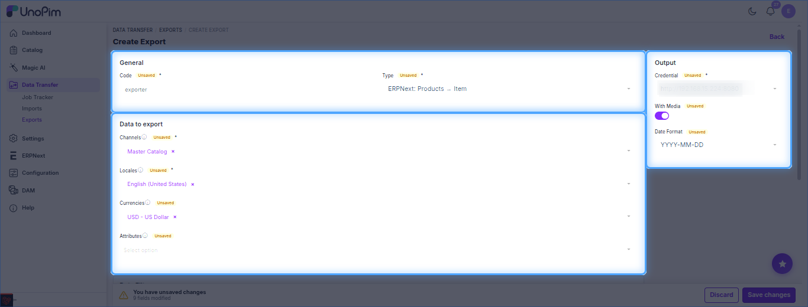
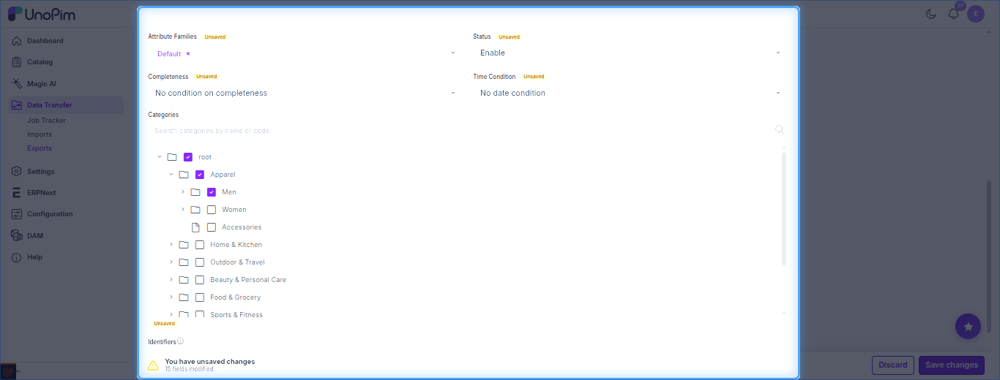
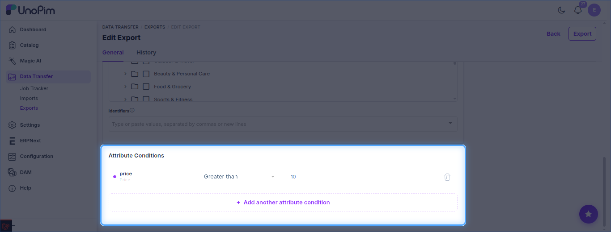
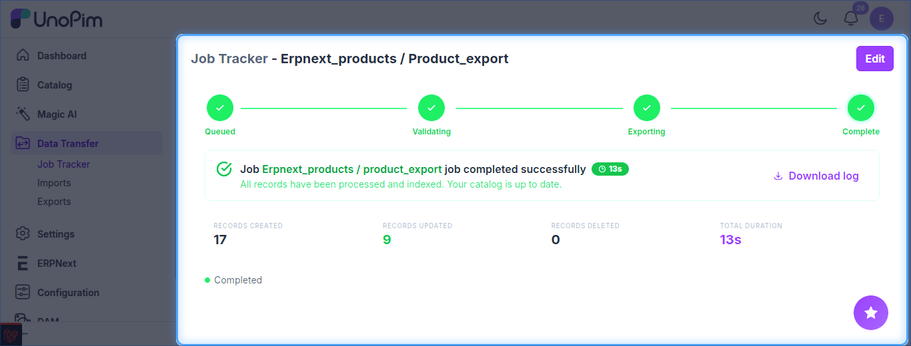

# UnoPim - Export Products to ERPNext

Exports UnoPim products (simple and variant, with attributes, images and pricing) to ERPNext as **Items**.

The job type is listed as **ERPNext: Products → Item**.

**Prerequisites:** set up your [credentials](./setup-credentials.md), configure [Attribute Mapping](./attribute-mapping.md), and (recommended) run [Export Attributes](./export-attributes.md) and [Export Categories](./export-categories.md) first.

## Steps

1. Go to **Data Transfer → Exports** and click **Create Export**.
2. Enter a unique **Code** and select **ERPNext: Products → Item** as the type.
3. Set the filters below, then click **Save changes**.
4. Click **Export** to run the job.

## Filters

**Data to export**

| Filter | Purpose |
| --- | --- |
| **Channels** / **Locales** | Channel and locale the product data is taken from. *(required)* |
| **Currencies** | Currency used for exported prices. |
| **Attributes** | Limit the export to selected attributes. |

**Output**

| Option | Purpose |
| --- | --- |
| **Credential** | ERPNext site to export to. *(required)* |
| **With Media** | Also export product images. |
| **Date Format** | Format used for date values. |

**Data filters** - narrow down which products are exported:

| Filter | Purpose |
| --- | --- |
| **Attribute Families** | Export only products of the chosen families. |
| **Status** | Enabled / disabled products. |
| **Completeness** | Filter by completeness condition. |
| **Time Condition** | Filter by a date condition (e.g. recently updated). |
| **Categories** | Tick the categories to export. |
| **Identifiers** | Paste SKUs (comma or new-line separated) to export only those products. |

**Attribute Conditions** - add rules on attribute values, e.g. `price` *Greater than* `10`. Use **Add another attribute condition** for more rules.

## Variants and Re-runs

- A parent product is exported as an ERPNext **Item template**; each variation becomes a **variant Item**.
- Re-running the job updates existing Items instead of creating duplicates (last-write-wins on `modified`).

## Track the Job

Follow progress in **Data Transfer → Job Tracker**.

