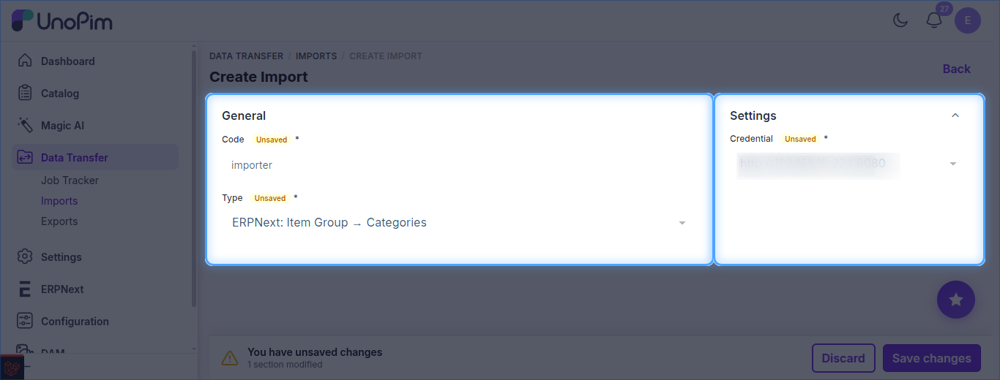
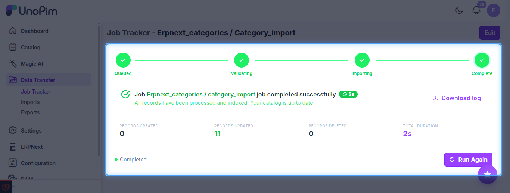

# UnoPim - Import Categories from ERPNext

Imports ERPNext **Item Groups** into UnoPim as categories.

The job type is listed as **ERPNext: Item Group → Categories**.

**Prerequisite:** set up your [credentials](./setup-credentials.md) first.

## Steps

1. Go to **Data Transfer → Imports** and click **Create Import**.
2. Enter a unique **Code** and select **ERPNext: Item Group → Categories** as the type.
3. Set the filters below, then click **Save changes**.
4. Click **Import Now** to run the job.

## Filters

| Setting | Purpose |
| --- | --- |
| **Credential** | ERPNext site to import from. *(required)* |

## Track the Job

Follow progress in **Data Transfer → Job Tracker**, which shows the created / updated counts and a downloadable log.

