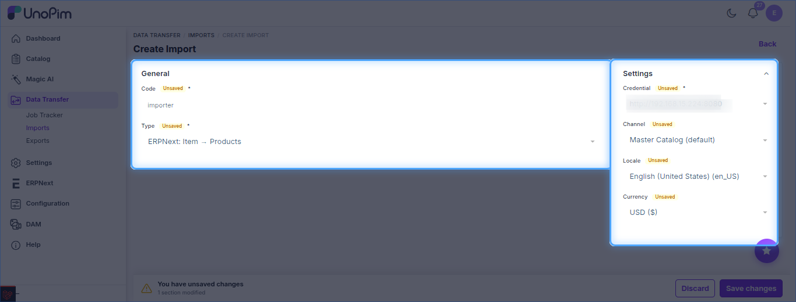
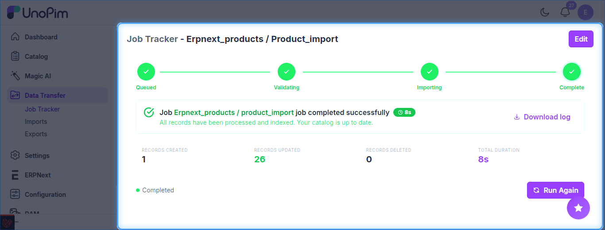

# UnoPim - Import Products from ERPNext

Imports ERPNext **Items** into UnoPim as products. Import attributes and categories first so the products' references already exist.

The job type is listed as **ERPNext: Item → Products**.

**Prerequisite:** set up your [credentials](./setup-credentials.md) first.

## Steps

1. Go to **Data Transfer → Imports** and click **Create Import**.
2. Enter a unique **Code** and select **ERPNext: Item → Products** as the type.
3. Set the filters below, then click **Save changes**.
4. Click **Import Now** to run the job.

## Filters

| Setting | Purpose |
| --- | --- |
| **Credential** | ERPNext site to import from. *(required)* |
| **Channel** | Channel the imported products are assigned to. |
| **Locale** | Locale the product data is stored under. |
| **Currency** | Currency used for imported prices. |

Re-running the import updates existing products instead of creating duplicates.

## Track the Job

Follow progress in **Data Transfer → Job Tracker**, which shows the created / updated counts and a downloadable log.

