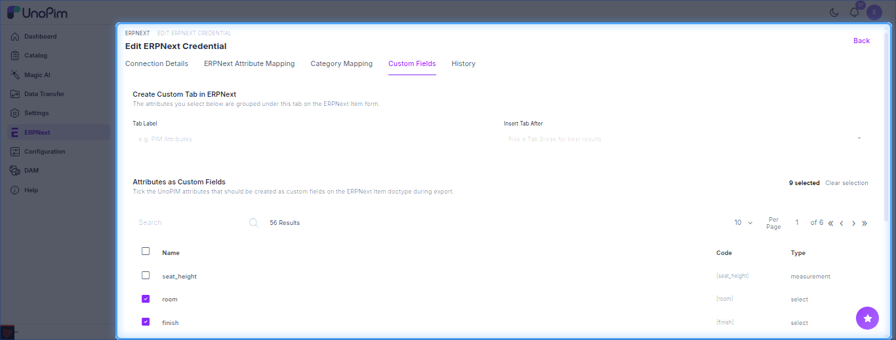

# Custom Fields Mapping

Push UnoPim attributes into **custom fields** on the ERPNext Item doctype - fields that don't exist in ERPNext out of the box. During export, the connector **auto-creates** these custom fields in ERPNext.

Open it from **ERPNext → Credentials → Edit → Custom Fields**.

## Create a Custom Tab (optional)

Group the custom fields under their own tab on the ERPNext Item form:

| Field | What to enter |
| --- | --- |
| **Tab Label** | Name of the new tab (e.g. `PIM Attributes`). |
| **Insert Tab After** | An existing **Tab Break** on the Item form; the new tab is placed right after it. |

## Select Attributes as Custom Fields

Tick the UnoPim attributes to create as custom fields. The list shows each attribute's **Name**, **Code** and **Type**, with search, pagination and a **Clear selection** option.

Click **Save** to store the mapping. The fields are created in ERPNext on the next product export.
