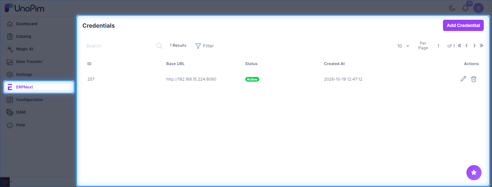
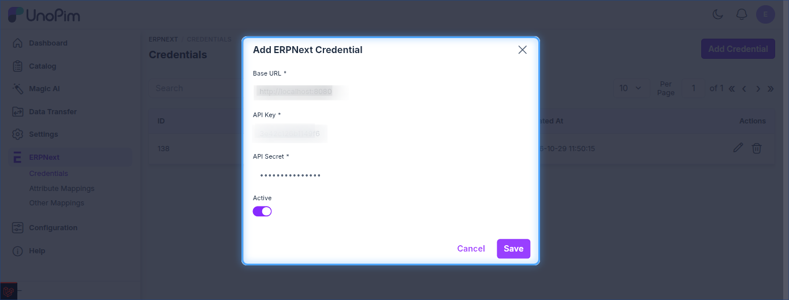
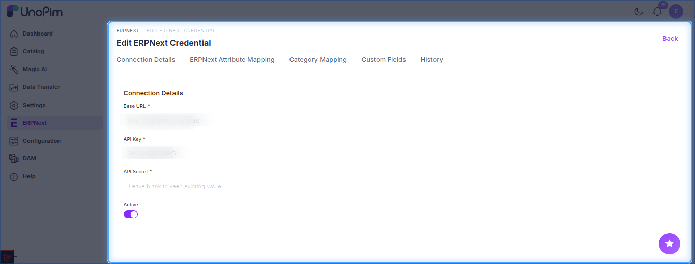
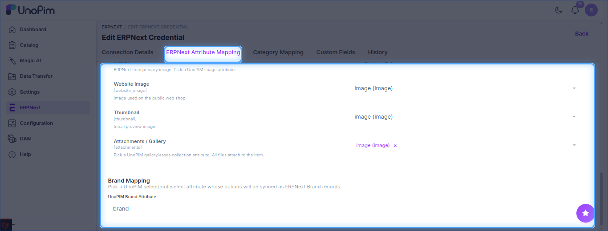
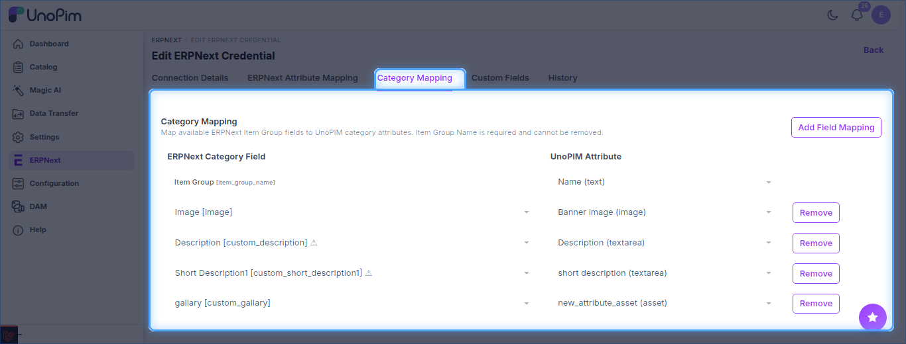
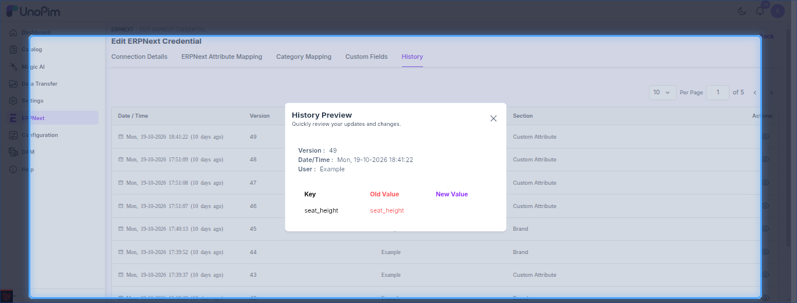

# Setting Up ERPNext Credentials

Connect your ERPNext instance to UnoPim by adding its API details. You can add **multiple ERPNext sites**, one credential each.

> Need an API Key and Secret? See [ERPNext Setup](./erpnext-setup.md).

## Add a Credential

1. In UnoPim, go to **ERPNext → Credentials** and click **Add Credential**.

2. Fill in the details and click **Save**.

| Field | What to enter |
|---|---|
| **Base URL** | URL of your ERPNext instance (e.g. `https://your-company.erpnext.com`). |
| **API Key** | API Key generated for your ERPNext user. |
| **API Secret** | API Secret generated with the key. |
| **Active** | Enable or disable the credential. |

## Edit a Credential

Click the edit icon to open the credential. Leave **API Secret** blank to keep the saved value.

The other tabs configure mappings for this credential:

- **ERPNext Attribute Mapping** - item fields, media slots and the brand attribute.

- **Category Mapping** - map ERPNext Item Group fields to UnoPim category attributes (Item Group name is required).

- **Custom Fields** - attributes created as custom fields in ERPNext.
- **History** - review past changes, with old and new values.

