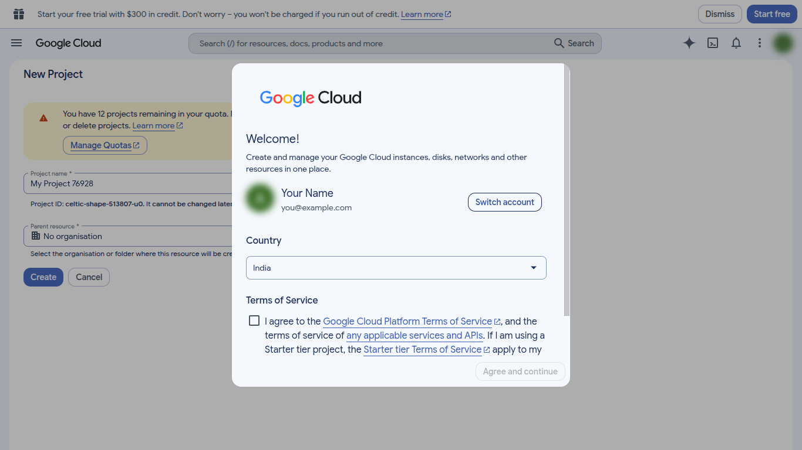
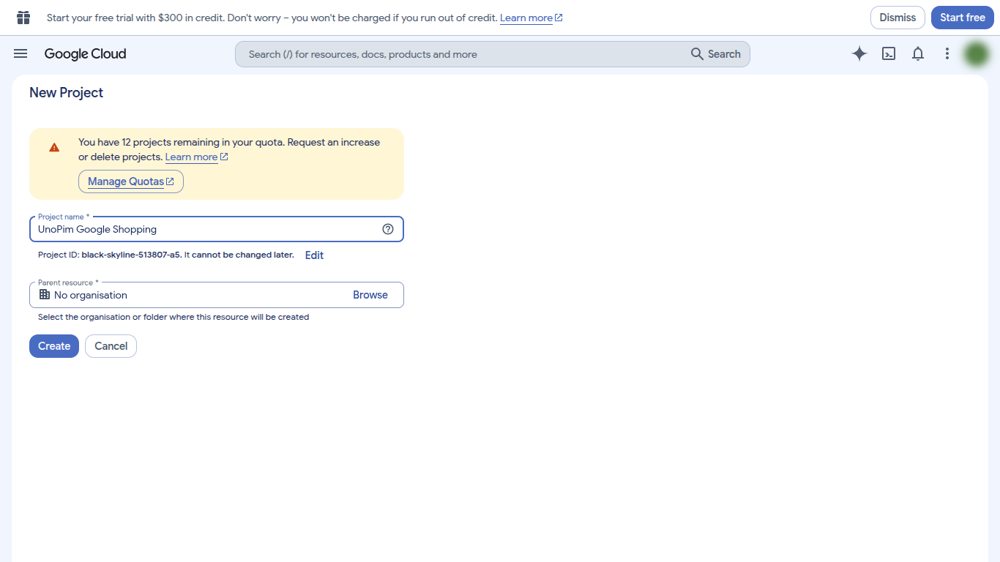
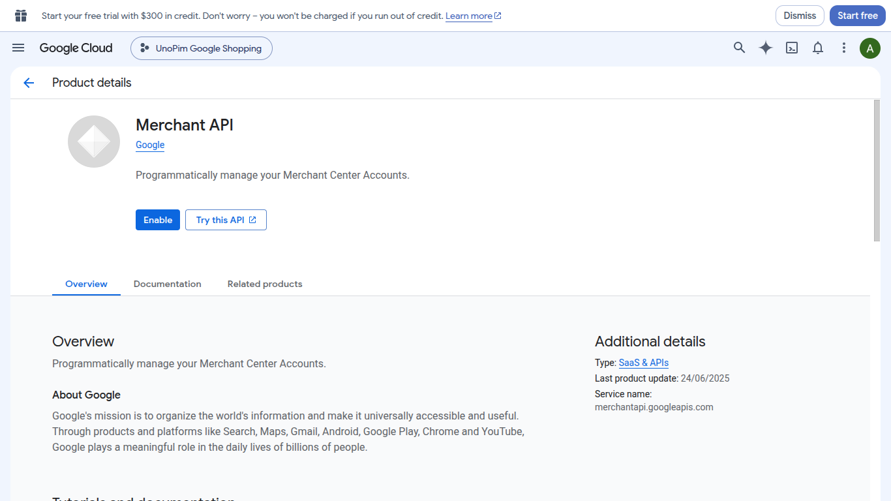
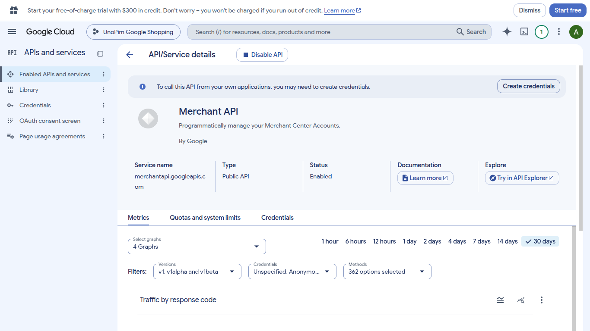

# Step 2 · Google Cloud Project

**Goal:** a Google Cloud project with the **Merchant API** turned on.

**Time:** about 5 minutes. Creating a project and enabling the API are free.

The connector talks to Google through the **Merchant API**. Google only lets an API be used from a Cloud project where it is enabled, so you need one project for the connector.

## 2.1 Create a project

1. Open [console.cloud.google.com/projectcreate](https://console.cloud.google.com/projectcreate). Sign in with the same Google account as in step 1 if you can.
2. **First time in Google Cloud?** A **Welcome** window appears. Pick your **Country**, tick **I agree to the Google Cloud Platform Terms of Service**, and click **Agree and continue**.

   

3. On the **New Project** page, enter a **Project name** you'll recognise, such as `UnoPim Google Shopping`. Leave **Parent resource** as it is.
4. Click **Create**.

   

5. Wait a few seconds for the project to be created. Check that its name appears in the **project picker** at the top of the page. Every following step must be done in this project.

## 2.2 Enable the Merchant API

1. Open the [Merchant API page in the API Library](https://console.cloud.google.com/apis/library/merchantapi.googleapis.com). You can also open **☰ → APIs and services → Library** and search for **Merchant API**.
2. Check that your new project is shown at the top, then click **Enable**.

   

3. The **API/Service details** page opens with **Status: Enabled**.

   

::: info Merchant API vs Content API
Google is retiring the older **Content API for Shopping** on **18 August 2026**, and new projects can no longer enable it. The connector uses the Merchant API by default, so enabling Merchant API is all you need.
:::

## ✅ Done when

- [x] Your project is selected in the project picker.
- [x] **Merchant API** shows **Status: Enabled**.

**Next:** [3. OAuth Client](./google-oauth-client)
