# Step 1 · Merchant Center Account

**Goal:** a Merchant Center account with a verified website, plus your **Merchant ID**.

**Time:** about 10 minutes. Website verification can take longer if you need help from whoever manages your site.

::: tip Already have a Merchant Center account?
Skip to [1.5 Copy your Merchant ID](#_1-5-copy-your-merchant-id).
:::

## 1.1 Open Merchant Center

1. Go to [merchants.google.com](https://merchants.google.com/) and click **Start now**.

   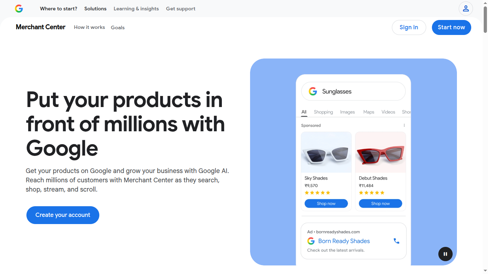

2. Sign in with the Google account that will own the Merchant Center account. Use a business account you'll keep long-term.

   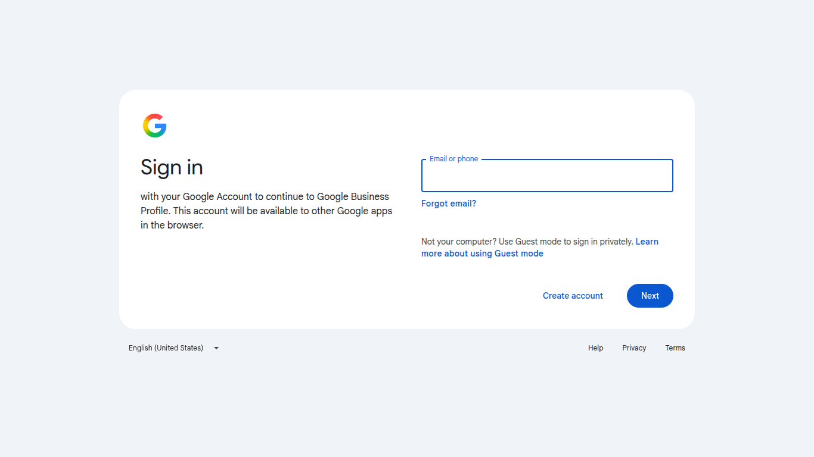

## 1.2 Tell Google about your business

1. **Do you sell products online?** Click **Yes**. This connector is for online stores.

   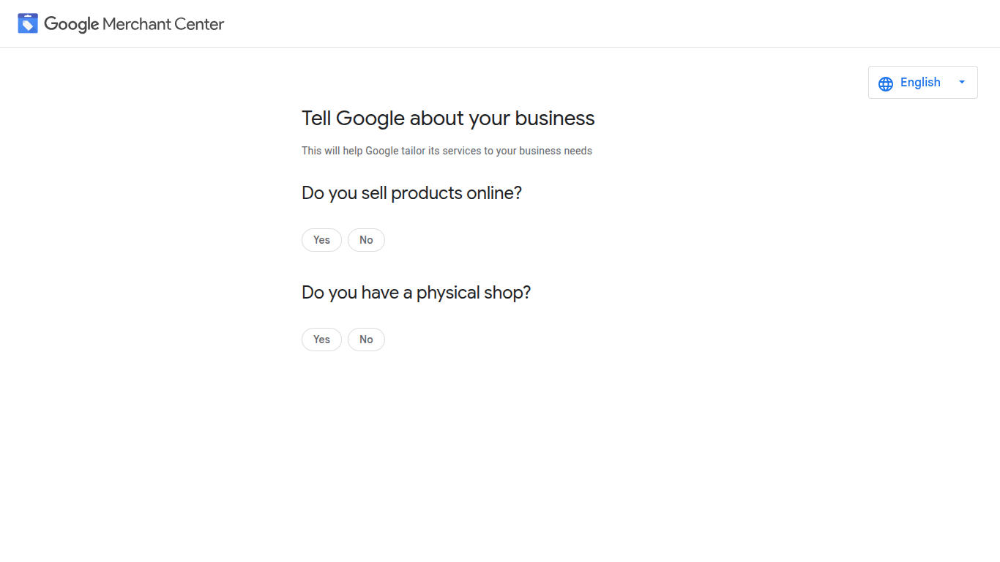

2. A **Your shop's website** field appears. Enter your public store address, for example `https://www.yourstore.com`.

   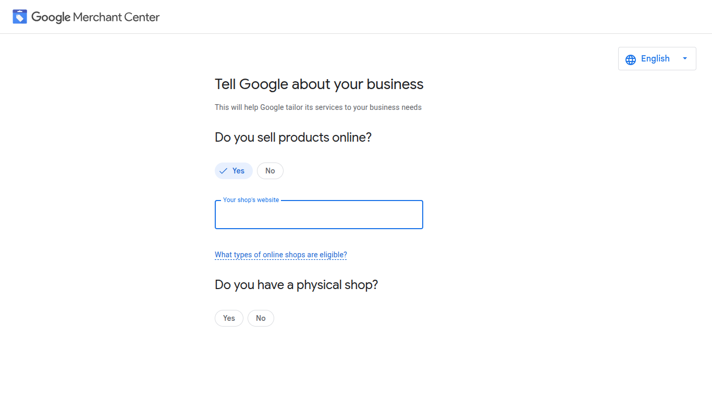

3. **Do you have a physical shop?** Answer **Yes** or **No**. For an online-only store, choose **No**.
4. Click **Continue**.

   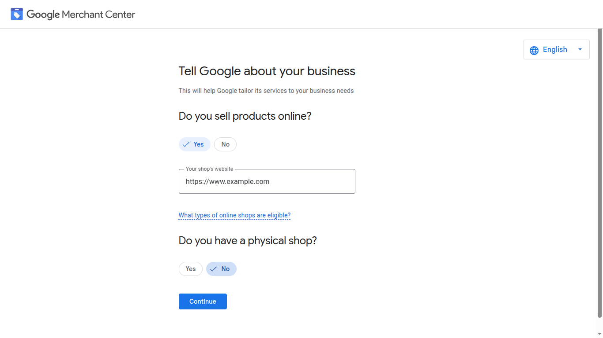

5. Google shows an introduction page. Scroll down and click **Continue to Merchant Center**.

   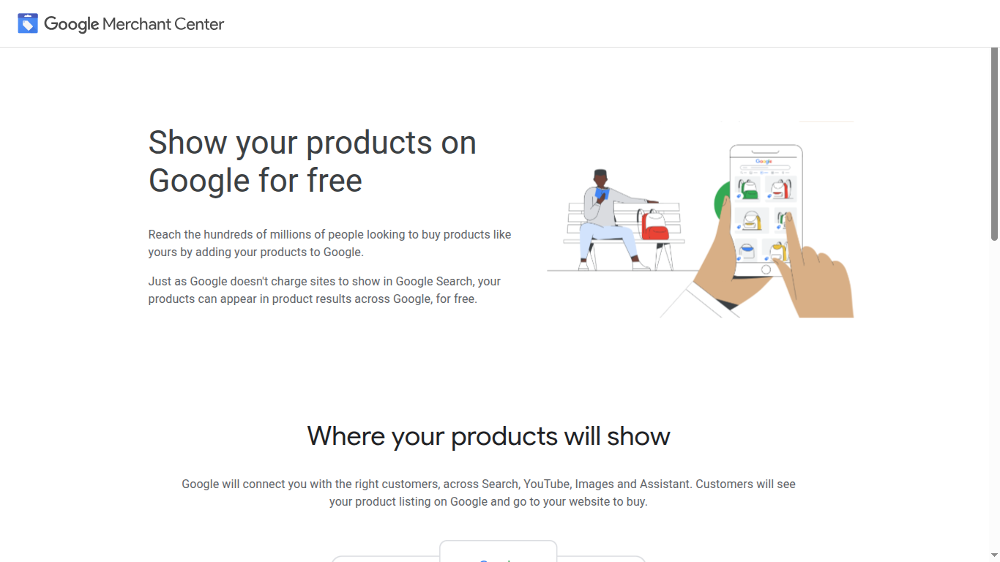

## 1.3 Enter your business info

1. Enter your **Business name**. It becomes the name of your Merchant Center account.
2. Check the **Registered country**.
3. Click **Continue to Merchant Center**. This accepts the Merchant Center Terms of Service.

   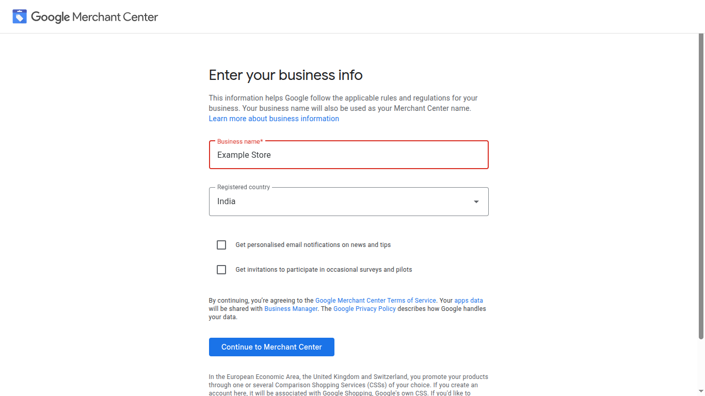

If Google asks you to **verify that it's you**, click **Continue** and confirm your password or phone prompt.

## 1.4 Finish the setup checklist

Merchant Center now walks you through a short setup checklist ("0 of 6 tasks completed").

- **Business address**: fill it in now, or click **Do it later**. The connector doesn't use it.

  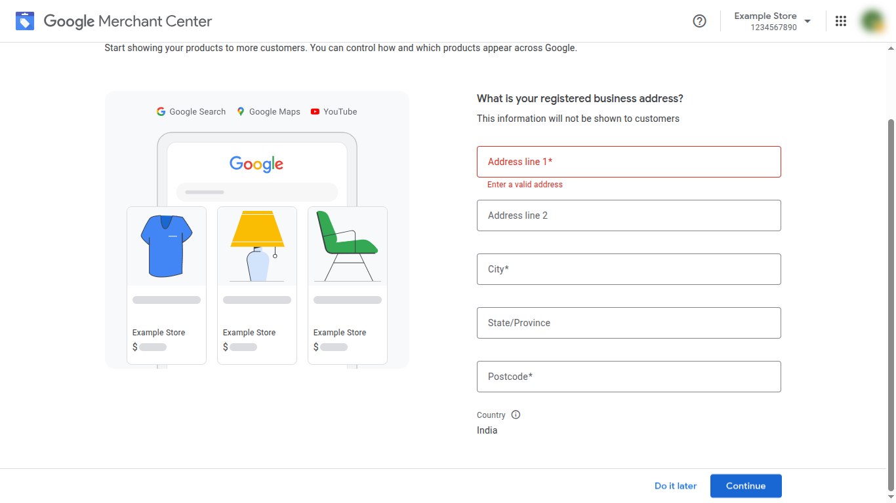

- **Website verification**: **required** for the connector. See 1.6 below.
- **Countries, shipping and returns**: fill these in when you're ready to show products. You can click **Do it later** for now.

## 1.5 Copy your Merchant ID

Your **Merchant ID** is the number under your account name in the **top-right corner** of every Merchant Center page.

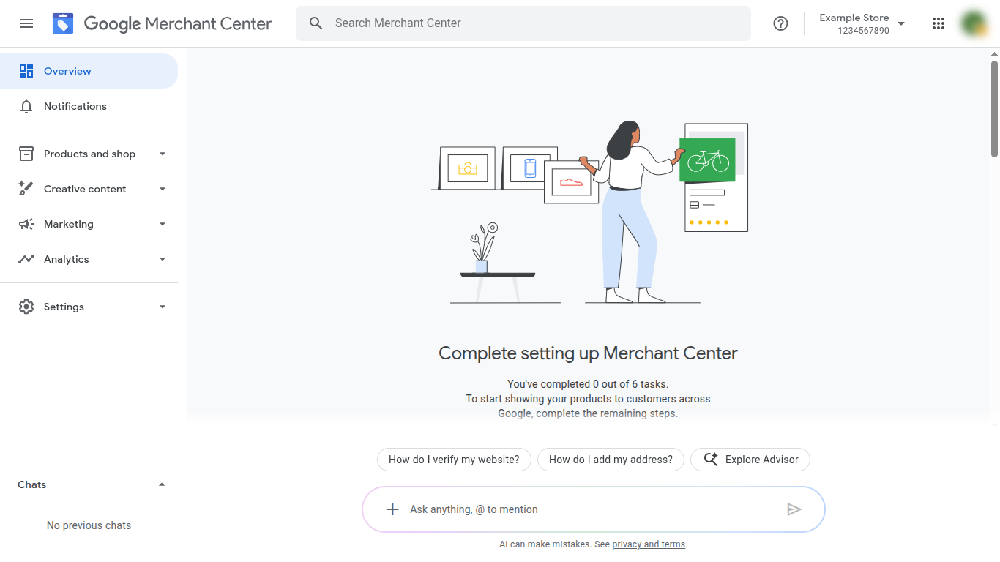

Copy it. You'll paste it into UnoPim in [step 5](./connection-setup).

## 1.6 Verify and claim your website

Google only accepts products whose links point to a website you've proven you own. The Merchant API also refuses to work until the website is verified, so this step is **required**, even if you only want to export.

1. Go to **Settings → Business info**. Under **Your online shop** you'll see **Not yet verified** and **Not yet claimed**. Click **Confirm online shop**.

   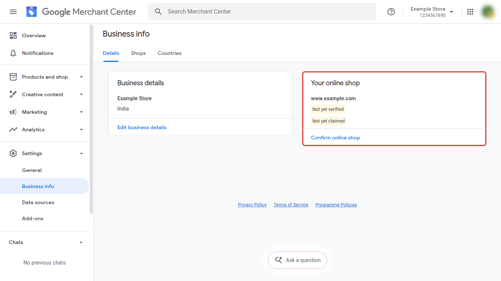

2. Choose a verification method:
   - **Use your e-commerce platform**: if your store runs on Shopify, WooCommerce, Wix and similar platforms.
   - **Add an HTML tag or file**: works for most sites. Copy the `<meta name="google-site-verification" …>` tag and paste it into the `<head>` of your homepage, or ask your web developer to.
   - **Use Google Tag Manager** or **Google Analytics**: if your site already uses one of them.

   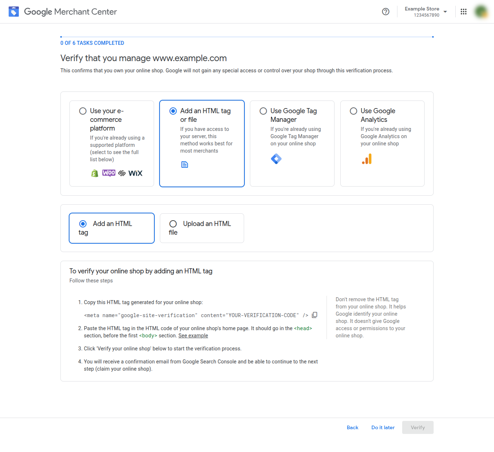

3. Click **Verify**. When it succeeds, click **Claim**.

Back on **Settings → Business info**, both labels should now show as verified and claimed.

::: tip Requirements for the website
- It must be **public** and use **HTTPS**. `localhost`, a staging site behind a login, or a private IP can't be verified.
- Another Merchant Center account can't have already claimed it.
- Keep the HTML tag on your site after verifying. Removing it un-verifies the site.
- Use the same address later as the **Storefront Base URL** in UnoPim ([step 6](./required-settings)).
:::

Google's guide: [Verify and claim your website](https://support.google.com/merchants/answer/11586344).

## 1.7 Check you're an Admin

Later you'll sign in to Google from UnoPim. The Google account you use must have **Admin** access to this Merchant Center account.

Go to **Settings → Access and services → People and access**. Your account should list **Admin** under **Roles**.

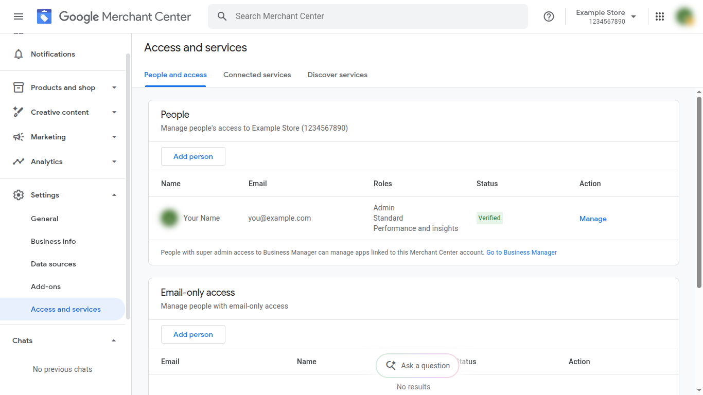

To give another person access, click **Add person** and choose the **Admin** role.

## ✅ Done when

- [x] You've copied your **Merchant ID**.
- [x] **Settings → Business info** shows your website as **verified** and **claimed**.
- [x] Your Google account has the **Admin** role.

**Next:** [2. Google Cloud Project](./google-cloud-project)
