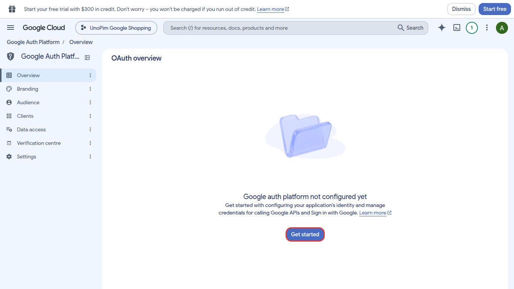
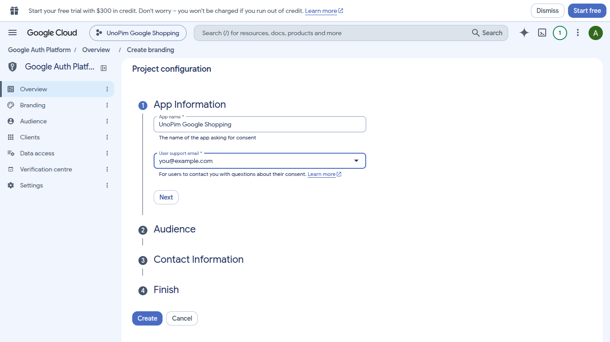
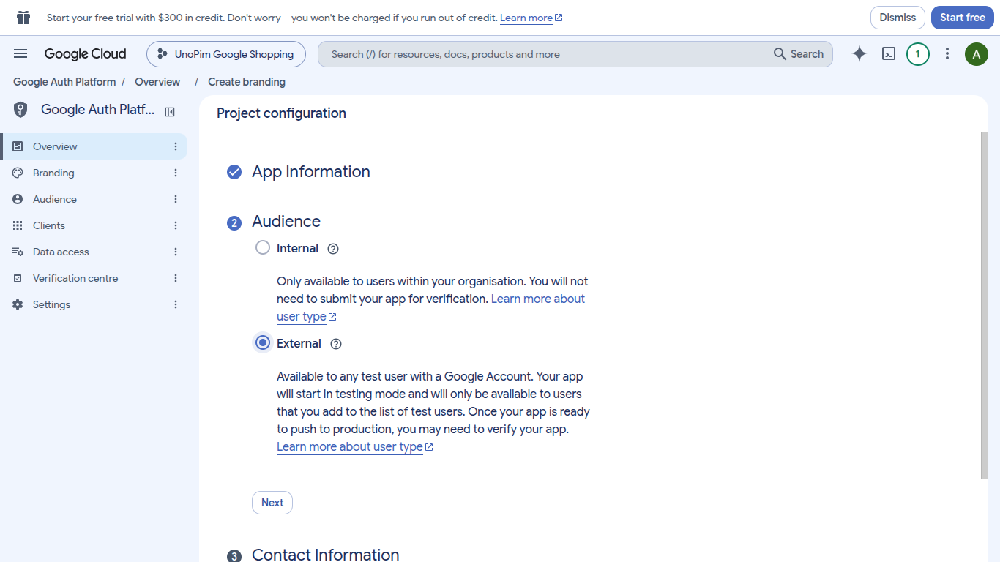
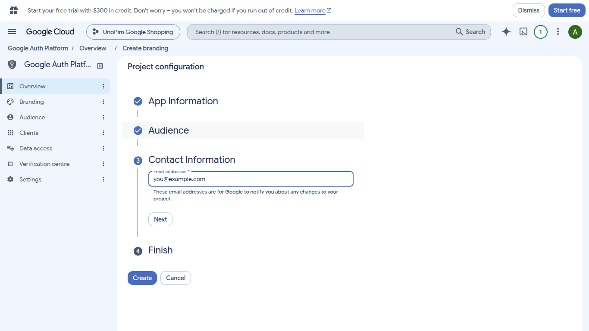
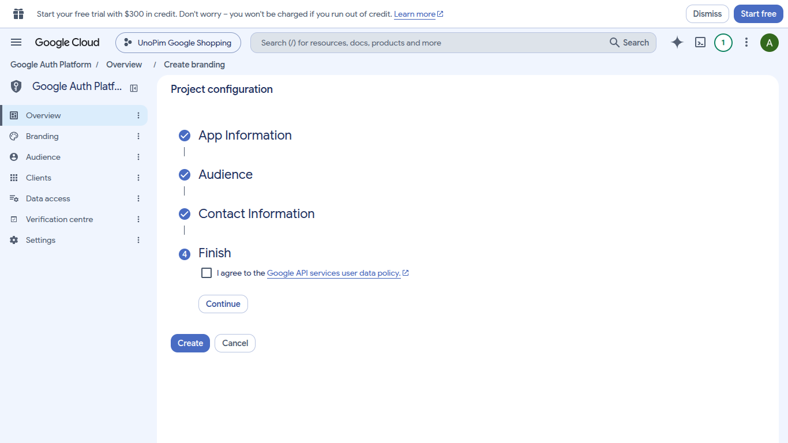
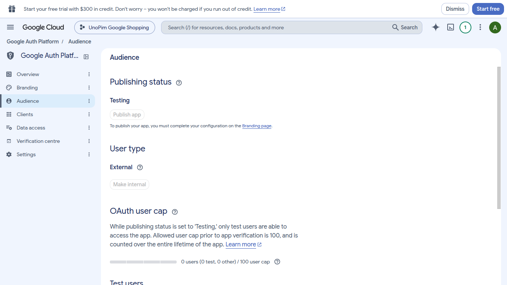
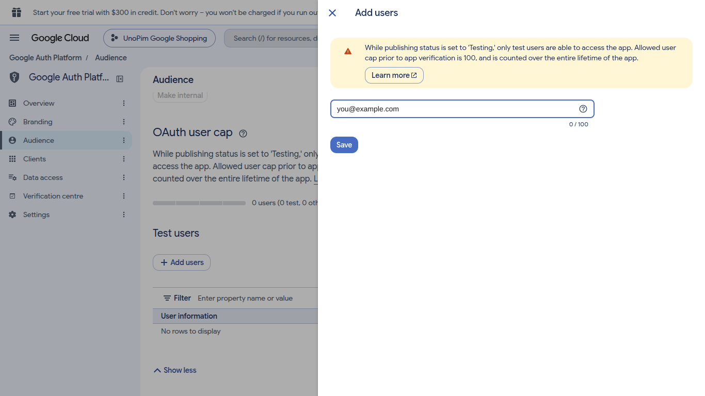
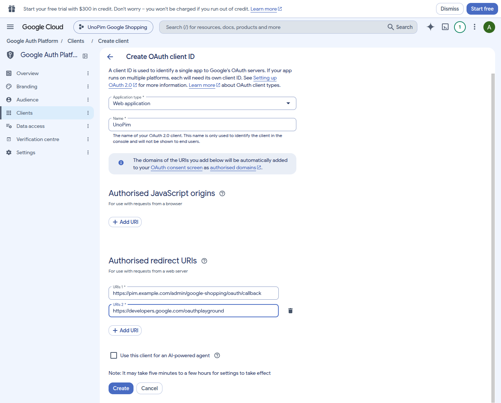
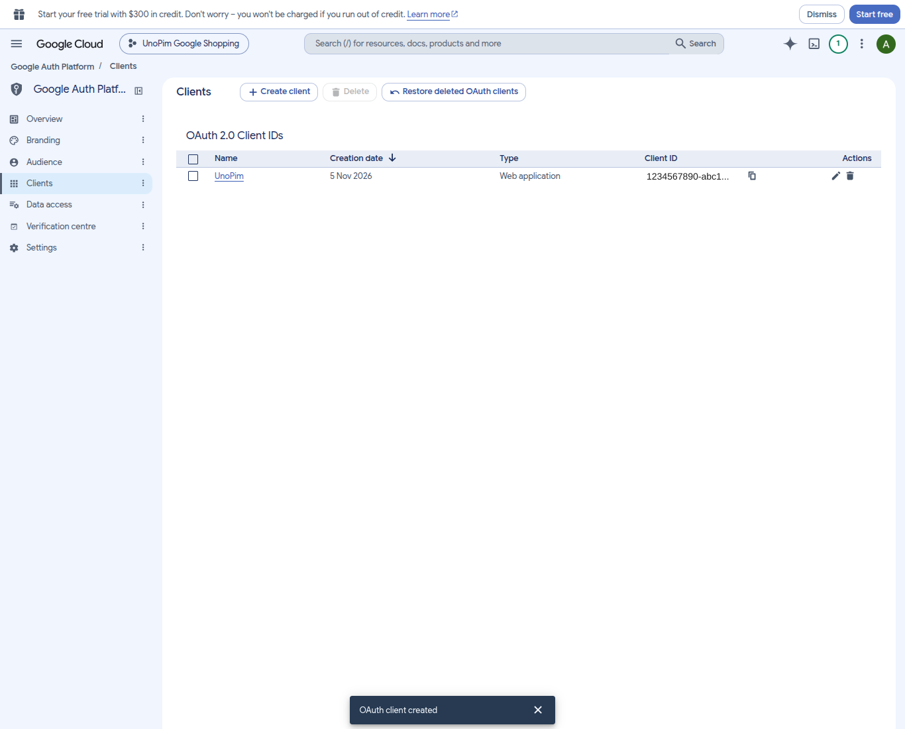
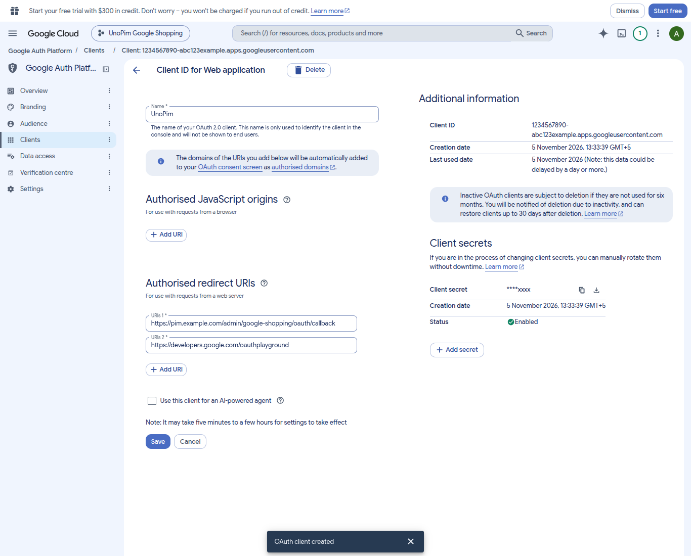

# Step 3 · OAuth Client

**Goal:** a **Client ID** and **Client Secret** that let UnoPim sign in to Google on your behalf.

**Time:** about 10 minutes.

Do this in the same Cloud project as step 2. Check that it's selected in the project picker before you start.

## Before you start: your redirect URI

After you sign in, Google sends you back to UnoPim. You must tell Google that exact return address, called the **redirect URI**. Build it like this:

```
https://<your-unopim-domain>/<admin-path>/google-shopping/oauth/callback
```

- `<your-unopim-domain>` is the address you use to open UnoPim, for example `pim.example.com`.
- `<admin-path>` is the path of your admin panel, usually `admin`. It's whatever appears right after the domain when you're logged in.

**Example:** `https://pim.example.com/admin/google-shopping/oauth/callback`

::: tip Copy it from your browser
Log in to UnoPim and copy the address up to and including the admin path, such as `https://pim.example.com/admin`. Then add `/google-shopping/oauth/callback` to the end. Use the same `http`/`https`, domain and port as UnoPim. Google rejects even a small difference.
:::

## 3.1 Set up the consent screen

This is the screen Google shows when you click **Authenticate with Google** in UnoPim.

1. Open **☰ → Google Auth Platform → Overview** ([direct link](https://console.cloud.google.com/auth/overview)). You'll see *"Google auth platform not configured yet"*. Click **Get started**.

   

2. **App Information**: enter an **App name**, such as `UnoPim Google Shopping`, and pick your email as the **User support email**. Click **Next**.

   

3. **Audience**: choose the user type and click **Next**.
   - **Internal**: only if your Google account belongs to a Google Workspace organisation. This is the simplest option, with no test users and no 7-day sign-out.
   - **External**: for a regular `@gmail.com` account. **Internal** is greyed out for these accounts.

   

4. **Contact Information**: enter an email address where Google can notify you about the project. Click **Next**.

   

5. **Finish**: tick **I agree to the Google API services user data policy**, click **Continue**, then click **Create**.

   

## 3.2 Add yourself as a test user (External only)

New External apps start in **Testing** mode. In Testing mode, only listed **test users** can sign in. Anyone else gets *"Access blocked: … has not completed the Google verification process"*.

1. Go to **Google Auth Platform → Audience**. **Publishing status** shows **Testing**.

   

2. Scroll to **Test users** and click **Add users**.
3. Enter the Google account that is an **Admin** on your Merchant Center account (step 1.7), then click **Save**.

   

4. **Check that the email now appears in the Test users table.** If the table still says *"No rows to display"*, add it again.

::: warning Testing mode signs you out after 7 days
While an External app is in **Testing**, Google expires the sign-in after **7 days**. The UnoPim connection then shows **Expired** and exports stop until you click **Re-authenticate**.

For a permanent setup, move the app to **In production**:

1. Open **Google Auth Platform → Branding** and complete the remaining fields (app home page, privacy policy link, authorised domain). **Publish app** stays greyed out until Branding is complete.
2. Open **Audience** and click **Publish app**.

When you authenticate afterwards, Google may show *"Google hasn't verified this app"*. Because this is your own app, click **Advanced → Go to (app name)** to continue.
:::

## 3.3 Create the OAuth client

1. Go to **Google Auth Platform → Clients** and click **Create client**.
2. Set **Application type** to **Web application**.
3. Give it a **Name**, such as `UnoPim`.
4. Under **Authorised redirect URIs**, click **Add URI** twice and add both of these:
   - **URIs 1**: your UnoPim redirect URI from above, for example `https://pim.example.com/admin/google-shopping/oauth/callback`
   - **URIs 2**: `https://developers.google.com/oauthplayground` (used in [step 4](./google-register-project))
5. Leave **Authorised JavaScript origins** empty and click **Create**.

   

::: danger Copy the Client Secret right away
Google shows the **Client Secret** in full **only once**, in the *"OAuth client created"* window that appears straight after you click **Create**. Copy both the **Client ID** and the **Client Secret**, or click **Download JSON**, before you close it.

If you missed it, open the client and click **+ Add secret** under **Client secrets** to create a new one.
:::

The new client appears under **OAuth 2.0 Client IDs**:



Click its name to see the details at any time. The **Client ID** is shown on the right. The secret is masked, and you can add a new one with **+ Add secret**. Redirect URIs can be edited here later. Click **Save** after changing them, and allow a few minutes for changes to take effect.



::: info No scopes to add
You don't need to add scopes on the **Data access** page. The connector asks for the one it needs (`https://www.googleapis.com/auth/content`) when you sign in.
:::

## ✅ Done when

- [x] The consent screen is set up.
- [x] You appear under **Test users**, or the app is **In production**.
- [x] A **Web application** client exists with both redirect URIs.
- [x] You've saved the **Client ID** and **Client Secret**.

**Next:** [4. Register the Project](./google-register-project)
