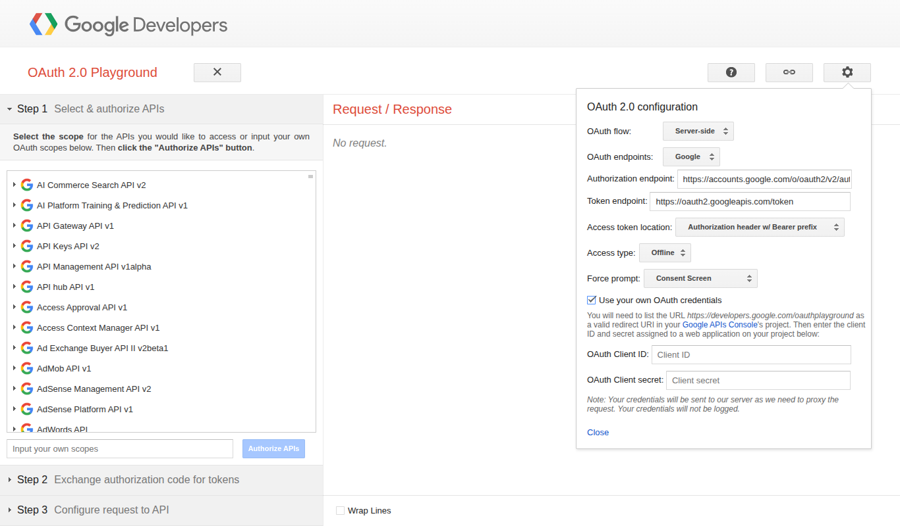
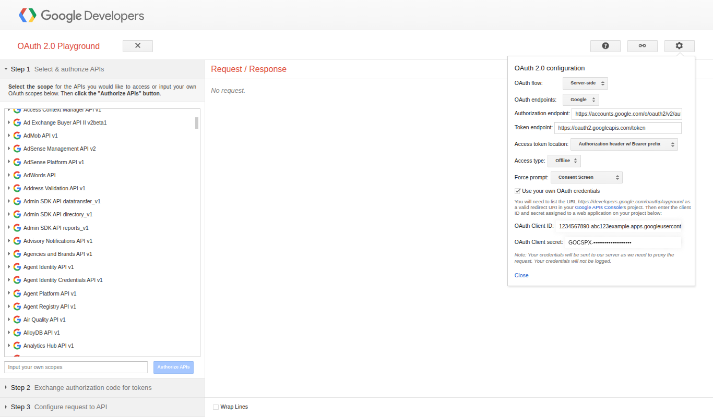
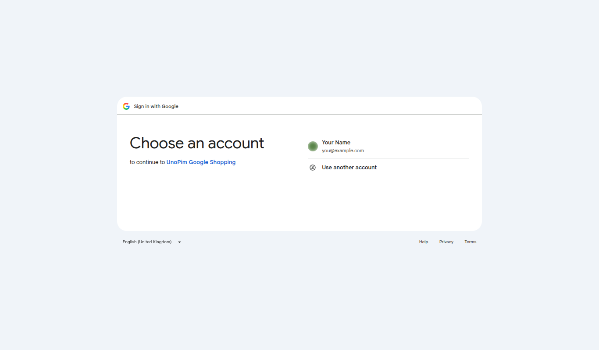

# Step 4 · Register the Project

**Goal:** tell your Merchant Center account that your Cloud project is allowed to call it.

**Time:** about 5 minutes, plus a 5-minute wait at the end.

The Merchant API only accepts calls from Cloud projects that are **registered** with the merchant account. Merchant Center has no button for this, so you make one API call yourself. You can do it entirely in your browser with Google's **OAuth 2.0 Playground**, and you don't need to write any code.

::: warning Skipping this breaks every export
Until the project is registered, every request fails with:
`401 UNAUTHENTICATED – GCP project with id … is not registered with the merchant account.`
:::

## Before you start

- [x] Your website is **verified and claimed** (step 1.6). Otherwise this call fails with `unverified homepage`.
- [x] You'll sign in with a Google account that is an **Admin** on the Merchant Center account.
- [x] `https://developers.google.com/oauthplayground` is in your OAuth client's redirect URIs (step 3.3).

## 4.1 Use your own client in the Playground

1. Open [developers.google.com/oauthplayground](https://developers.google.com/oauthplayground).
2. Click the **gear icon (⚙)** in the top-right corner.
3. Tick **Use your own OAuth credentials**.
4. Paste your **Client ID** and **Client Secret** from step 3, then click **Close**.





::: info Why your own credentials?
Google registers the project that owns the client you use. Using your own Client ID makes sure **your** project gets registered, not Google's demo project.
:::

## 4.2 Sign in

1. On the left, under **Step 1**, find the box **Input your own scopes** and paste:
   ```
   https://www.googleapis.com/auth/content
   ```
2. Click **Authorize APIs**.
3. Choose your Merchant Center **Admin** account and click **Continue** / **Allow**.

   
 If you see *"Google hasn't verified this app"*, click **Advanced → Go to (app name)**.
4. Back in the Playground, under **Step 2**, click **Exchange authorization code for tokens**.

## 4.3 Send the registration request

The Playground moves on to **Step 3 · Configure request to API**. Fill it in:

| Field | Value |
|---|---|
| **HTTP Method** | `POST` |
| **Request URI** | `https://merchantapi.googleapis.com/accounts/v1/accounts/MERCHANT_ID/developerRegistration:registerGcp` |

Replace `MERCHANT_ID` with your Merchant ID from step 1.5.

Then click **Enter request body** and paste the following, with your own email:

```json
{ "developerEmail": "you@yourcompany.com" }
```

If the Playground asks for a content type, choose **application/json**. Click **Send the request**.

A successful response is **HTTP 200** and contains your project number, for example:

```json
{
  "name": "accounts/5432109876/developerRegistration",
  "gcpIds": ["123456789012"]
}
```

## 4.4 Wait 5 minutes

Google needs a few minutes to apply the registration. Wait about **5 minutes** before you run your first export.

To confirm it worked, change the method to **GET**, set the URI to `https://merchantapi.googleapis.com/accounts/v1/accounts/MERCHANT_ID/developerRegistration`, and send again. You should see the same `gcpIds`.

## Common errors

| Response | What to do |
|---|---|
| `400 FAILED_PRECONDITION … unverified homepage` | Finish website verification and claiming (step 1.6), then try again. |
| `403 PERMISSION_DENIED` | The account you signed in with isn't an **Admin** on the Merchant Center. Sign in with an Admin account. |
| `403 … Merchant API has not been used in project …` | Merchant API isn't enabled on this project (step 2.2). |
| `Error 400: redirect_uri_mismatch` (during sign-in) | Add `https://developers.google.com/oauthplayground` to the client's redirect URIs (step 3.3). |
| `Error 403: access_denied … has not completed the Google verification process` | Add your account as a test user (step 3.2). |

::: details Prefer the command line?
Authenticate the connection in UnoPim first (step 5). Then use any access token issued to **your** OAuth client:

```bash
curl -X POST \
  "https://merchantapi.googleapis.com/accounts/v1/accounts/<MERCHANT_ID>/developerRegistration:registerGcp" \
  -H "Authorization: Bearer <ACCESS_TOKEN>" \
  -H "Content-Type: application/json" \
  -d '{"developerEmail": "<ADMIN_EMAIL>"}'
```

To undo the registration, call `:unregisterGcp`.
:::

## ✅ Done when

- [x] The registration request returned **200** with a `gcpIds` list.
- [x] You've waited about 5 minutes.

Google setup is complete. 🎉 **Next:** [5. Connect to Google](./connection-setup) in UnoPim.
