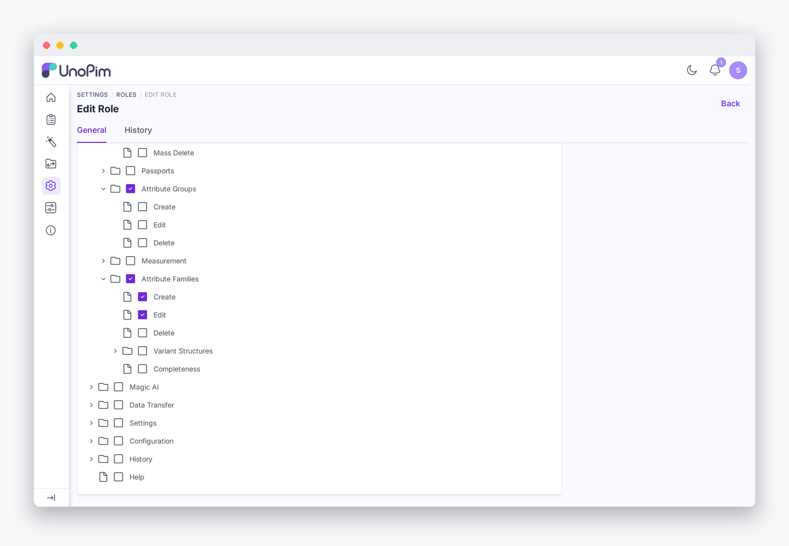

# Permissions

The extension adds three ACL permissions that control access to history features. All three are managed in **Settings → Roles**.

## Available permissions

| Permission | Key | What it allows |
|---|---|---|
| **History** | `history` | View the History tab on any record. |
| **History → Restore History** | `history.restore` | Click the Restore button on any history row, and open file previews in the version popup. |
| **Configuration → System Settings → History** | `configuration.system_settings.history` | Change the History settings (restore mode and auto-purge). See [Restoring Versions](./restore#restore-behaviour-modes) and [Purging Old History](./purge#automatic-purge-from-system-settings). |

## Setting up permissions

1. Go to **Settings → Roles** in your UnoPim admin panel.
2. Click **Edit** on the role you want to configure.
3. Locate the **History** section in the permission tree.
4. Enable the permissions appropriate for this role.
5. Click **Save**.

> [!NOTE]
> Roles without the **History** permission will not see the History tab at all. Roles with **History** but without **Restore History** can view history but cannot click the Restore button or open file previews from the version popup.

## Restore requires the Restore History permission

Restore is granted only by **Restore History** (`history.restore`). An entity's own edit permission (for example `catalog.products.edit`) does **not** unlock Restore. Grant **Restore History** to every role that must restore versions.
