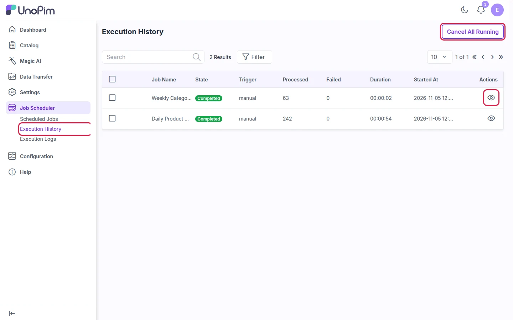
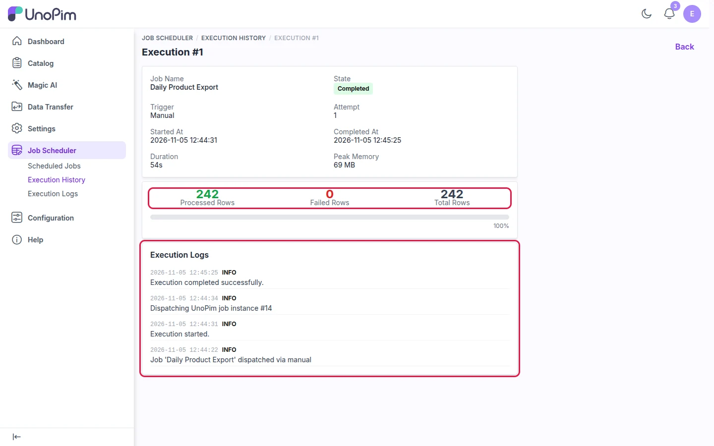

# Execution History

Every time a scheduled job runs, it is recorded here. Use this page to check that your jobs are running and to spot failures quickly.

Go to **Job Scheduler → Execution History**.

| Column | Meaning |
|---|---|
| **Job Name** | The scheduled job that ran |
| **State** | **Running**, **Completed** or **Failed** |
| **Trigger** | How the run started: by the schedule (**scheduled**) or by hand (**manual**) |
| **Processed / Failed** | How many records succeeded and how many failed |
| **Duration** | How long the run took |
| **Started At** | When the run began |

> **Stop running jobs:** Click **Cancel All Running** (top right) to stop every job that is still running, for example one that is stuck.

---

## View a Single Run

To see the details of a run, click the **eye icon** in the **Actions** column. The page shows:

- **Summary**: state, trigger, start/end time, duration and memory used
- **Row counts**: processed, failed and total rows, with a progress bar
- **Execution Logs**: each step of the run, from start to finish

